# Self-indicating polymers: a pathway to intelligent materials

__Paper Type:__ Review

## M1: System Overview & Implementation
*   **Vector ID:** M1
*   **Vector Type:** Overview

### **1.1 System Description**

*   **Vector ID:** M1.1
*   **Vector Type:** Description
    *   Content: Self-indicating polymers are described as smart materials capable of undergoing detectable changes in physical or chemical properties in response to stimuli. The review focuses on mechanisms enabling self-indication: aggregation, phase transition, bond cleavage (covalent/non-covalent), isomerization, charge transfer, and energy transfer. These polymers are used in sensing, monitoring, smart coatings, drug delivery, food sensors, wearable devices, and molecular switches. The purpose is to provide an overview of self-indicating mechanisms and applications, guiding the design and development of new intelligent materials.
    *   CT-GIN Mapping: `SystemNode` attributes: `systemType: Polymer`, `domain: Materials Science, Chemistry`, `mechanism: Self-indication based on physicochemical changes`, `components: Polymers, Chromophores, Stimuli-responsive groups`, `purpose: Sensing, Monitoring, Smart Materials, Drug Delivery, Food Sensing, Wearable Devices, Molecular Switches`
    *   Implicit/Explicit: Explicit
        *  Justification: The system description, components, mechanisms, and purpose are explicitly stated in the abstract and introduction sections of the provided text.

### **1.2 Implementation Clarity**

*   **Vector ID:** M1.2
*   **Vector Type:** Score
    *   Score: [7]
    *   Justification: The review provides a moderately clear description of self-indicating polymers as a class of materials and their mechanisms. It clearly outlines several mechanisms and applications with examples. However, implementation details on how to *create* these materials with specific functionalities are less detailed and more conceptual, as it is a review article surveying the field rather than a specific experimental realization.
    *   Implicit/Explicit: Explicit
        * Justification: The score is based on the overall clarity of the descriptive text in the review excerpt, directly reflecting how well it communicates the nature and mechanisms of self-indicating polymers.

### **1.3 Key Parameters**

*   **Vector ID:** M1.3
*   **Vector Type:** ParameterTable
    *   Table:
        | Parameter Name | Value | Units | Source (Fig/Table/Section) | Implicit/Explicit | Data Reliability (High/Medium/Low) | Derivation Method (if Implicit) |
        | :------------- | :---: | :---: | :-----------------------: | :-----------------: | :-----------------------------: | :-------------------------------: |
        | Wavelength (Light Stimuli) | Various | nm | Section 1.1, 2.3 | Implicit | Low | Wavelength ranges are mentioned generally for light-responsive polymers |
        | Temperature (Thermo-responsive) | Various | °C | Section 1.1, 2.2 | Implicit | Low | Temperature ranges are generally discussed for thermo-responsive polymers |
        | pH range (pH-sensitive) | Various | pH units | Section 1.1, 2.3 | Implicit | Low | pH ranges are generally discussed for pH-sensitive polymers |
        | Förster Distance (RET) | 1-10 | nm | Section 2.4 | Explicit | High | Directly mentioned as optimal range for RET |
        | Phase Transition Temperature (PCMs) | 39.11 | °C | Section 2.2 | Explicit | High | Mentioned for PGD-based smart window |

    *   **Note:** List *up to 5* key parameters characterizing the system's *implementation*.  Provide values and units if possible. If a parameter is not explicitly stated but derived/inferred, clearly state the derivation method. *Always* include units if applicable. If a value is not applicable, write "N/A".  Data Reliability: High = Directly measured, Medium = Derived from measurements/simulations, Low = Estimated/Inferred.

## M2: Energy Flow
*   **Vector ID:** M2
*   **Vector Type:** Energy

### **2.1 Energy Input**

*   **Vector ID:** M2.1
*   **Vector Type:** Input
    *   Content: The primary energy sources discussed are various stimuli that induce changes in the polymers. These include light (UV, visible), thermal energy (temperature variation), chemical energy (pH change, ion concentration, chemical exposure), and mechanical energy (mechanical stress).
    *   Value: N/A
    *   Units: N/A
    *   CT-GIN Mapping: `EnergyInputNode`: attributes - `source: Light, Thermal, Chemical, Mechanical`, `type: Stimuli`
    *   Implicit/Explicit: Explicit
        *  Justification: The different energy inputs acting as stimuli are directly listed and discussed throughout the text, especially in sections 1.1 and 1.2.

### **2.2 Energy Transduction**

*   **Vector ID:** M2.2
*   **Vector Type:** Transduction
    *   Content: Energy transduction occurs through various mechanisms depending on the stimulus and polymer type.
        *   **Light to Optical Change:** Light irradiation (UV/Visible) leads to isomerization (spiropyran, azobenzene), resulting in color changes or fluorescence modulation. This is photochemical energy transduction.
        *   **Thermal to Phase Change:** Thermal energy input alters polymer phase (solid-liquid transition), affecting transparency and conductivity. This is thermal-mechanical/electrical transduction.
        *   **Chemical to Optical/Structural Change:** Chemical stimuli (pH variation, ion concentration, specific analytes) induce aggregation, bond cleavage/formation, or charge transfer, changing optical (fluorescence, absorption) or structural (solubility, conformation) polymer properties. This is chemical-optical/structural transduction.
        *   **Mechanical to Optical Change:** Mechanical force leads to bond cleavage (mechanophores like spiropyran), resulting in color change or fluorescence shift. This is mechanical-optical transduction.
        *   **Excitation Energy Transfer to Emission:** In RET, energy from donor chromophore (excited by light) is transferred to an acceptor, leading to emission at a different wavelength. This is electromagnetic energy transfer.
    *   CT-GIN Mapping: `EnergyTransductionEdge`: attributes - `mechanism: Photoisomerization, Phase Transition, Aggregation, Bond Cleavage/Formation, Charge Transfer, Resonance Energy Transfer`, `from_node: EnergyInputNode (Light, Thermal, Chemical, Mechanical)`, `to_node: SystemNode (Self-indicating Polymer)`
    *   Implicit/Explicit: Mixed
        *  Justification: The main energy transformations are explicitly described for each self-indication mechanism. While the specific classification of transduction types (photochemical, thermal-mechanical, etc.) is implicit, it is a reasonable inference based on the described mechanisms.

### **2.3 Energy Efficiency**

*   **Vector ID:** M2.3
*   **Vector Type:** Score
    *   Score: [5]
    *   Justification/Metrics: Energy efficiency is not explicitly quantified in the review. Based on the described mechanisms (isomerization, phase transition, bond cleavage, charge transfer, energy transfer), efficiency is likely Medium. Some processes like energy transfer (FRET, TBET) in LSCs aim for efficient light harvesting, with claimed efficiencies of up to 99.9% in specific cases. However, overall energy conversion efficiencies for stimuli-responsive polymers are not systematically evaluated or compared. Qualitative assessment: Medium due to the variety of mechanisms, some potentially more efficient than others but without comparative metrics provided.
    *   CT-GIN Mapping: Attribute of relevant `EnergyTransductionEdge`s
    *   Implicit/Explicit: Implicit
      *  Justification: The efficiency is not directly mentioned but can be inferred as moderate based on the discussed mechanisms and their inherent energy conversion characteristics. Some examples mention enhanced efficiency (e.g., LSCs, FRET-based sensors) but lack overall quantification of material-level energy efficiency.

### **2.4 Energy Dissipation**

*   **Vector ID:** M2.4
*   **Vector Type:** Dissipation
    *   Content: Energy dissipation mechanisms are implicitly present in the descriptions, but not explicitly quantified. Mechanisms include:
        *   **Non-radiative decay:** In aggregation-caused quenching (ACQ) and aggregation-induced emission (AIE), energy is dissipated through thermal relaxation and vibrational modes if intermolecular rotations are not restricted (RIR, RIV).
        *   **Heat loss:** Phase transitions (solid-liquid) in PCMs involve latent heat exchange with the surroundings, implying some thermal energy loss.
        *   **Resistance:** In charge transfer polymers, electrical conductivity changes suggest energy dissipation due to resistance, though not quantified.
        *   **Incomplete Isomerization/Bond Cleavage:** Reversible processes might not be 100% efficient, leading to some energy loss in each cycle.
        Qualitative Assessment: Medium to High dissipation, depending on the specific mechanism. Aggregation phenomena may involve higher dissipation through non-radiative pathways. Phase change materials have latent heat losses. Charge transfer and bond cleavage/formation likely have some energy losses due to activation energies and incomplete reactions. Precise quantification is absent.
    *   CT-GIN Mapping: Creates `EnergyDissipationNode`s and `EnergyDissipationEdge`s
    *    Implicit/Explicit: Implicit
        *  Justification: Dissipation mechanisms are not explicitly quantified but are inherent to the physical and chemical processes described, deducible from fundamental physics and chemistry principles governing these phenomena.

## M3: Memory
*   **Vector ID:** M3
*   **Vector Type:** Memory

### **3.1 Memory Presence:**

*   **Vector ID:** M3.1
*   **Vector Type:** Binary
    *   Content: [Yes]
    *   Justification: Self-indicating polymers exhibit memory in the sense that their response to a stimulus is detectable and persistent beyond the immediate stimulus duration, influencing future observation or action based on this changed state (indication). For example, color change indicating damage in microcapsules, transparency change in phase change materials, and isomer state in photochromic materials all persist and are readable after the initial stimulus is removed. This persistent change in state based on a past event qualifies as memory.
    *    Implicit/Explicit: Mixed
        * Justification: The persistence of the indication is explicit. The interpretation of this persistence as a form of "memory" in the context of material intelligence is implicit, though aligned with the concept of retaining state information.

### **3.2 Memory Type:**

*   **Vector ID:** M3.2
*   **Vector Type:** Score
*   Score: [4]
*   Justification: Score of 4 reflects basic, short-term to mid-term, and relatively low fidelity memory.
    *   **Retention:** The memory retention in self-indicating polymers is variable. Some mechanisms like phase changes or covalent bond cleavage can be relatively long-term (days to weeks or longer, depending on stability). Isomerization and aggregation/de-aggregation effects can be more reversible and potentially shorter-term (minutes to hours).
    *   **Capacity:** Memory capacity is low and typically involves binary or few-state (e.g., color change - on/off, transparent/opaque, a few distinct colors) representation of past stimuli. It's not designed for high-density information storage.
    *   **Read-out Accuracy:** Read-out is generally visual or spectroscopic, offering reasonable accuracy for detection of the indicated change in property (e.g., color change is clearly observable). However, quantitative readout and precision may vary. Fidelity is limited by the reversibility of the mechanisms; some are more prone to degradation.
    Overall: Basic, few-state memory with variable retention and reasonable readout for indication purposes, not complex information processing or storage.
*   CT-GIN Mapping: Defines the `MemoryNode` type.
*    Implicit/Explicit: Mixed
    * Justification: The memory properties are inferred from the described mechanisms. The score assignment is based on an interpretation of the capabilities in terms of retention, capacity and accuracy, considering the descriptions of the polymer responses.

### **3.3 Memory Retention Time:**

*   **Vector ID:** M3.3
*   **Vector Type:** Parameter
*   Value: Short-term to Long-term
*    Units: Qualitative Descriptor: "Short-term to Long-term"
*   Justification: Memory retention time is highly variable and mechanism-dependent:
    *   **Short-term (Minutes to Hours):** Isomerization (e.g., spiropyran, azobenzene) and aggregation/de-aggregation (AIE/ACQ) often exhibit reversibility and shorter retention governed by relaxation times or reverse stimuli.
    *   **Mid-term (Hours to Days):** Phase transition memory in PCMs can last as long as the material remains in a specific phase, influenced by temperature.
    *   **Long-term (Days to Weeks or Longer):** Covalent bond cleavage (damage reporting) and some chemical changes can be designed for irreversible or very slow reversal, achieving longer-term indication.
    The review does not provide systematic quantitative data on retention times, making a qualitative descriptor most appropriate.
*    Implicit/Explicit: Implicit
        * Justification: The retention time is not explicitly quantified but is discussed qualitatively based on the nature of the underlying mechanisms described for each type of self-indicating polymer.

### **3.4 Memory Capacity (Optional - if applicable)**

* **Vector ID:** M3.4
* **Vector Type:** Parameter
*  Value: Low
*   Units: Qualitative Descriptor: Low (Few distinct states, indication-focused)
*   Justification: Memory capacity is qualitatively low. Self-indicating polymers are generally designed for detection or indication, not for complex data storage. Memory capacity is limited to a few states, primarily binary (e.g., damaged/undamaged, transparent/opaque, color on/off) or a small number of distinct states/colors. They are not designed for high-density or complex information storage. Capacity is focused on conveying a specific indication related to a stimulus.
*    Implicit/Explicit: Implicit
        *  Justification: The low capacity is inferred from the focus on indication and simple responses rather than complex information storage. The described applications and mechanisms suggest limited capacity, not designed for multi-bit data storage.

### **3.5 Readout Accuracy (Optional - if applicable)**

* **Vector ID:** M3.5
* **Vector Type:** Parameter
*   Value: Medium to High
*   Units: Qualitative Descriptor: Medium to High (Visual/Spectroscopic detection)
*   Justification: Readout accuracy is generally Medium to High for their intended purpose of indication.
    *   **Visual Readout:** Color changes are designed to be readily visible to the naked eye, providing easy and reliable indication.
    *   **Spectroscopic Readout:** Fluorescence and absorption changes can be quantitatively measured using spectrometers, offering high precision and accuracy in laboratory settings.
    *   **Limitations:** Accuracy can be affected by environmental factors (lighting conditions for visual readout, instrument noise for spectroscopic readout). Quantitative accuracy depends on the specific detection method and calibration. For qualitative indication, visual readout provides sufficient accuracy. For quantitative sensing applications, spectroscopic methods offer higher readout accuracy.
*    Implicit/Explicit: Mixed
       *  Justification: The readout methods are explicitly described (visual, spectroscopic). The assessment of accuracy as 'Medium to High' is an implicit evaluation based on the general capabilities of visual and spectroscopic detection methods, in the context of the described applications.

### **3.6 Degradation Rate (Optional - if applicable)**
* **Vector ID:** M3.6
* **Vector Type:** Parameter
    *   Value: Variable
    *   Units: Qualitative Descriptor: Variable, mechanism-dependent stability
    *   Justification: Degradation rate is variable and mechanism-dependent, not consistently quantified:
        *   **High Stability:** Phase change materials (PCMs) and some microcapsule-based systems could potentially exhibit higher stability and lower degradation over extended periods, depending on material and encapsulation stability.
        *   **Moderate Stability:** Isomerization-based memory (photochromic materials) may have moderate degradation due to fatigue upon repeated cycling or photobleaching over time.
        *   **Lower Stability:** Bond cleavage-based memory (damage reporting) might be designed for single-use or limited use before degradation of the reporting function.
        The review lacks systematic data on degradation rates, making a qualitative descriptor most appropriate. Stability and reversibility vary significantly among mechanisms.
    *    Implicit/Explicit: Implicit
            * Justification: Degradation rate is not explicitly quantified but can be inferred as variable based on the stability characteristics associated with different mechanisms, and the general trade-offs between reversibility, sensitivity, and long-term stability in responsive materials.

### **3.7 Memory Operations Energy Cost (Optional - if applicable)**
* **Vector ID:** M3.7
* **Vector Type:** Table
*   Table:
    | Memory Operation ID | Energy Consumption per Bit | Power Usage during Operation| Units | Uncertainty | Data Source Reference | Implicit/Explicit | Justification |
    | :------------------ | :--------------------------: | :-----------------------------: | :---: |:-----------------:|:-----------------:|:-----------------:| :------------------ |
    | Writing (Stimulus application) | N/A | N/A |  | N/A |  | Implicit | Energy cost depends on stimulus type and intensity, not quantified per bit  |
    | Reading (Detection of state) | N/A | N/A |  | N/A |  | Implicit | Energy cost depends on detection method, not quantified per bit |

*   Implicit/Explicit: Implicit
    *   Justification: Energy costs for memory operations are not quantified. The review focuses on mechanisms and applications, not on energy efficiency of memory operations at a bit level. Energy costs are highly dependent on the specific implementation, stimulus type and detection method, making generalized quantification complex.

### **3.8 Memory Fidelity & Robustness Metrics (Optional - if applicable)**
* **Vector ID:** M3.8
* **Vector Type:** Table
*   Table:
    | Metric ID | Description | Value | Units | CT-GIN Mapping | Data Source | Implicit/Explicit | Justification |
    | :-------- | :---------- | :----: | :---: | :-------------: | :----------: |:-----------------:| :-----------------:|
    | Reversibility (Isomerization, Aggregation) | Number of cycles before significant degradation | Up to 50 Cycles (Spiro) | Cycles | Attribute of `MemoryNode` | Section 3.1 | Explicit | Mentioned for thioxanthylium cations based hydrochromic system |
    | Stability (PCMs) | Operating Temperature Range | e.g., 28-32 | °C | Attribute of `MemoryNode` | Section 2.2 | Explicit | TPCC film stability range |
    | Contrast Ratio (Damage Reporting) | Ratio of emission intensity (damaged/undamaged) | Good Contrast | Qualitative | Attribute of `MemoryNode` | Section 2.1 | Explicit | Mentioned for TPE microcapsules damage reporting |

*   Implicit/Explicit: Mixed
*   Justification: Some metrics like reversibility and operating temperature range are explicitly mentioned (or inferred). The concept of 'fidelity' and 'robustness' as general memory metrics is implicit, and the table extracts examples that could represent aspects of these metrics. The 'Value' column provides qualitative or some quantitative data directly or indirectly available from the text.

---

## M4: Self-Organization and Emergent Order
*   **Vector ID:** M4
*   **Vector Type:** Self-Organization

### **4.1 Self-Organization Presence:**

*   **Vector ID:** M4.1
*   **Vector Type:** Binary
    *   Content: [No]
    *   Justification: The review primarily describes pre-designed polymer systems with specific functionalities achieved through chemical synthesis and formulation. Self-organization, in the sense of spontaneous emergence of global order from local interactions *without* external design of the global structure, is not a central theme. While aggregation phenomena are discussed, these are typically stimulus-induced aggregation of pre-designed molecules or polymers, not emergent self-organization of the material's architecture itself from simpler components or local rules. The order in these systems is largely *designed* and predetermined by the polymer structure and chemical composition created by researchers.
    *   Implicit/Explicit: Explicit
        *  Justification: The absence of self-organization is explicit in the sense that the paper focuses on engineered smart materials where function arises from design and synthesis, not spontaneous self-ordering from local interaction rules.

**(Conditional: If M4.1 is "No", skip to Module 5. If "Yes", include M4.2-M4.7)**

### **4.2 Local Interaction Rules:**

*   **Vector ID:** M4.2
*   **Vector Type:** Rules
    *   Content: N/A
    *   CT-GIN Mapping: N/A
    * **Implicit/Explicit**: N/A
        *  Justification: N/A

### **4.2.1 Local Interaction Parameters:**

* **Vector ID:** M4.2.1
* **Vector Type:** Table
*   Table:
    | Rule ID | Description | Parameter Name | Parameter Value Range | Units | Data Source | Implicit/Explicit | Justification |
    | :------ | :---------- | :------------- | :---------- | :---: | :----------: | :----------------: | :------------: |
    |         |             |                |             |       |             |                   |               |

### **4.3 Global Order:**

*   **Vector ID:** M4.3
*   **Vector Type:** Order
    *   Content: N/A
    *   CT-GIN Mapping: N/A
    * **Implicit/Explicit**: N/A
        *  Justification: N/A

### **4.4 Predictability of Global Order:**

*   **Vector ID:** M4.4
*   **Vector Type:** Score
    *   Score: N/A
    *   Justification: N/A
    * **Implicit/Explicit**: N/A
    *  Justification: N/A
    *   CT-GIN Mapping: N/A

### **4.5. Local Interaction Rules (for Self-Organization)**
* **Vector ID:** M4.5
* **Vector Type:** Table
*   Table:
| Rule ID | Description | Parameter | Value Range | Units | Implicit/Explicit | Justification | Source |
| :------ | :---------- | :-------- | :---------- | :---: | :----------------: | :------------: | :-----: |
|         |             |                |      |           |               |                   |         |

### **4.6. Globally Emergent Order and Order Parameters**
* **Vector ID:** M4.6
* **Vector Type:** Table
*   Table:
| Property ID | Description | Parameter | Value Range | Units | Implicit/Explicit | Justification | Protocol | Source |
| :---------- | :---------- | :-------- | :---------- | :---: | :----------------: | :------------: | :------: | :-----: |
|        |    |   |   |    | |  | |  |

### **4.7 Yoneda Embedding and Local-to-Global Mapping Fidelity**

*   **Vector ID:** M4.7
*   **Vector Type:** Table
*   Table:
    | Link Type | Description | Predictability | Yoneda Score | Metrics | Implicit/Explicit | Justification | Source |
    | :-------- | :---------- | :------------- | :----------- | :------ | :----------------: | :------------: | :-----: |
     |        |      |         |         |    | |   |   |
    *   **Yoneda Embedding Fulfillment Score [0-10]:** N/A
    *   **Metrics:**  N/A
    *   **Justification:** N/A

## M5: Computation
*   **Vector ID:** M5
*   **Vector Type:** Computation

### **5.1 Embodied Computation Presence:**

*   **Vector ID:** M5.1
*   **Vector Type:** Binary
    *   Content: [No]
    *   Justification: Embodied computation in the sense of intrinsic computation arising from the material's physical properties, *without* an external controller, is not described. The polymers respond to stimuli, leading to detectable changes, but these responses are not presented as computation. The system is designed for indication and sensing, not for performing complex computational operations embodied within the material structure itself. The transformations are stimulus-response actions, not information processing via material physics.
    *    Implicit/Explicit: Explicit
        *  Justification: The absence of embodied computation is explicit because the paper describes materials with stimulus-response behavior for indication and sensing, without any mention of or evidence for computational primitives or information processing intrinsic to the material structure beyond stimulus transduction.

**(Conditional: If M5.1 is "No", skip to Module 6. If "Yes", include M5.2-5.4)**

### **5.2 Computation Type:**

*   **Vector ID:** M5.2
*   **Vector Type:** Classification
    *   Content: N/A
    *   CT-GIN Mapping: N/A
    *    Implicit/Explicit: N/A
    *    Justification: N/A

### **5.3 Computational Primitive:**

*   **Vector ID:** M5.3
*   **Vector Type:** Function
    *   Content: N/A
    *   **Sub-Type (if applicable):** N/A
    *   CT-GIN Mapping: N/A
    *   Implicit/Explicit: N/A
    * Justification: N/A

### **5.4 Embodied Computational Units**
* **Vector ID:** M5.4
* **Vector Type:** Table
*   Table:
| Unit ID | Description | Processing Power | Energy/Operation | Freq/Resp. Time | Bit-Depth | Data Source | Implicit/Explicit | Justification |
| :------ | :---------- | :--------------- | :--------------- | :--------------: | :-------: | :----------: |:-----------------:| :-----------------:|
|      |      |      |  |   |  |     |      |    |

## M6: Temporal Dynamics
*   **Vector ID:** M6
*   **Vector Type:** Temporal

### **6.1 Timescales:**

*   **Vector ID:** M6.1
*   **Vector Type:** ParameterTable
    *   Table:
        | Timescale Description | Value | Units | Source | Implicit/Explicit | Justification |
        | :-------------------- | :---: | :---: | :----: | :----------------: | :------------: |
        | Response time (Isomerization) | Fast | Qualitative | Section 2.3 | Explicit | Described as rapid response for photochromic materials |
        | Phase Transition Time (PCMs) | Significant Change (42 ± 1°C) | °C | Section 2.2 | Explicit | TPCC film transparency change temperature range |
        | Reversal time (Mechanochromic SP) | 5-300 | min | Fig 4, Section 2.3 | Explicit | Recovery time after failure of PMA film |
        | Lifetime (Photochromic recording) | > 3 months (ambient light), > 1 year (darkness) | months/year | Section 2.3 | Explicit | Stability of recorded signals on pyrrylfulgide material |

    *   **Note:** Identify and quantify the *relevant timescales* of the system's dynamics (e.g., response time, process duration, oscillation period, memory decay, adaptation/learning timescale, self-assembly timescale). Use consistent units (e.g., seconds, milliseconds) for comparability.

### **6.2 Active Inference:**

*   **Vector ID:** M6.2
*   **Vector Type:** Assessment
    *   Content: [No] Active Inference: No
    *   Justification: Active inference, involving prediction of future states, action selection to minimize prediction error driven by internal models is not present in self-indicating polymers described in the review. The systems react passively to stimuli based on pre-engineered mechanisms but do not exhibit predictive behavior, action selection, or internal model-based decision making. Their behavior is reactive/responsive, not anticipatory or inference-driven.
    *   Implicit/Explicit: Explicit
        *  Justification: The absence of active inference is explicit because the materials are presented as stimulus-responsive systems with predefined behaviors, lacking the key characteristics of active inference such as prediction, action selection based on prediction error minimization, and adaptive internal models.

## M7: Adaptation
*   **Vector ID:** M7
*   **Vector Type:** Adaptation

### **7.1 Adaptive Plasticity Presence:**

*   **Vector ID:** M7.1
*   **Vector Type:** Binary
    *   Content: [No]
    *   Justification: Adaptive plasticity, defined as the system changing its behavior or internal structure in response to experience, leading to improved performance or altered functionality *over time* beyond simple stimulus-response, is not evident. While stimuli induce changes in polymer properties, these changes are reversible or follow pre-determined pathways designed into the material. There's no indication of persistent behavioral change or improved performance based on experience or learning from prior interactions. The system's responses are fixed and do not evolve or adapt over time in a way indicative of plasticity.
    *    Implicit/Explicit: Explicit
        * Justification: The lack of adaptive plasticity is explicit as the review describes stimulus-response behaviors that are pre-engineered and fixed, with no mention of mechanisms for the system to change its behavior or internal structure based on experience or learning over time.

**(Conditional: If M7.1 is "No", skip to Module 8. If "Yes", include M7.2)**

### **7.2 Adaptation Mechanism:**

*   **Vector ID:** M7.2
*   **Vector Type:** Description
    *   Content: N/A
    *   CT-GIN Mapping: N/A
    *    Implicit/Explicit: N/A
        *  Justification: N/A

## M8: Emergent Behaviors
*   **Vector ID:** M8
*   **Vector Type:** Behavior

### **8.1 Behavior Description:**

*   **Vector ID:** M8.1
*   **Vector Type:** Description
    *   Content: The main functional behaviors are:
        *   **Self-Indication:** Detectable visual or spectroscopic change in response to specific stimuli (light, temperature, pH, mechanical force, chemical analytes). This is the primary behavior, encompassing color change, fluorescence modulation, transparency switching, and conductivity changes.
        *   **Sensing:** Acting as sensors for analytes, environmental parameters, or mechanical stress based on their responsive nature and self-indicating capability.
        *   **Damage Reporting:** Visual indication of damage (color change, fluorescence) in coatings or composites upon mechanical stress or rupture of microcapsules.
        *   **Smart Windows:** Reversible transparency switching in response to temperature for energy-efficient buildings.
        *   **Fingernail pH sensors:** Colorimetric indication of pH changes using wearable sensors on fingernails.
        *   **Food Spoilage Indication:** Colorimetric or fluorescent indication of food spoilage based on pH changes, gas release, or other spoilage markers.
    These behaviors are all characterized by a stimulus-response mechanism with a detectable output, primarily visual or optical.
    *   CT-GIN Mapping: `BehaviorArchetypeNode`. Specify the type of behavior: `Self-Indication`, `Sensing`, `Damage Reporting`, `Smart Windows`, `pH sensing`, `Food Spoilage Indication`.
    *    Implicit/Explicit: Explicit
       *  Justification: The behaviors are explicitly described as the primary applications and functionalities of self-indicating polymers throughout the review, outlined in sections on applications and mechanisms.

### **8.2 Behavior Robustness:**

*   **Vector ID:** M8.2
*   **Vector Type:** Score
    *   Score: [6]
    *   Justification: Robustness is moderately assessed (score 6).
        *   **Stimulus Specificity:** Self-indicating polymers are engineered to be responsive to specific target stimuli. Robustness in this context implies selectivity and minimal cross-sensitivity to off-target stimuli. Selectivity is mentioned for some sensors (e.g., ion sensors, pH sensors), suggesting moderate robustness in stimulus recognition for intended analytes.
        *   **Environmental Variations:** Robustness to environmental variations (temperature, humidity, solvent effects) is not systematically assessed. Performance may be affected by conditions outside controlled laboratory settings.
        *   **Durability/Cycle Stability:** Reversibility and cycle stability are mentioned for some photochromic and hydrochromic systems (e.g., thioxanthylium cations - up to 50 cycles). However, long-term operational robustness and durability against repeated use or environmental stress are not broadly or quantitatively evaluated across all types of self-indicating polymers. Damage reporting systems are often single-use by design, implying limited robustness after damage indication.
        Qualitative Assessment: Moderate robustness, with stimulus specificity and some cycle stability for reversible systems but limited data on broader environmental robustness and long-term durability across all polymer types.
    *   Implicit/Explicit: Mixed
        *  Justification: Robustness is indirectly discussed through mentions of selectivity, reversibility cycles, and stability testing for specific applications, allowing for a qualitative estimation of moderate robustness, but lacks systematic quantification or broad robustness analysis.

### **8.3 CT-GIN Emergent Behavior Validation**

*    **Vector ID:** M8.3
*    **Vector Type:** Validation
     *  Content: Validation methods are described for individual examples, not as a systematic validation of "emergent behavior" (as self-organization and complex computation are not claimed). Validation methods include:
        *   **Spectroscopic measurements:** UV-Vis absorption, fluorescence emission spectra to quantify color changes, emission intensity shifts (Figures 1, 2, 7, 8, 9, 10, 11, 14, 16, 19, 21, 22 ,23, 24).
        *   **Colorimetric analysis:** Naked-eye observation of color changes, comparison of images before and after stimuli (Figures 1, 3, 4, 7, 9, 10, 11, 16, 18, 19, 21, 22, 23, 24).
        *   **Microscopy Imaging:** Fluorescence microscopy for cell imaging, visualizing spatial distribution of responses (Figures 7, 9, 11, 14, 19, 24).
        *   **Mechanical Testing:** Tensile testing, strain measurements to correlate mechanical force with color changes in mechanophores (Figure 4).
        *   **Performance Testing:** Evaluation of LSC efficiency in solar energy conversion (Figure 2), smart window transparency switching efficacy (Figure 3, 23), sensor response to target analytes or pH (Figures 7, 8, 9, 10, 11, 21).
        *   **Control experiments:** Selectivity studies for sensors against interferents (Figures 7, 10, 11, 21), comparison against non-responsive materials.
        **Limitations:** Validation is typically focused on demonstrating the intended stimulus-response behavior for specific applications, with less emphasis on robustness, long-term reliability, or emergent system-level properties beyond the designed functions.
     *   Implicit/Explicit: Explicit
    *   Justification: The validation methods are explicitly mentioned in the context of experiments described in the review, cited with figure and section references showcasing different validation approaches.

## M9: Cognitive Proximity
*   **Vector ID:** M9
*   **Vector Type:** Cognition

### **9.1 Cognitive Mapping:**

*   **Vector ID:** M9.1
*   **Vector Type:** Description
    *   Content: None. There is no attempt to map the functionality of self-indicating polymers to cognitive processes, even metaphorically. The review focuses on their stimulus-responsive and indication capabilities for sensing and smart material applications, without invoking cognitive analogies.
    *   CT-GIN Mapping: None
    *   Implicit/Explicit: Explicit
    * Justification: The absence of cognitive mapping is explicit as the review's discourse remains within materials science and engineering terminology, without drawing parallels to cognitive functions or systems.

### **9.2 Cognitive Proximity Score:**

*   **Vector ID:** M9.2
*   **Vector Type:** Score
    *   Score: [1]
    *   Justification: Cognitive Proximity Score of 1 - **Level 1: Simple Responsivity:** The system exhibits basic stimulus-response behavior. Self-indicating polymers directly react to stimuli with fixed and predetermined responses (color change, transparency switch, etc.). Their actions are purely reactive, lacking internal states or adaptive behaviors beyond the immediate stimulus-response cycle. They are designed to perform specific tasks based on direct environmental cues, representing a Level 1 in the Cognizance Scale, characterized by predefined and fixed reactions.
    *   Implicit/Explicit: Explicit
    *  Justification: Scoring at level 1 is based on the explicit description of the polymers' function as stimulus-response systems and the absence of any features corresponding to higher cognitive levels in the provided text like memory-guided decisions, model-based reasoning or learning.

**CT-GIN Cognizance Scale:**

*   **Level 0: Non-Cognitive:** Purely reactive system.  No internal state beyond immediate stimulus-response.
*   **Level 1: Simple Responsivity:** Basic stimulus-response behavior.  Reactions are fixed and predetermined.
*   **Level 2: Sub-Organismal Responsivity:**  Behavior exhibits basic forms of adaptation or plasticity, but lacks complex representation or goal-directedness.
*   **Level 3: Reactive/Adaptive Autonomy:** System adapts its behavior based on experience and feedback, but within a limited behavioral repertoire.
*   **Level 4: Goal-Directed/Model-Based Cognition:** System exhibits goal-directed behavior based on internal models of the world, allowing for planning and flexible action selection.
*   **Level 5: Contextual/Relational Cognition:** System understands and responds to relationships between objects, events, and concepts.
*   **Level 6: Abstract/Symbolic Cognition:** System can manipulate abstract concepts and symbols, enabling logical reasoning and problem-solving.
*   **Level 7: Social Cognition:** System exhibits social intelligence, understanding and interacting with other agents.
*   **Level 8: Metacognition/Self-Awareness:** System possesses awareness of its own internal states and cognitive processes.
*   **Level 9: Phenomenal Consciousness:**  System exhibits subjective experience (qualia). (Currently theoretical for material systems)
*   **Level 10: Sapience/Self-Reflective Consciousness:** System possesses self-awareness, understanding of its own existence, and ability for complex abstract thought. (Currently theoretical for material systems)

### **9.3 Cognitive Function Checklist**

* **Vector ID:** M9.3
* **Vector Type:** Checklist
    *   | Cognitive Function               | Score (0-10) | Justification/Notes                                                                       | CT-GIN Mapping (if applicable) | Implicit/Explicit | Justification for Implicit/Explicit/Mixed |
    | :-------------------------------- | :----------: | :------------------------------------------------------------------------------------ | :--------------------------------: | :-----------------:|:-----------------:|
    | Sensing/Perception               |      7       | Effective sensing of stimuli (light, temp, pH, mech, chemical) for indication, moderate selectivity and sensitivity.                                                                                       | `CognitiveFunctionNode: Sensing`                                   | Explicit                     | Explicitly described as sensors and sensing applications |
    | Memory (Short-Term/Working)        |      3       | Basic, short-term memory via reversible state changes (isomerization, aggregation), limited capacity & retention.                                                                                       | `CognitiveFunctionNode: Memory (Short-Term)`                                   | Implicit                     | Inferred from persistence of indication and reversibility cycle |
    | Memory (Long-Term)                 |      3       | Basic, long-term memory via irreversible (damage) or slowly reversible changes; indication-focused, low capacity, not rewritable.                                                                                       | `CognitiveFunctionNode: Memory (Long-Term)`                                   | Implicit                     | Inferred from persistence of indication in damage and phase change examples  |
    | Learning/Adaptation              |      0       | No evidence of learning or adaptive plasticity beyond pre-programmed stimulus-response pathways; responses are fixed and non-evolving.                                                                                       | N/A                                   | Explicit                     | Explicit absence of adaptive mechanisms |
    | Decision-Making/Planning          |      0       | No decision-making or planning capabilities; actions are direct stimulus responses, not goal-directed or plan-based.                                                                                       | N/A                                   | Explicit                     | Explicit absence of decision making description |
    | Communication/Social Interaction |      0       | No communication or social interaction capabilities; system acts as isolated responsive unit.                                                                                       | N/A                                   | Explicit                     | Explicit absence of communication/social behavior |
    | Goal-Directed Behavior            |      0       | No goal-directed behavior; actions are stimulus-driven reactions, not directed towards a specific goal beyond indicating a stimulus.                                                                                       | N/A                                   | Explicit                     | Explicit absence of goal-directedness beyond indication |
    | Model-Based Reasoning              |      0       | No model-based reasoning; system lacks internal models or representations of its environment to perform reasoning or inferencing.                                                                                       | N/A                                   | Explicit                     | Explicit absence of model-based aspects |
    | **Overall score**                 |      [1.25]       |                                                                                       |                                   |                     |                |

    *   **Note:** Assess the system for *each* function, providing a score (0-10) and a short (1-2 sentences) justification.  0 = Absent, 10 = Human-level performance.

## M10: Criticality Assessment
*   **Vector ID:** M10
*   **Vector Type:** Criticality

### **10.1 Criticality:**

*   **Vector ID:** M10.1
*   **Vector Type:** Assessment
    *   Content: [No] Does the system operate near a critical point, displaying scale-free behavior, power laws, or long-range correlations? No.
    *   Justification: Criticality, scale-free behavior, power laws, or long-range correlations are not discussed or evident in the description of self-indicating polymers. The systems operate based on localized stimulus-response mechanisms, without mention of emergent collective phenomena or dynamics associated with criticality. The behavior is primarily determined by the design of individual polymer units and their direct interaction with stimuli, not by collective behavior near a critical point.
        *   Critical Parameters (If Yes/Partial): N/A
        *   Evidence: No evidence in the text.
    *   Implicit/Explicit: Explicit
    *    Justification: The absence of criticality is explicit as the paper lacks any discussion or data suggesting critical behavior. The focus on deterministic stimulus-response mechanisms further suggests that criticality is not a relevant aspect of these systems as described.

## M11: Review Paper Specifics (Conditional)

**(This entire module is conditional and *only* appears if the paper type is "Review")**

*   **Vector ID:** M11
*   **Vector Type:** Review

### **11.1 Literature Synthesis Quality:**

*   **Vector ID:** M11.1
*   **Vector Type:** Score
    *   Score: [7]
    *   Justification: The review provides a reasonably good synthesis of literature on self-indicating polymers. It categorizes the mechanisms effectively (aggregation, phase separation, isomerization, RET, charge transfer, bond cleavage/formation), and provides examples of each. It covers various applications. From CT-GIN perspective, the review identifies different classes of *materials* (nodes) and their *mechanisms of indication* (*edges* related to energy transduction and response). Synthesis is moderate in depth regarding unifying principles or cross-mechanism analysis from a CT-GIN viewpoint.
    *    Implicit/Explicit: Mixed
         *  Justification: The quality assessment is based on explicit content (categorization, examples) of the review, but interpretation from CT-GIN perspective is somewhat implicit as the review doesn't explicitly use CT-GIN framework but can be interpreted through it.

### **11.2 Gap Identification:**

*   **Vector ID:** M11.2
*   **Vector Type:** Score
    *   Score: [5]
    *   Justification: The review implicitly identifies gaps by highlighting future directions such as designing new self-indicating polymers for wider applications and optimizing performance. However, these gaps are not explicitly articulated in a CT-GIN framework.  Gaps related to fundamental CT-GIN categories like limitations in memory capacity/retention for complex tasks, lack of embodied computation, or absence of self-organization are *not* explicitly identified. Gaps are application and material design-oriented, not deeply conceptual or CT-GIN specific.
    *   Implicit/Explicit: Mixed
        *  Justification: Gap identification is implicit, inferred from future directions, but not explicitly framed through CT-GIN categories. The score reflects moderate gap identification from a generic materials science perspective, with limited explicit articulation relevant to CT-GIN.

### **11.3 Future Directions:**

*   **Vector ID:** M11.3
*   **Vector Type:** Score
    *   Score: [7]
    *   Justification: The review proposes reasonably concrete future research directions. It suggests designing and developing new self-indicating polymers with highly interesting applications by exploring different mechanisms. It mentions optimizing solar energy conversion in LSCs, advancing traceable drug delivery and therapy, and developing wearable sensors and food sensors. These directions are actionable and relevant to the field. Alignment with CT-GIN framework is implicit - future directions could be interpreted through CT-GIN lenses (e.g., enhancing energy transduction efficiency, memory retention, exploring new computation primitives for sensing applications), but this alignment is not explicitly made in the review.
    *    Implicit/Explicit: Mixed
    *   Justification: Future directions are explicit in their articulation, but their alignment with CT-GIN is implicit and requires interpretation, hence a 'Mixed' classification. The score reflects good relevance of future directions to materials science and sensor development but moderate explicit alignment with a CT-GIN framework.

### **11.4 Review Paper CT-GIN Alignment Score**

*   **Vector ID:** M11.4
*   **Vector Type:** Score
    *   Score: [5]
    *   Justification: Overall alignment with CT-GIN framework is moderate (score 5). The review provides a useful overview of self-indicating polymers, categorizing materials (nodes) and their stimulus-response mechanisms (edges related to energy and function). Breadth is good in covering various mechanisms and applications. Depth from CT-GIN perspective is limited; the analysis is descriptive and example-based, not deeply analytical in terms of CT-GIN categories (computation, self-organization, criticality) or metrics. Novelty from CT-GIN viewpoint is low, as framework is not used explicitly. Review provides a foundation for CT-GIN analysis by outlining material categories and functionalities, but needs further analysis to fully leverage CT-GIN framework.
    *    Implicit/Explicit: Mixed
        *  Justification: The CT-GIN alignment score is mixed because the review inherently provides materials and mechanisms (data) that can be mapped to a CT-GIN framework (implicitly aligns), but it does not explicitly use or refer to CT-GIN concepts or perform analysis through this framework (explicit alignment is low).

## M12: Theoretical Paper Specifics (Conditional)

**(This entire module is conditional and *only* appears if the paper type is "Theoretical")**

*   **Vector ID:** M12
*   **Vector Type:** Theory

### **12.1 Theoretical Rigor:**

*   **Vector ID:** M12.1
*   **Vector Type:** Score
    *   Score: N/A
       * Implicit/Explicit: N/A
       *  Justification: N/A

### **12.2 Realization Potential:**

*   **Vector ID:** M12.2
*   **Vector Type:** Score
    *   Score: N/A
    *   Implicit/Explicit: N/A
    *  Justification: N/A

### **12.3 Potential for Future CT-GIN Implementation Score**

* **Vector ID:** M12.3
*   **Vector Type:** Score
    *   Score: N/A
    *    Implicit/Explicit: N/A
    *   Justification: N/A

## M13: Overall Assessment & Scoring

*   **Vector ID:** M13
*   **Vector Type:** Overall

### **13.1 CT-GIN Readiness Score:**

*   **Vector ID:** M13.1
*   **Vector Type:** Score
*   **Calculated Score:** [4.6]

**CT-GIN Readiness Summary Table:**

| CT-GIN Aspect                   | Strength (Yes/Partial/No) | Key Supporting Metrics (with units) | Limitations (Missing Metrics/Data Gaps)                                           | Improvement Areas (Future Research)                                          |
| :------------------------------ | :-----------------------: | :-----------------------------------| :------------------------------------------------------------------------------- | :---------------------------------------------------------------------------- |
| Energy Flow Efficiency          |        Partial               | FRET efficiency (up to 99.9%)     | Overall energy conversion efficiency not systematically quantified                 | Systematic efficiency analysis and optimization across different mechanisms |
| Memory Fidelity                 |        Partial               | Reversibility (up to 50 cycles), Stability Range (28-32 °C) | Capacity (low, few states), Retention Time (variable, qualitative) | Enhance memory capacity, retention, stability, and fidelity for complex tasks |
| Organizational Complexity       |        No                  | N/A                                 | Self-organization absent, order is pre-designed                                  | Explore self-organizing architectures inspired by local interaction rules        |
| Embodied Computation            |        No                  | N/A                                 | Computation not embodied in material, stimulus-response only                     | Integrate embodied computation for richer information processing           |
| Temporal Integration            |        Partial               | Response time, phase transition time, recovery time, lifetime (various timescales) | Limited data on precise timescales for all mechanisms                             | Detailed temporal dynamics characterization                                   |
| Adaptive Plasticity             |        No                  | N/A                                 | Adaptation/Learning absent , responses pre-programmed                              | Incorporate adaptive plasticity and learning mechanisms                       |
| Functional Universality         |        Partial               | Sensing, Damage Reporting, Smart Windows, Food Sensors, Wearable Devices, Fingerprint ID | Limited functional integration within single material system                    | Explore multifunctional integration within a single material platform          |
| Cognitive Proximity            |        No                  | Level 1 Cognizance Score          | No cognitive mapping, purely stimulus-response behavior                             | Move beyond stimulus-response, explore basic cognitive functions             |
| Design Scalability & Robustness |        Partial               | Cycle stability (up to 50), selectivity mentioned for some sensors | Broad environmental robustness and long-term durability data missing        | Systematic robustness and scalability assessments, improve durability      |
| **Overall CT-GIN Readiness Score** |        |   |   |      |

### **13.2 Qualitative CT-GIN Assessment Conclusion:**

*   **Vector ID:** M13.2
*   **Vector Type:** Textual Summary
    *   Content: This review paper on self-indicating polymers presents a comprehensive overview of stimulus-responsive materials and their mechanisms for indication across diverse applications. Key strengths lie in the variety of energy transduction mechanisms employed for sensing and indication, and moderate memory capabilities evident in state retention and reversibility. However, significant limitations emerge in the areas related to higher cognitive functions within the CT-GIN framework. Organizational complexity is absent, with no evidence of self-organization. Embodied computation is lacking, the system operating purely as a reactive stimulus-response device. Adaptive plasticity, model-based reasoning, and goal-directed behavior are non-existent, resulting in a low Cognitive Proximity Score (Level 1). Overall assessment indicates that self-indicating polymers, as reviewed, are at an early stage of CT-GIN readiness, primarily functioning as sophisticated sensors and indicators with basic memory features, but far from exhibiting more complex behaviors associated with material intelligence or cognizant matter. Potential lies in future research to enhance memory fidelity, explore self-organization principles in polymer design, and incorporate basic forms of embodied computation to move beyond purely reactive responses.

### **13.3 CT-GIN Refinement Directions:**

*   **Vector ID:** M13.3
*   **Vector Type:** Recommendations
    *   * Enhance Memory Fidelity and Capacity: Research new mechanisms to increase memory retention time, capacity (multi-state or analog memory), and readout accuracy in self-indicating polymers. Explore molecular or supramolecular switches with improved stability and rewritability.
    *   * Incorporate Embodied Computation Primitives: Investigate routes to integrate basic computational functions (thresholding, signal modulation, analog logic) directly into the polymer material's physical properties, moving beyond simple stimulus transduction and indication. Explore non-linear material responses for analog computation.
    *   * Explore Self-Organization for Emergent Order: Design polymer systems that exhibit self-organization from local interaction rules, leading to emergent architectures with enhanced functionalities. Investigate bio-inspired self-assembly and dynamic pattern formation in responsive polymer materials.
    *   * Enhance Energy Efficiency and Reduce Dissipation: Systematically analyze and optimize energy transduction pathways in self-indicating polymers to improve efficiency and minimize dissipation. Explore energy harvesting mechanisms to make systems more autonomous.
    *   * Investigate Temporal Integration and Active Inference: Design systems that can integrate temporal information and exhibit predictive behaviors. Explore mechanisms for polymers to implement basic forms of active inference by adapting their responses based on past experiences and rudimentary internal models.
    *   * Broaden Functional Universality through Modular Design: Develop modular polymer building blocks that can be combined to create materials with integrated functionalities, allowing for more complex and versatile behaviors within a single material platform.

## M14: CT-GIN Knowledge Graph

*   **Vector ID:** M14
*   **Vector Type:** Visualization

### **14.1. CT-GIN Knowledge Graph:**
* **Content:**
[__Insert a schematic diagram of the CT-GIN Knowledge Graph. Use distinct shapes/colors for different CT-GIN node types (Energy, Memory, Configuration, Temporal, Behavior, Cognitive, Reliability). Use directed edges to represent relationships, labeled with CT-GIN edge types (Transduction, Transition, Adjunction, Coupling, Feedback, Temporal Evolution, Cognitive Mapping). Annotate nodes and edges with key attributes and parameters (with units!) extracted from the previous sections.__]

```mermaid
graph LR
    subgraph Self-Indicating Polymer System [Self-Indicating Polymer System]
    SystemNode(System Node) -- "Transduction: Photoisomerization" --> EnergyTransduction1(Energy Transduction)
    SystemNode -- "Transduction: Phase Transition" --> EnergyTransduction2(Energy Transduction)
    SystemNode -- "Transduction: Aggregation" --> EnergyTransduction3(Energy Transduction)
    SystemNode -- "Transduction: Bond Cleavage/Formation" --> EnergyTransduction4(Energy Transduction)
    SystemNode -- "Transduction: Charge Transfer" --> EnergyTransduction5(Energy Transduction)
    SystemNode -- "Transduction: Resonance Energy Transfer" --> EnergyTransduction6(Energy Transduction)

    EnergyInputLight(Energy Input: Light)
    EnergyInputThermal(Energy Input: Thermal)
    EnergyInputChemical(Energy Input: Chemical)
    EnergyInputMechanical(Energy Input: Mechanical)

    EnergyTransduction1 -- "Input: Light" --> EnergyInputLight
    EnergyTransduction2 -- "Input: Thermal" --> EnergyInputThermal
    EnergyTransduction3 -- "Input: Chemical" --> EnergyInputChemical
    EnergyTransduction4 -- "Input: Mechanical" --> EnergyInputMechanical
    EnergyTransduction5 -- "Input: Chemical" --> EnergyInputChemical
    EnergyTransduction6 -- "Input: Light" --> EnergyInputLight


    MemoryNode(Memory Node)
    MemoryNode -- "Retention Time: Short-term to Long-term" --> TimeScale1((Timescale))
    MemoryNode -- "Capacity: Low" --> Capacity1((Capacity))
    MemoryNode -- "Readout Accuracy: Medium to High" --> ReadoutAccuracy1((Readout Accuracy))


    SystemNode -- "Memory" --> MemoryNode
    SystemNode -- "Behavior: Self-Indication" --> BehaviorNode(Behavior Node: Self-Indication)
    SystemNode -- "Behavior: Sensing" --> BehaviorNode
    SystemNode -- "Behavior: Damage Reporting" --> BehaviorNode
    SystemNode -- "Behavior: Smart Windows" --> BehaviorNode
    SystemNode -- "Behavior: pH Sensing" --> BehaviorNode
    SystemNode -- "Behavior: Food Spoilage Indication" --> BehaviorNode


    CognitiveProximity(Cognitive Proximity) -- "Level 1: Simple Responsivity" --> CognitiveLevel((Cognitive Level))
    SystemNode -- "Cognitive Proximity" --> CognitiveProximity

    EnergyDissipationNode(Energy Dissipation Node)
    SystemNode -- "Dissipation" --> EnergyDissipationNode

    DataReliability((Data Reliability: Variable))
    DataReliability_Para((Data Reliability: High for Förster Distance, Transition Temp))
    DataReliability_Low((Data Reliability: Low for Wavelength, Temp range, pH Range))


    ParameterNode1(Parameter: Wavelength)
    ParameterNode1 -- "Value: Various nm" --> WavelengthValue((Value))
    ParameterNode1 -- "Reliability" --> DataReliability_Low

    ParameterNode2(Parameter: Temperature)
    ParameterNode2 -- "Value: Various °C" --> TemperatureValue((Value))
    ParameterNode2 -- "Reliability" --> DataReliability_Low

    ParameterNode3(Parameter: pH range)
    ParameterNode3 -- "Value: Various pH units" --> pHValue((Value))
    ParameterNode3 -- "Reliability" --> DataReliability_Low

    ParameterNode4(Parameter: Förster Distance)
    ParameterNode4 -- "Value: 1-10 nm" --> ForsterDistanceValue((Value))
    ParameterNode4 -- "Reliability" --> DataReliability_Para

    ParameterNode5(Parameter: Phase Transition Temp)
    ParameterNode5 -- "Value: 39.11 °C" --> PhaseTempValue((Value))
    ParameterNode5 -- "Reliability" --> DataReliability_Para

    SystemNode -- "Key Parameter" --> ParameterNode1
    SystemNode -- "Key Parameter" --> ParameterNode2
    SystemNode -- "Key Parameter" --> ParameterNode3
    SystemNode -- "Key Parameter" --> ParameterNode4
    SystemNode -- "Key Parameter" --> ParameterNode5


    Timescale1 --> TimeScaleValue((Value: Short-term to Long-term))

    Capacity1 --> CapacityValue((Value: Low))
    ReadoutAccuracy1 --> ReadoutAccuracyValue((Value: Medium to High))

    CognitiveLevel --> CognitiveLevelValue((Level: 1))

    end

    style SystemNode fill:#f9f,stroke:#333,stroke-width:2px
    style EnergyInputNode fill:#ccf,stroke:#333,stroke-width:2px
    style EnergyTransductionNode fill:#ccf,stroke:#333,stroke-width:2px
    style MemoryNode fill:#aaf,stroke:#333,stroke-width:2px
    style BehaviorNode fill:#afa,stroke:#333,stroke-width:2px
    style CognitiveProximity fill:#caa,stroke:#333,stroke-width:2px
    style EnergyDissipationNode fill:#cfa,stroke:#333,stroke-width:2px

    classDef parameterNode fill:#eee,stroke:#333,stroke-width:1px
    class ParameterNode parameterNode
    class DataReliability parameterNode
    class CognitiveLevel parameterNode
    class TimeValue parameterNode
    class CapacityValue parameterNode
    class ReadoutAccuracyValue parameterNode
    class WavelengthValue parameterNode
    class TemperatureValue parameterNode
    class pHValue parameterNode
    class ForsterDistanceValue parameterNode
    class PhaseTempValue parameterNode

```

## M15: Relationship Vectors
*   **Vector ID:** M15
*   **Vector Type:** Relationships
*   Relationships:
        | Source Vector ID | Target Vector ID | Relationship Type |
        | ------------- | ------------- | ----------------- |
        | M2.2 | M2.1 | Input-Output |
        | M2.3 | M2.2 | Efficiency-Transduction Mechanism |
        | M2.4 | M2.2 | Dissipation-Transduction Mechanism |
        | M3 | M1.1 | Memory-System Description |
        | M8.1 | M1.1 | Behavior-System Description |
        | M9.2 | M9.1 | Cognitive Score-Cognitive Mapping |
        | M13.1 | M1.2, M2.3, M3.2, M4.4, M8.2, M9.2 | CT-GIN Readiness Score-Component Scores |

## M16: CT-GIN Template Self-Improvement Insights

*   **Vector ID:** M16
*   **Vector Type:** Feedback

### **Template Feedback:**

*    **Vector ID:** M16.1
*   **Vector Type:** Text
Provide specific, actionable feedback on the *CT-GIN template itself*, based on this analysis:
    *   **Missing Probes:** The template covers the key aspects well for analyzing this review paper. Perhaps a section on "Scalability and Manufacturing" would be useful for experimental papers, evaluating the potential for large-scale production.
    *   **Unclear Definitions:** The definitions were generally clear. The Cognizance Scale is helpful but still somewhat subjective, especially in distinguishing levels 2 and 3. More detailed rubrics for each level could improve consistency in scoring.
    *   **Unclear Node/Edge Representations:** The guidance for mapping to GIN nodes/edges was sufficient. Clarifying the distinction between `TransitionEdge` and `Temporal Evolution` Edge could be helpful. It was not entirely clear where to represent the "stimuli" in the Knowledge Graph - decided to represent them as attributes of the `EnergyInputNode`.
    *   **Scoring Difficulties:** Scoring for cognitive proximity and robustness is inherently subjective. Providing more granular scoring rubrics with examples for intermediate scores (e.g., 2, 4, 6, 8) might improve consistency. For “Energy Efficiency”, a clearer differentiation between inherent transduction efficiency vs. overall system efficiency (including dissipation) is needed.
    *   **Data Extraction/Output Mapping:** Data extraction was relatively straightforward for this review paper. Mapping to the template was also manageable.
    *   **Overall Usability:** The template is comprehensive and well-structured, although quite lengthy.  It's effective for detailed analysis but can be time-consuming. For review papers, maybe some sections (like computation, self-organization) could be optional or collapsed to streamline the process if they're not central to the paper's focus.
    * **Specific Suggestions:**
        * Add "Scalability and Manufacturing" section for experimental papers.
        * Refine and expand rubrics for Cognizance Scale and Robustness scores, providing examples for each level.
        * Clarify distinction between `TransitionEdge` and `Temporal Evolution Edge`.
        * Add more nuanced guidance on where to represent ‘stimuli’ in the Knowledge Graph.
        * Consider making certain sections optional for specific paper types (e.g., Computation, Self-organization for purely descriptive reviews).
        * Add more granular scoring rubrics for intermediate scores.
        * Differentiate 'transduction efficiency' from 'overall system efficiency' in M2 probes.