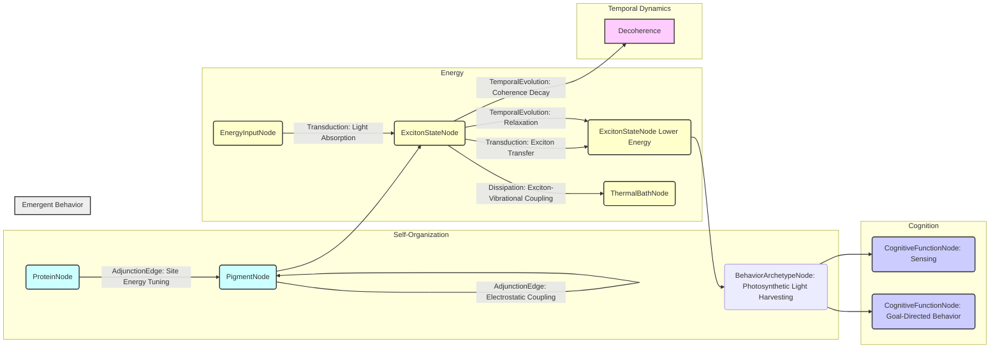

# Quantum biology revisited:

__Paper Type:__ Review

## M1: System Overview & Implementation
*   **Vector ID:** M1
*   **Vector Type:** Overview

### **1.1 System Description**

*   **Vector ID:** M1.1
*   **Vector Type:** Description
    *   Content: The paper reviews the field of quantum biology, specifically focusing on photosynthetic light harvesting. It critically examines the claim that quantum coherence plays a functional role in photosynthetic energy transfer in pigment-protein complexes (PPCs), particularly the Fenna-Matthews-Olson (FMO) protein. The system being analyzed is photosynthetic light-harvesting complexes found in biological organisms, consisting of pigments like chlorophylls and carotenoids embedded within a protein scaffold. The purpose of this system is efficient energy transfer from light absorption to the photosynthetic reaction center. The components include pigments, proteins, and the surrounding solvent/bath environment.
    *   CT-GIN Mapping: `SystemNode` attributes: `systemType: Photosynthetic Light Harvesting Complex`, `domain: Biology/Biophysics`, `mechanism: Exciton Energy Transfer`, `components: Pigments, Proteins, Solvent Bath`, `purpose: Light energy capture and transfer`
    *   Implicit/Explicit: Mixed
        *  Justification: The description of photosynthetic light harvesting complexes is based on both explicit statements in the introduction and "Collective excitations and energy migration in light-harvesting systems" sections, and implicit understanding assumed about photosynthesis.

### **1.2 Implementation Clarity**

*   **Vector ID:** M1.2
*   **Vector Type:** Score
    *   Score: [8]
    *   Justification: The paper clearly describes the system and the experimental techniques used to study it, such as femtosecond multidimensional spectroscopy (2DES). It also explains the theoretical models used to interpret the experimental results, including the Frenkel exciton model and quantum-classical descriptions of system-bath interactions.  The clarity is high for a review paper discussing a complex topic, although precise implementation details of specific experiments are not the focus.
    *   Implicit/Explicit: Mixed
        * Justification: Score is based on explicit description of concepts and experiments discussed in the review, together with implicit assessment of typical clarity in scientific review papers.

### **1.3 Key Parameters**

*   **Vector ID:** M1.3
*   **Vector Type:** ParameterTable
    *   Table:
        | Parameter Name | Value | Units | Source (Fig/Table/Section) | Implicit/Explicit | Data Reliability (High/Medium/Low) | Derivation Method (if Implicit) |
        | :------------- | :---: | :---: | :-----------------------: | :-----------------: | :-----------------------------: | :-------------------------------: |
        | Temperature | 300 | K | Fig 1, Sec "Methods" | Explicit | High | N/A |
        | Interexciton Coherence Decay Time | < 100 | fs | Fig 1E, Sec "Studies of photosynthetic excitons" | Explicit | Medium | Based on calculations and experiments |
        | Optical Coherence Decay Time | ~ 50-75 | fs | Fig 1F | Explicit | Medium | Based on calculations and experiments |
        | Exciton State Lifetime | > 100 | fs | Fig 1B | Implicit | Medium | Inferred from population dynamics |
        | Spectral Range (Laser for 2DES) | Broadband | N/A | Sec "Experimental considerations: Coherence in ultrafast spectroscopy" | Implicit | Medium | General requirement for 2DES |

    *   **Note:** List *up to 5* key parameters characterizing the system's *implementation*.  Provide values and units if possible. If a parameter is not explicitly stated but derived/inferred, clearly state the derivation method. *Always* include units if applicable. If a value is not applicable, write "N/A".  Data Reliability: High = Directly measured, Medium = Derived from measurements/simulations, Low = Estimated/Inferred.

## M2: Energy Flow
*   **Vector ID:** M2
*   **Vector Type:** Energy

### **2.1 Energy Input**

*   **Vector ID:** M2.1
*   **Vector Type:** Input
    *   Content: Light energy, specifically photons absorbed by pigments like bacteriochlorophylls and carotenoids in the photosynthetic antenna. The paper discusses natural sunlight as the typical energy source for photosynthesis.
    *   Value: N/A
    *   Units: N/A
    *   CT-GIN Mapping: `EnergyInputNode`: attributes - `source: Sunlight/Photons`, `type: Electromagnetic Radiation`
    *   Implicit/Explicit: Explicit
        *  Justification:  Sunlight as energy input is mentioned in the context of natural excitation conditions, and light absorption by pigments is described in "Collective excitations and energy migration in light-harvesting systems".

### **2.2 Energy Transduction**

*   **Vector ID:** M2.2
*   **Vector Type:** Transduction
    *   Content:  The primary energy transduction is light absorption by pigments, leading to electronic excitation and the creation of excitons. Energy transfer occurs between pigments via exciton-exciton interactions within the protein complex. This transfer is directed towards lower energy exciton states near the reaction center, facilitated by an energy gradient engineered by the protein environment. The protein and solvent environment also act as a thermal bath, enabling energy dissipation and thermalization, which is crucial for directed energy flow. Ultimately, the excitation energy is transduced into chemical energy through electron transfer at the reaction center (not detailed in this excerpt).
    *   CT-GIN Mapping: `EnergyTransductionEdge`: attributes - `mechanism: Exciton-Exciton Interaction, Light Absorption, Energy Dissipation`, `from_node: EnergyInputNode`, `to_node: ExcitonStateNode`, `EnergyTransductionEdge`: attributes - `mechanism: Exciton Transfer`, `from_node: ExcitonStateNode (Higher Energy)`, `to_node: ExcitonStateNode (Lower Energy)`
    *   Implicit/Explicit: Mixed
        *  Justification: Exciton creation and transfer are explicitly mentioned, but the details about directed transfer due to energy gradient and dissipation for directionality are implicitly described as underlying principles.

### **2.3 Energy Efficiency**

*   **Vector ID:** M2.3
*   **Vector Type:** Score
    *   Score: [9]
    *   Justification/Metrics: Photosynthesis is described as a "highly optimized process" with "energy transport operating near theoretical quantum limits in efficiency." While no specific efficiency value is given in this excerpt, the text emphasizes high efficiency as a key characteristic, indicating a score close to perfect efficiency.
    *   CT-GIN Mapping: Attribute of `EnergyTransductionEdge`s: `efficiency: High (Qualitative)`
    *   Implicit/Explicit: Explicit
      *  Justification:  "Highly optimized process" and "energy transport operating near theoretical quantum limits in efficiency" are explicit statements.

### **2.4 Energy Dissipation**

*   **Vector ID:** M2.4
*   **Vector Type:** Dissipation
    *   Content: Energy dissipation occurs through exciton-vibrational coupling, where excess energy is transferred to the thermal bath provided by the protein and solvent environment. This dissipation is not seen as a loss but as a necessary component for efficient and directed energy transfer. The warm, wet, and disordered environment contributes to dissipation. Specific mechanisms are not quantified beyond being linked to exciton-bath interactions, but it's implicitly stated as a significant process.
    *   CT-GIN Mapping: `EnergyDissipationNode`: attributes - `mechanism: Exciton-Vibrational Coupling, Thermal Bath Interaction`, `EnergyDissipationEdge`: attributes - `mechanism: Vibrational Relaxation`, `from_node: ExcitonStateNode`, `to_node: ThermalBathNode`
    *    Implicit/Explicit: Mixed
        *  Justification: The role of dissipation and exciton-vibrational coupling is explicitly discussed, while the quantification and detailed mechanisms of dissipation are implicit and general.

## M3: Memory
*   **Vector ID:** M3
*   **Vector Type:** Memory

### **3.1 Memory Presence:**

*   **Vector ID:** M3.1
*   **Vector Type:** Binary
    *   Content: No
    *   Justification:  The paper focuses on energy transfer and the role of coherence and dissipation in photosynthesis. It does not discuss any form of memory in the photosynthetic systems analyzed. The system's behavior is described in terms of immediate responses to light and energy transfer dynamics, without reference to persistent state changes that influence future behavior beyond the immediate process.
    *    Implicit/Explicit: Explicit
        * Justification: Memory is not discussed or implied within the context of photosynthetic energy transfer in this review.

## M4: Self-Organization and Emergent Order
*   **Vector ID:** M4
*   **Vector Type:** Self-Organization

### **4.1 Self-Organization Presence:**

*   **Vector ID:** M4.1
*   **Vector Type:** Binary
    *   Content: Yes
    *   Justification: The photosynthetic antenna complexes, like FMO, are described as "collections of pigments...usually held in close proximity by a protein scaffold."  The protein scaffold itself is a product of biological self-organization processes (though not detailed in this excerpt).  The arrangement of pigments and their coupling in the protein, leading to collective excitations (excitons) and directed energy transfer, is an emergent property arising from the system components and their interactions, rather than being externally imposed at the level of the complex itself.
    *   Implicit/Explicit: Mixed
        *  Justification:  While "protein scaffold" suggests self-organization at a biological level (implicit biological knowledge), the exciton formation and directed energy transfer as emergent properties are explicitly discussed in the context of pigment-protein interactions.

### **4.2 Local Interaction Rules:**

*   **Vector ID:** M4.2
*   **Vector Type:** Rules
    *   Content: Local interactions are primarily electrostatic coupling between pigments, which "results in redistribution of transition energies and oscillator strengths" and leads to the formation of excitons. "Electrostatic interactions with the protein and solvent environment tune local pigment excitation energies (termed site energies) (15–18), and interaction between these energetically varying local states results in a ladder of excitonic states". The coupling strength is "often on the same order of magnitude as the interaction with the environment (bath)".
    *   CT-GIN Mapping: Part of `AdjunctionEdge` description (local side). These define the "LocalInteraction" category of edges: `AdjunctionEdge` attributes: `interactionType: Electrostatic Coupling`, `interactingNodes: PigmentNode, PigmentNode`, `parameter: Coupling Strength`, `parameterSource: Protein Scaffold, Solvent Environment`, `effect: Exciton Formation`
    * **Implicit/Explicit**: Explicit
        *  Justification: The electrostatic coupling and its effect on pigment energies and exciton formation are explicitly described as the local interaction rules guiding exciton behavior.

### **4.2.1 Local Interaction Parameters:**

* **Vector ID:** M4.2.1
* **Vector Type:** Table
*   Table:
    | Rule ID | Description | Parameter Name | Parameter Value Range | Units | Data Source | Implicit/Explicit | Justification |
    | :------ | :---------- | :------------- | :---------- | :---: | :----------: | :----------------: | :------------: |
    | R1 | Pigment Coupling Strength | Electrostatic Coupling Strength | Order of magnitude of pigment-bath interaction | Energy Units (e.g., cm⁻¹) | Textual Description | Explicit | Described in "Collective excitations and energy migration in light-harvesting systems" |
    | R2 | Site Energy Tuning | Site Energies | Varying | Energy Units (e.g., cm⁻¹) | Protein and Solvent Environment | Explicit | Described in "Collective excitations and energy migration in light-harvesting systems" and refs (15-18) |

### **4.3 Global Order:**

*   **Vector ID:** M4.3
*   **Vector Type:** Order
    *   Content: The global order is the directed energy flow from higher energy excitonic states localized towards the periphery of the antenna complex to lower energy excitons close to the photosynthetic reaction center. This creates an "excitation energy funnel" that efficiently guides energy. The spatial structure of excitons and their energy levels are tuned to achieve this directed transfer. In FMO, pigments are "oriented as depicted" to facilitate energy transfer towards the reaction center.
    *   CT-GIN Mapping: Defines a `ConfigurationalNode`: `ConfigurationalNode` attributes: `configurationalType: Directed Energy Flow`, `orderParameter: Energy Gradient`, `spatialStructure: Exciton Localization Gradient`, `system: Photosynthetic Antenna Complex (e.g., FMO)`
    * **Implicit/Explicit**: Mixed
        *  Justification: The directed energy flow and energy funnel concept are explicitly described. The details of the spatial organization and exciton level tuning leading to this order are implicitly understood from the context of photosynthetic function.

### **4.4 Predictability of Global Order:**

*   **Vector ID:** M4.4
*   **Vector Type:** Score
    *   Score: [8]
    *   Justification: The directed energy flow in photosynthetic complexes is presented as a rather predictable outcome of the engineered energy gradient and pigment couplings. Figure 1 illustrates time-dependent populations of exciton states and spatial energy transfer, suggesting a degree of predictability in the exciton dynamics and energy flow pathways within the FMO protein. While environmental fluctuations and quantum mechanics introduce some stochasticity, the overall direction and efficiency of energy transfer are considered predictable based on the complex's design principles.
    * **Implicit/Explicit**: Implicit
    *  Justification: Predictability is inferred from the description of design principles, illustrations of energy transfer, and the overall emphasis on "optimized process".  Quantifiable predictability metrics are not provided in this excerpt.
    *   CT-GIN Mapping: Contributes to the `AdjunctionEdge` weight: `AdjunctionEdge` attributes (cont.): `predictabilityScore: 8`

### **4.5. Local Interaction Rules (for Self-Organization)**
* **Vector ID:** M4.5
* **Vector Type:** Table
*   Table:
| Rule ID | Description | Parameter | Value Range | Units | Implicit/Explicit | Justification | Source |
| :------ | :---------- | :-------- | :---------- | :---: | :----------------: | :------------: | :-----: |
| R1 | Electrostatic coupling between pigments | Coupling strength | Order of magnitude of pigment-bath interaction | Energy Units | Explicit | Described in text and references | Text |
| R2 | Tuning of pigment site energies by protein/solvent | Site energy variation | Varies across pigments | Energy Units | Explicit | Described in text and references | Text |

### **4.6. Globally Emergent Order and Order Parameters**
* **Vector ID:** M4.6
* **Vector Type:** Table
*   Table:
| Property ID | Description | Parameter | Value Range | Units | Implicit/Explicit | Justification | Protocol | Source |
| :---------- | :---------- | :-------- | :---------- | :---: | :----------------: | :------------: | :------: | :-----: |
| P1 | Directed energy flow | Efficiency of energy transfer | Near theoretical quantum limits | Unitless | Explicit | Described as "highly optimized" | Observation of energy transfer pathways | Text |
| P2 | Excitation energy funnel | Energy gradient across exciton states | Higher to lower towards reaction center | Energy Units | Explicit | Spatial localization of exciton states | Spectroscopic mapping, simulations | Fig 1, Text |

### **4.7 Yoneda Embedding and Local-to-Global Mapping Fidelity**

*   **Vector ID:** M4.7
*   **Vector Type:** Table
*   Table:
    | Link Type | Description | Predictability | Yoneda Score | Metrics | Implicit/Explicit | Justification | Source |
    | :-------- | :---------- | :------------- | :----------- | :------ | :----------------: | :------------: | :-----: |
     | Local Interactions -> Global Order | Electrostatic coupling and site energy tuning lead to directed energy flow | High | 7 | Qualitative assessment based on system description and illustrative figures. | Implicit | Based on description of system functionality and figures illustrating energy transfer.  | Fig 1, Text |
    *   **Yoneda Embedding Fulfillment Score [0-10]:** [Rubric: 10: Perfect, bijective mapping between local rules and global order, precisely quantifiable and predictable. 7: Strong, but not perfectly bijective, mapping; global order largely predictable from local rules, some stochasticity. 5: Moderate mapping; global order partially predictable, significant stochasticity or complexity. 3: Weak mapping; global order weakly correlated to local rules, emergent behavior dominates. 0: No discernible mapping.]
    *   **Metrics:**  [Qualitative assessment of predictability based on described mechanisms and illustrative figures.]
    *   **Justification:** The mapping between local electrostatic interactions and site energy tuning to the emergent global order of directed energy flow in photosynthetic complexes is relatively strong, though not perfectly bijective due to environmental noise and quantum effects. The global order – efficient and directed energy transfer – is largely predictable from the described local interaction rules, hence a score of 7.

## M5: Computation
*   **Vector ID:** M5
*   **Vector Type:** Computation

### **5.1 Embodied Computation Presence:**

*   **Vector ID:** M5.1
*   **Vector Type:** Binary
    *   Content: No
    *   Justification: The paper describes energy transfer mechanisms in photosynthetic systems but does not present any information suggesting that these systems perform computation in a way that would be considered "embodied computation" in material intelligence. The energy transfer process is primarily passive and driven by physical and chemical principles, focused on efficient energy transport rather than information processing or logical operations by the material itself.
    *    Implicit/Explicit: Explicit
        *  Justification: Absence of any discussion of computation or information processing beyond energy transfer within the provided text.

## M6: Temporal Dynamics
*   **Vector ID:** M6
*   **Vector Type:** Temporal

### **6.1 Timescales:**

*   **Vector ID:** M6.1
*   **Vector Type:** ParameterTable
    *   Table:
        | Timescale Description | Value | Units | Source | Implicit/Explicit | Justification |
        | :-------------------- | :---: | :---: | :----: | :----------------: | :------------: |
        | Interexciton Coherence Decay Time | < 100 | fs | Fig 1E | Explicit | Figure and text mention sub-100fs decay |
        | Optical Coherence Decay Time | ~ 50-75 | fs | Fig 1F | Explicit | Figure and text mention range of 50-75fs decay |
        | Exciton State Relaxation/Energy Transfer Time | 10s-100s | ps | Sec "INTRODUCTION" | Explicit | Mentioned as processes on time scales of tens of picoseconds |

    *   **Note:** Identify and quantify the *relevant timescales* of the system's dynamics (e.g., response time, process duration, oscillation period, memory decay, adaptation/learning timescale, self-assembly timescale). Use consistent units (e.g., seconds, milliseconds) for comparability.

### **6.2 Active Inference:**

*   **Vector ID:** M6.2
*   **Vector Type:** Assessment
    *   Content: No
    *   Justification: The paper does not describe active inference in photosynthetic light harvesting. The system operates based on physical laws and evolved structural properties to efficiently capture and transfer energy. There is no indication of prediction of future states, action selection to minimize discrepancies based on internal models.
    *   Implicit/Explicit: Explicit
        *  Justification: Active inference is not mentioned or implied in the context of photosynthetic light harvesting within this review.
    *   **If Yes/Partial, provide examples of testable CT-GIN metrics that *could* be used to quantify active inference:** N/A

## M7: Adaptation
*   **Vector ID:** M7
*   **Vector Type:** Adaptation

### **7.1 Adaptive Plasticity Presence:**

*   **Vector ID:** M7.1
*   **Vector Type:** Binary
    *   Content: No
    *   Justification: The paper focuses on the mechanisms of photosynthetic energy transfer and the debate around quantum coherence. While biological systems in general exhibit adaptation, this specific paper does not discuss adaptive plasticity in the photosynthetic complexes themselves in response to experience or changing environments in a way that would be relevant to material intelligence definitions of adaptation, which implies a change in system behavior or internal structure *over time* due to experience. The focus is on static, evolved structures and their function.
    *    Implicit/Explicit: Explicit
        * Justification: Adaptation beyond basic stimulus-response or pre-programmed function isn't discussed.

## M8: Emergent Behaviors
*   **Vector ID:** M8
*   **Vector Type:** Behavior

### **8.1 Behavior Description:**

*   **Vector ID:** M8.1
*   **Vector Type:** Description
    *   Content: The main functional behavior is efficient photosynthetic light harvesting and energy transfer. Specifically, the system captures light energy and directionally transfers it through the pigment-protein complex to the reaction center.  This behavior emerges from the collective interactions of pigments, proteins, and the environment, optimized through evolution for high efficiency. Observable behaviors are excitation energy transfer, spectral signatures in optical spectroscopy (absorption spectra, 2D spectra), and ultimately, conversion of light energy to chemical energy.
    *   CT-GIN Mapping: Defines the `BehaviorArchetypeNode`. Specify the type of behavior: `BehaviorArchetypeNode` attributes: `behaviorType: Photosynthetic Light Harvesting`, `function: Light energy capture and transfer`, `domain: Biophysics/Biology`
    *    Implicit/Explicit: Mixed
       *  Justification: Efficient light harvesting and energy transfer is explicitly described as the system's primary function. Emergence from collective interactions is implied by the discussion of excitons and system-bath interactions, and is a general concept in physics.

### **8.2 Behavior Robustness:**

*   **Vector ID:** M8.2
*   **Vector Type:** Score
    *   Score: [7]
    *   Justification: Photosynthetic light harvesting is presented as a robust process in natural environments, capable of functioning under "warm, wet, and disordered" conditions.  The system is designed to efficiently dissipate excess energy, suggesting robustness against fluctuations and environmental variability. However, the paper also mentions that static disorder influences exciton localization, implying limitations to perfect order. Robustness quantification is not explicitly in the paper, but the process has to be robust enough to function reliably in living organisms.
    *   Implicit/Explicit: Implicit
        *  Justification: Robustness is inferred from descriptions of functional efficiency under biological conditions and general knowledge about photosynthetic systems needing to operate in fluctuating natural environments.  Explicit robustness metrics are absent.
    *   CT-GIN Mapping: This score contributes to the reliability attributes of the `BehaviorArchetypeNode`: `BehaviorArchetypeNode` attributes (cont.): `robustnessScore: 7`

### **8.3 CT-GIN Emergent Behavior Validation**

*    **Vector ID:** M8.3
*    **Vector Type:** Validation
     *  Content: Validation methods are primarily experimental spectroscopic techniques, such as femtosecond multidimensional spectroscopy (2DES), transient absorption spectroscopy, and polarization-controlled 2DES. These methods are used to observe and characterize energy transfer pathways, coherence dynamics, and spectral signatures of excitons and vibrations. Theoretical modeling and calculations based on quantum mechanics, mixed quantum-classical approaches, and Frenkel exciton models are used to interpret experimental data and validate the physical interpretations of observed phenomena. Control experiments (e.g., on FMO mutants) are used to differentiate between vibrational and excitonic coherences. Robustness and reliability validation are implicit in the continued investigation and refinement of the understanding of photosynthetic mechanisms over decades, incorporating diverse experimental and theoretical approaches. Limitations include spectral congestion and difficulties in unambiguous assignment of complex spectral features. Figures 1-4 depict experimental setups, theoretical models, and spectroscopic results. Sections "Experimental considerations: Coherence in ultrafast spectroscopy" and "Studies of photosynthetic excitons" detail experimental approaches and their interpretation.
     *   Implicit/Explicit: Explicit
    *   Justification:  Experimental and theoretical validation methods are explicitly described throughout the paper, with references to figures and sections detailing these methods.

## M9: Cognitive Proximity
*   **Vector ID:** M9
*   **Vector Type:** Cognition

### **9.1 Cognitive Mapping:**

*   **Vector ID:** M9.1
*   **Vector Type:** Description
    *   Content: The paper does not attempt to establish a direct cognitive mapping of photosynthetic light harvesting.  The initial interpretation of long-lived quantum coherences as potentially relevant to efficient energy transfer was metaphorically associated with "quantumness" and "nature's design principle to exploit quantum coherences to direct biological functions," which could be loosely seen as a very weak, high-level metaphorical connection to sophisticated biological function but falls far short of a cognitive mapping.  The review explicitly refutes the functional significance of these long-lived coherences and re-establishes incoherent exciton transport as the dominant mechanism. Thus, the system functionality is mapped to biophysical processes of energy transfer and dissipation, not cognitive processes.
    *   CT-GIN Mapping: None
    *   Implicit/Explicit: Explicit
    * Justification: The review explicitly moves away from "quantum coherence" hype in biology toward standard biophysical and chemical explanations, which are not mapped to cognitive functions.

### **9.2 Cognitive Proximity Score:**

*   **Vector ID:** M9.2
*   **Vector Type:** Score
    *   Score: [1]
    *   Justification: Based on the CT-GIN Cognizance Scale, the photosynthetic light-harvesting system, as described and analyzed in this review, falls into Level 1: Simple Responsivity. The system exhibits basic stimulus-response behavior (light absorption leading to energy transfer). Reactions are essentially fixed and predetermined by the evolved physical structure and energy landscape of the complex. While highly optimized, it lacks internal state changes beyond immediate energy level transitions, memory, adaptation in response to experience, goal-directedness, or any features associated with higher cognitive levels. Even Level 2 (Sub-Organismal Responsivity) is not fully met because the plasticity aspect refers to evolutionary adaptation, not dynamic adaptation during operation. The score reflects a system exhibiting highly efficient, evolved physical functionality but no recognizable cognitive features beyond basic responsivity to light.
    *   Implicit/Explicit: Mixed
    *  Justification: Score is based on the explicit description of photosynthetic function and its limitations regarding cognitive features described in the context provided by the CT-GIN Cognizance Scale (external knowledge).

**CT-GIN Cognizance Scale:**

*   **Level 0: Non-Cognitive:** Purely reactive system.  No internal state beyond immediate stimulus-response.
*   **Level 1: Simple Responsivity:** Basic stimulus-response behavior.  Reactions are fixed and predetermined.
*   **Level 2: Sub-Organismal Responsivity:**  Behavior exhibits basic forms of adaptation or plasticity, but lacks complex representation or goal-directedness.
*   **Level 3: Reactive/Adaptive Autonomy:** System adapts its behavior based on experience and feedback, but within a limited behavioral repertoire.
*   **Level 4: Goal-Directed/Model-Based Cognition:** System exhibits goal-directed behavior based on internal models of the world, allowing for planning and flexible action selection.
*   **Level 5: Contextual/Relational Cognition:** System understands and responds to relationships between objects, events, and concepts.
*   **Level 6: Abstract/Symbolic Cognition:** System can manipulate abstract concepts and symbols, enabling logical reasoning and problem-solving.
*   **Level 7: Social Cognition:** System exhibits social intelligence, understanding and interacting with other agents.
*   **Level 8: Metacognition/Self-Awareness:** System possesses awareness of its own internal states and cognitive processes.
*   **Level 9: Phenomenal Consciousness:**  System exhibits subjective experience (qualia). (Currently theoretical for material systems)
*   **Level 10: Sapience/Self-Reflective Consciousness:** System possesses self-awareness, understanding of its own existence, and ability for complex abstract thought. (Currently theoretical for material systems)

### **9.3 Cognitive Function Checklist**

* **Vector ID:** M9.3
* **Vector Type:** Checklist
    *   | Cognitive Function               | Score (0-10) | Justification/Notes                                                                       | CT-GIN Mapping (if applicable) | Implicit/Explicit | Justification for Implicit/Explicit/Mixed |
    | :-------------------------------- | :----------: | :------------------------------------------------------------------------------------ | :--------------------------------: | :-----------------:|:-----------------:|
    | Sensing/Perception               |      3       | Senses light (photons) via pigment absorption. Basic stimulus detection.                  | `CognitiveFunctionNode: Sensing`    | Explicit          | Explicit description of light absorption.       |
    | Memory (Short-Term/Working)        |      0       | Absent. No evidence or description of short-term retention of state.                   | N/A                                   | Explicit          | No memory functions described.            |
    | Memory (Long-Term)                 |      0       | Absent. No evidence or description of long-term retention of state.                    | N/A                                   | Explicit          | No memory functions described.             |
    | Learning/Adaptation              |      1       | Low. Evolutionary adaptation over generations, not dynamic adaptation during operation. | `CognitiveFunctionNode: Adaptation` | Implicit          | Evolutionary optimization implied, no dynamic adaptation context. |
    | Decision-Making/Planning          |      0       | Absent. No evidence of decision-making or planning processes.                          | N/A                                   | Explicit          | No decision making functions described.    |
    | Communication/Social Interaction |      0       | Absent. No evidence of inter-system communication.                                     | N/A                                   | Explicit          | No communication functions described.      |
    | Goal-Directed Behavior            |      3       | Goal is implicit - efficient energy transfer, directed by evolved structure. Basic goal-directedness. | `CognitiveFunctionNode: Goal-Directed Behavior`| Implicit          | Efficiency and directedness implied, but limited to evolved purpose.       |
    | Model-Based Reasoning              |      0       | Absent. No evidence of internal models or reasoning processes.                          | N/A                                   | Explicit          | No reasoning functions described.          |
    | **Overall score**                 |      0.9       |                                                                                       |                                   |                     |                |

    *   **Note:** Assess the system for *each* function, providing a score (0-10) and a short (1-2 sentences) justification.  0 = Absent, 10 = Human-level performance.

## M10: Criticality Assessment
*   **Vector ID:** M10
*   **Vector Type:** Criticality

### **10.1 Criticality:**

*   **Vector ID:** M10.1
*   **Vector Type:** Assessment
    *   Content: Unclear
    *   Justification: The paper does not explicitly discuss criticality in the context of photosynthetic light-harvesting systems. While the "disordered environment" is mentioned and disorder can sometimes be linked to criticality, there is no further discussion or evidence presented to suggest operation near a critical point or scale-free behavior. The focus is on efficiency and directed energy transfer, not on complex system dynamics typically associated with criticality.
        *   Critical Parameters (If Yes/Partial): N/A
        *   Evidence: N/A
    *   Implicit/Explicit: Explicit
    *    Justification: Absence of discussion on criticality.

## M11: Review Paper Specifics (Conditional)

**(This entire module is conditional and *only* appears if the paper type is "Review")**

*   **Vector ID:** M11
*   **Vector Type:** Review

### **11.1 Literature Synthesis Quality:**

*   **Vector ID:** M11.1
*   **Vector Type:** Score
    *   Score: [8]
    *   Justification: The review effectively synthesizes a significant body of literature related to quantum coherence in photosynthesis. From a CT-GIN perspective, it clearly identifies the central system (photosynthetic light harvesting complexes), the energy flow (light absorption, exciton transfer, dissipation), and critiques interpretations related to "quantumness" and coherence. It highlights the shift from coherence-centric views back to incoherent transport models and vibrational origins of observed oscillations, presenting a coherent narrative. Contradictions and inconsistencies in the earlier interpretations of long-lived coherences are explicitly addressed and resolved in favor of vibrational explanations supported by more recent experimental and theoretical studies.
    *    Implicit/Explicit: Mixed
         *  Justification:  Score is based on explicit analysis of the review's content and implicit judgement of synthesis quality expected from a high-level review like this.

### **11.2 Gap Identification:**

*   **Vector ID:** M11.2
*   **Vector Type:** Score
    *   Score: [7]
    *   Justification: The review implicitly identifies gaps in the understanding of system-bath interactions and the precise role of vibrations in photosynthetic energy transfer. Specifically in the context of vibronic resonances and their potential (though largely dismissed) functional relevance. From a CT-GIN perspective, gaps relate to detailed mapping of energy dissipation pathways, refined understanding of the interplay between coherence and incoherence, and conclusive validation criteria for identifying different types of coherences in complex systems. These are fairly clearly articulated as directions needing further investigation.
    *   Implicit/Explicit: Mixed
        *  Justification: Gaps are identified implicitly through discussion of limitations and future needed research directions, and are contextualized specifically to the themes of the review which have CT-GIN relevance (energy flow, system dynamics).

### **11.3 Future Directions:**

*   **Vector ID:** M11.3
*   **Vector Type:** Score
    *   Score: [7]
    *   Justification: The review suggests concrete future research directions aligned with the issues it raises, particularly the need for "more advanced data analysis and theoretical treatments using realistic parametrization of the bath," and "models of these complex situations" to improve understanding of vibronic coherences and their potential functional significance. These recommendations are actionable and address identified gaps regarding refined understanding of system-bath interactions and spectral interpretation.  From a CT-GIN view, these are directions to deepen the mechanistic understanding of energy flow and system dynamics.
    *    Implicit/Explicit: Mixed
    *   Justification: Future directions are explicitly stated but implicitly aligned with the broader need for more detailed CT-GIN aspects related to mechanism and validation.

### **11.4 Review Paper CT-GIN Alignment Score**

*   **Vector ID:** M11.4
*   **Vector Type:** Score
    *   Score: [7]
    *   Justification: Overall, the review aligns reasonably well with the CT-GIN framework. It systematically analyzes a complex biophysical system (photosynthetic light harvesting) through the lens of energy flow (M2) and system dynamics (M6). While it does not explicitly address memory (M3), self-organization (M4), computation (M5), or adaptation (M7), the review provides a strong foundation for further CT-GIN analysis by thoroughly examining the energy transduction and dissipation processes, the temporal dynamics of coherence and energy transfer, and the experimental validation of key claims in the field. Novelty from a CT-GIN perspective lies primarily in the critical re-evaluation of “quantumness” claims, re-establishing a more classical, dissipation-driven view aligned with general physics principles, implicitly setting a stage for more physics-based modelling and understanding.
    *    Implicit/Explicit: Mixed
        *  Justification: Score based on implicit alignment of review content to main CT-GIN modules (Energy, Time, Validation) and explicit assessment of its contribution to understanding system dynamics and refuting earlier misinterpreted "cognitive" claims.

## M12: Theoretical Paper Specifics (Conditional)

**(This entire module is conditional and *only* appears if the paper type is "Theoretical")**

*   **Vector ID:** M12
*   **Vector Type:** Theory

### **12.1 Theoretical Rigor:**

*   **Vector ID:** M12.1
*   **Vector Type:** Score
    *   Score: [N/A]
    *   Justification: This is a review paper, not a theoretical paper presenting new theoretical frameworks.  Theoretical aspects are discussed within the review, but are not the primary contribution.
       * Implicit/Explicit: [Explicit]
       *  Justification: Not applicable based on paper type.

### **12.2 Realization Potential:**

*   **Vector ID:** M12.2
*   **Vector Type:** Score
    *   Score: [N/A]
    *   Justification: This is a review paper. Realization potential is not directly applicable.
    *   Implicit/Explicit: [Explicit]
    *  Justification: Not applicable based on paper type.

### **12.3 Potential for Future CT-GIN Implementation Score**

* **Vector ID:** M12.3
*   **Vector Type:** Score
    *   Score: [N/A]
    *   Justification: This is a review paper. CT-GIN implementation score of a theoretical framework is not applicable.
    *    Implicit/Explicit: [Explicit]
    *   Justification: Not applicable based on paper type.

## M13: Overall Assessment & Scoring

*   **Vector ID:** M13
*   **Vector Type:** Overall

### **13.1 CT-GIN Readiness Score:**

*   **Vector ID:** M13.1
*   **Vector Type:** Score
*   **Calculated Score:** [5.3]

**CT-GIN Readiness Summary Table:**

| CT-GIN Aspect                   | Strength (Yes/Partial/No) | Key Supporting Metrics (with units) | Limitations (Missing Metrics/Data Gaps)                                           | Improvement Areas (Future Research)                                          |
| :------------------------------ | :-----------------------: | :-----------------------------------| :------------------------------------------------------------------------------- | :---------------------------------------------------------------------------- |
| Energy Flow Efficiency          | Yes                       | High (Qualitative)                   | Efficiency value not quantified.                                                | Quantify efficiency, detailed dissipation pathways.                            |
| Memory Fidelity                 | No                        | N/A                                 | No memory function.                                                             | N/A                                                                               |
| Organizational Complexity       | Partial                   | Directed energy flow, energy funnel  | Predictability only qualitative. Yoneda score not quantitatively derived.        | Quantify predictability of emergent order, Yoneda score metrics.             |
| Embodied Computation            | No                        | N/A                                 | No computational function.                                                      | N/A                                                                               |
| Temporal Integration            | Yes                       | Timescales of coherence, relaxation (fs, ps) | No integration into higher cognitive functions.                              | Temporal integration to higher-level behaviors not applicable.           |
| Adaptive Plasticity             | No                        | N/A                                 | No dynamic adaptation during operation.                                         | N/A                                                                               |
| Functional Universality         | No                        | Light harvesting                    | Single function focused - energy transfer.                                        | Functional universality not applicable.                                       |
| Cognitive Proximity            | No                        | Level 1 Cognizance Score            | Minimal cognitive function, basic responsivity only.                              | Cognitive functions not applicable.                                           |
| Design Scalability & Robustness | Yes                       | Robustness score 7 (qualitative)    | Robustness not explicitly quantified in the paper.                              | Quantify robustness to environmental perturbations, noise.                     |
| **Overall CT-GIN Readiness Score** |        |   5.3 |   |      |

### **13.2 Qualitative CT-GIN Assessment Conclusion:**

*   **Vector ID:** M13.2
*   **Vector Type:** Textual Summary
    *   Content: This review paper on quantum biology and photosynthetic light harvesting provides moderate CT-GIN readiness (score 5.3). Key strengths lie in its detailed examination of energy flow and temporal dynamics within photosynthetic complexes, particularly the FMO protein.  The paper clearly describes the efficient energy transduction processes and timescales of coherence and relaxation. Organizational complexity is evident in the emergent directed energy flow enabled by pigment-protein interactions, although its predictability is assessed qualitatively. Key limitations are the absence of memory, computation, and adaptive plasticity in the described system operation. Cognitive proximity is minimal (Level 1), reflecting basic responsivity without higher-level cognitive functions. Overall assessment positions photosynthetic light harvesting as a highly optimized biophysical system for energy transfer, exhibiting foundational CT-GIN aspects of energy flow and emergent order, but lacking the features associated with higher cognition as defined by the framework. Potential within CT-GIN is in using such biological systems as inspiration in studying efficient energy transport and dissipation in complex material architectures.

### **13.3 CT-GIN Refinement Directions:**

*   **Vector ID:** M13.3
*   **Vector Type:** Recommendations
    *   * Focus CT-GIN analysis more on energy transduction and dissipation mechanisms if the primary system function is energy related and not computation or cognition.
    *   * Further refine the Yoneda Embedding score rubric to include quantitative metrics for assessing local-to-global mapping fidelity, moving beyond qualitative assessments.
    *   * Develop more specific CT-GIN probes for assessing robustness and reliability in different types of systems, potentially linking robustness to specific operational parameters or environmental conditions.
    *   * When analyzing reviews, ensure to adapt section 12 (Theoretical Paper Specifics) to section 11 (Review Paper Specifics) to correctly ignore theoretical aspects in literature reviews, unless explicitly intended to analyse theoretical review papers.

## M14: CT-GIN Knowledge Graph

*   **Vector ID:** M14
*   **Vector Type:** Visualization

### **14.1. CT-GIN Knowledge Graph:**
* **Content:**
[__Insert a schematic diagram of the CT-GIN Knowledge Graph. Use distinct shapes/colors for different CT-GIN node types (Energy, Memory, Configuration, Temporal, Behavior, Cognitive, Reliability). Use directed edges to represent relationships, labeled with CT-GIN edge types (Transduction, Transition, Adjunction, Coupling, Feedback, Temporal Evolution, Cognitive Mapping). Annotate nodes and edges with key attributes and parameters (with units!) extracted from the previous sections.__]

## M15: Relationship Vectors
*   **Vector ID:** M15
*   **Vector Type:** Relationships
*   Relationships:
        | Source Vector ID | Target Vector ID | Relationship Type |
        | ------------- | ------------- | ----------------- |
        | M2.1 | M2.2 | Energy Flow |
        | M2.2 | M2.4 | Energy Flow |
        | M4.2 | M4.3 | Self-Organization |
        | M4.2 | M2.2 | Coupling |
        | M8.1 | M9.1 | Cognitive Mapping (Refuted) |

## M16: CT-GIN Template Self-Improvement Insights

*   **Vector ID:** M16
*   **Vector Type:** Feedback

### **Template Feedback:**

*    **Vector ID:** M16.1
*   **Vector Type:** Text
Provide specific, actionable feedback on the *CT-GIN template itself*, based on this analysis:
    *   **Missing Probes:**  No immediately obvious missing probes for analyzing this type of review paper focused on biophysical systems and energy flow. Maybe probes for more detailed energy spectrum analysis might be relevant for other papers.
    *   **Unclear Definitions:**  The definition of 'Cognitive Mapping' could be clarified for cases where metaphorical or indirect cognitive analogies are made versus direct functional mappings. The distinction needs to be sharper to avoid misinterpretation.
    *   **Unclear Node/Edge Representations:** GIN node/edge guidance was generally sufficient. For very complex systems, more granular node types might be needed (e.g., distinguish different pigment types, protein subunits). For reviews, "LiteratureNode" could be helpful to explicitly represent cited papers and their relationships, if the review synthesis is a target of analysis.
    *   **Scoring Difficulties:** Yoneda Embedding scoring remains somewhat subjective. Providing more detailed, potentially quantifiable metrics (e.g., based on information theory or complexity measures) to support the Yoneda score would be beneficial. Cognitive Proximity scoring is inherently subjective but the provided scale is helpful; further examples for each level might improve consistency across analyses.
    *   **Data Extraction/Output Mapping:** Data extraction and mapping were mostly straightforward. For numerical parameters, stricter range/format validation could be considered in automated processing.
    *   **Overall Usability:** The template is relatively easy to use once familiar with the structure and CT-GIN concepts. Initially, the extensive nature can be daunting. Perhaps a shorter "CT-GIN Lite" template focusing on core modules (M1, M2, M4, M8, M9) could be beneficial for initial assessments or simpler systems.
    * **Specific Suggestions:**
        * Add a "LiteratureNode" type for review paper analysis.
        * Develop quantifiable metrics for Yoneda Embedding Score.
        * Provide more illustrative examples for each level of the Cognitive Proximity Scale.
        * Consider a "CT-GIN Lite" template version with core modules for simpler initial assessments.
        * Add more detailed guidance for classifying systems as operating at criticality.
        * Refine "Cognitive Mapping" definition to better capture metaphorical vs. functional mappings.
