# Modular assembly of microswimmers with liquid compartments

__Paper Type:__ Experimental

## M1: System Overview & Implementation
*   **Vector ID:** M1
*   **Vector Type:** Overview

### **1.1 System Description**

*   **Vector ID:** M1.1
*   **Vector Type:** Description
    *   Content: The system is composed of artificial microswimmers fabricated through modular assembly using microfluidic synthesis and sequential capillarity-assisted particle assembly (sCAPA). Microcapsules with liquid compartments are synthesized using microfluidics, and then assembled with microparticles (silica or polystyrene) into dumbbell-shaped microswimmers using sCAPA. These microswimmers self-propel in aqueous solution under an externally applied AC electric field due to asymmetric electro-hydrodynamic (EHD) flows. The purpose of the system is to actively transport and release cargo, demonstrated by encapsulating fluorescent dyes within the liquid compartments and showing controlled release via thermal permeabilization of the polymer shells.
    *   CT-GIN Mapping: `SystemNode` attributes: `systemType: Microswimmer`, `domain: Colloidal Suspension`, `mechanism: EHD flow driven self-propulsion`, `components: Polymer microcapsules, Microparticles (silica, polystyrene)`, `purpose: Active cargo transport and release`
    *   Implicit/Explicit: Mixed
        *  Justification: The description of the components, fabrication methods, and propulsion mechanism are explicit in the abstract and introduction. The purpose of cargo transport and release is suggested as potential applications in the abstract and introduction, and demonstrated implicitly by the dye release experiment.

### **1.2 Implementation Clarity**

*   **Vector ID:** M1.2
*   **Vector Type:** Score
    *   Score: [8]
    *   Justification: The paper provides a reasonably clear description of the microswimmer fabrication process using microfluidics and sCAPA, including materials, dimensions, and procedures. The experimental setup for active motion under AC electric fields is also described with sufficient detail in the main text and supplementary information. However, some finer details of the sCAPA process and microfluidic device fabrication may require referring to cited works.
    *   Implicit/Explicit: Mixed
        * Justification: The score is based on the overall clarity which is a mix of explicit details given and implicit requirement to refer to cited work for full implementation details.

### **1.3 Key Parameters**

*   **Vector ID:** M1.3
*   **Vector Type:** ParameterTable
    *   Table:
        | Parameter Name | Value | Units | Source (Fig/Table/Section) | Implicit/Explicit | Data Reliability (High/Medium/Low) | Derivation Method (if Implicit) |
        | :------------- | :---: | :---: | :-----------------------: | :-----------------: | :-----------------------------: | :-------------------------------: |
        | Microcapsule Diameter | 3-6 | µm | Abstract, Section 3 | Explicit | High | N/A |
        | Silica Microparticle Diameter | 4.5 | µm | Section 2.1, 2.4 | Explicit | High | N/A |
        | Polystyrene Microparticle Diameter | 2.7 | µm | Section 2.1 | Explicit | High | N/A |
        | sCAPA Trap Dimension (length x width x height) | 12 x 4 x 1.6 | µm | Section 2.3 | Explicit | Medium | Based on master design |
        | AC Electric Field Frequency | 1.5 | kHz | Section 2.5, 3 | Explicit | High | N/A |

    *   **Note:** List *up to 5* key parameters characterizing the system's *implementation*.  Provide values and units if possible. If a parameter is not explicitly stated but derived/inferred, clearly state the derivation method. *Always* include units if applicable. If a value is not applicable, write "N/A".  Data Reliability: High = Directly measured, Medium = Derived from measurements/simulations, Low = Estimated/Inferred.

## M2: Energy Flow
*   **Vector ID:** M2
*   **Vector Type:** Energy

### **2.1 Energy Input**

*   **Vector ID:** M2.1
*   **Vector Type:** Input
    *   Content: The primary energy source is an externally applied Alternating Current (AC) electric field.
    *   Value: 4-8
    *   Units: V (peak-to-peak amplitude)
    *   CT-GIN Mapping: `EnergyInputNode`: attributes - `source: AC Electric Field`, `type: Electromagnetic`
    *   Implicit/Explicit: Explicit
        *  Justification: The use of AC electric field and its amplitude range are explicitly mentioned in Section 2.5 and 3.

### **2.2 Energy Transduction**

*   **Vector ID:** M2.2
*   **Vector Type:** Transduction
    *   Content: The AC electric field polarizes the microswimmers in the aqueous medium. Due to the compositional asymmetry of the dumbbell-shaped microswimmer (silica/polystyrene microparticle and polymer microcapsule), this polarization leads to asymmetric electro-hydrodynamic (EHD) flows around the microswimmer. These EHD flows are the primary mechanism of energy transduction, converting electrical energy into kinetic energy, resulting in the self-propulsion of the microswimmer along its long axis.
    *   CT-GIN Mapping: `EnergyTransductionEdge`: attributes - `mechanism: Asymmetric Electro-hydrodynamic (EHD) Flows`, `from_node: EnergyInputNode (AC Electric Field)`, `to_node: Kinetic Energy (Microswimmer Motion)`
    *   Implicit/Explicit: Explicit
        *  Justification: The energy transduction mechanism via EHD flows is explicitly described in Section 3 and is based on established models cited in references [4, 10, 38].

### **2.3 Energy Efficiency**

*   **Vector ID:** M2.3
*   **Vector Type:** Score
    *   Score: [2]
    *   Justification/Metrics:  The system is likely to be very inefficient. EHD driven microswimmers typically exhibit low energy efficiency due to significant energy dissipation in fluid motion and Joule heating. While the paper does not explicitly quantify energy efficiency, it is implicitly low given the nature of EHD propulsion at microscale and typical values reported in literature for similar systems. A quantitative metric is not provided in the paper. Qualitative assessment: Low.
    *   CT-GIN Mapping: Attribute of `EnergyTransductionEdge`: `efficiency: Low`
    *   Implicit/Explicit: Implicit
      *  Justification: Efficiency assessment is based on general knowledge of EHD microswimmer systems and implicit in the lack of efficiency metrics in the paper, which usually are reported if efficiency is a significant aspect.

### **2.4 Energy Dissipation**

*   **Vector ID:** M2.4
*   **Vector Type:** Dissipation
    *   Content: Energy dissipation mechanisms in this system are primarily due to viscous friction in the surrounding fluid as the microswimmer moves. Joule heating from the electric field in the conductive medium also contributes to energy dissipation. The paper does not quantify these dissipation mechanisms. Qualitative assessment: High dissipation due to fluid friction and Joule heating.
    *   CT-GIN Mapping: Creates `EnergyDissipationNode`s: `DissipationType: Viscous Friction`, `DissipationType: Joule Heating`; `EnergyDissipationEdge`s: `from_node: Kinetic Energy (Microswimmer Motion)`, `to_node: EnergyDissipationNode (Viscous Friction)`, `from_node: EnergyInputNode (AC Electric Field)`, `to_node: EnergyDissipationNode (Joule Heating)`
    *    Implicit/Explicit: Implicit
        *  Justification: Dissipation mechanisms are inferred from the physics of microswimming in fluid and the application of an electric field in a conductive medium. No explicit quantification is provided in the paper, only implicit understanding of the involved physics.

## M3: Memory
*   **Vector ID:** M3
*   **Vector Type:** Memory

### **3.1 Memory Presence:**

*   **Vector ID:** M3.1
*   **Vector Type:** Binary
    *   Content: [No]
    *   Justification: The system does not exhibit memory. The microswimmer's behavior (self-propulsion) is a direct response to the instantaneous presence of the AC electric field. Once the field is removed, the motion stops, and there is no persistent change in the system state or future behavior based on past stimuli or experiences. The system is reactive but not exhibiting memory as a persistent change affecting future behavior beyond immediate stimulus-response.
    *    Implicit/Explicit: Implicit
        * Justification:  The absence of memory is inferred from the description of the system's operation, which is consistently presented as a direct, immediate response to an external stimulus without any indication of persistent state changes or influence of past events on current behavior.

## M4: Self-Organization and Emergent Order
*   **Vector ID:** M4
*   **Vector Type:** Self-Organization

### **4.1 Self-Organization Presence:**

*   **Vector ID:** M4.1
*   **Vector Type:** Binary
    *   Content: [No]
    *   Justification: The assembly of microswimmers is achieved through designed processes (microfluidics and sCAPA) and external manipulation (linear motor in sCAPA). While capillary forces play a role in sCAPA, the global structure (dumbbell shape, specific component arrangement) is dictated by the pre-designed PDMS traps and the sequential deposition process, not by spontaneous local interactions leading to emergent global order. The system is modularly *assembled*, not self-*organized*.
    *   Implicit/Explicit: Implicit
        *  Justification: The absence of self-organization is inferred from the explicit description of the fabrication process, which relies on pre-designed templates and sequential steps controlled externally. The emphasis is on *modular assembly* rather than spontaneous *self-organization*.

## M5: Computation
*   **Vector ID:** M5
*   **Vector Type:** Computation

### **5.1 Embodied Computation Presence:**

*   **Vector ID:** M5.1
*   **Vector Type:** Binary
    *   Content: [No]
    *   Justification: The system does not perform embodied computation. The microswimmer's motion is a physical response to the external electric field governed by electrohydrodynamics. There are no computational operations, information processing, or decision-making processes intrinsic to the material or its interactions. The motion is a direct physical consequence of the applied field and material properties, not a result of embodied computation.
    *    Implicit/Explicit: Implicit
        *  Justification: The absence of computation is inferred from the description of the system's functionality, which is limited to self-propulsion and cargo release, without any indication of information processing or computational operations being performed by the material system itself.

## M6: Temporal Dynamics
*   **Vector ID:** M6
*   **Vector Type:** Temporal

### **6.1 Timescales:**

*   **Vector ID:** M6.1
*   **Vector Type:** ParameterTable
    *   Table:
        | Timescale Description | Value | Units | Source | Implicit/Explicit | Justification |
        | :-------------------- | :---: | :---: | :----: | :----------------: | :------------: |
        | Response time to AC field | Rapid | N/A | Section 3, Video 4 | Implicit | Motion is observed immediately upon field application |

    *   **Note:** Identify and quantify the *relevant timescales* of the system's dynamics (e.g., response time, process duration, oscillation period, memory decay, adaptation/learning timescale, self-assembly timescale). Use consistent units (e.g., seconds, milliseconds) for comparability.

### **6.2 Active Inference:**

*   **Vector ID:** M6.2
*   **Vector Type:** Assessment
    *   Content: [No]
    *   Justification: The system does not exhibit active inference. The microswimmer's motion is a direct, reactive response to the external electric field and does not involve prediction of future states, action selection to minimize prediction errors, or internal models of the environment. The system lacks the necessary internal mechanisms for active inference.
    *   Implicit/Explicit: Implicit
        *  Justification:  The absence of active inference is inferred from the descriptive nature of the paper, which focuses on the stimulus-response behavior without any mention or evidence of predictive or model-based mechanisms within the system.
    *   **If Yes/Partial, provide examples of testable CT-GIN metrics that *could* be used to quantify active inference:** N/A

## M7: Adaptation
*   **Vector ID:** M7
*   **Vector Type:** Adaptation

### **7.1 Adaptive Plasticity Presence:**

*   **Vector ID:** M7.1
*   **Vector Type:** Binary
    *   Content: [No]
    *   Justification: The system does not exhibit adaptive plasticity. The microswimmer's properties and behavior are fixed after fabrication. There is no mechanism for the system to change its behavior or internal structure in response to experience, leading to improved performance or altered functionality over time. The system is purely reactive and does not learn or adapt.
    *    Implicit/Explicit: Implicit
        * Justification: The absence of adaptive plasticity is inferred from the paper's focus on fabrication and characterization of a static system, without any description or demonstration of mechanisms for learning or adaptive changes in response to environmental interactions or operational history.

## M8: Emergent Behaviors
*   **Vector ID:** M8
*   **Vector Type:** Behavior

### **8.1 Behavior Description:**

*   **Vector ID:** M8.1
*   **Vector Type:** Description
    *   Content: The primary functional behavior is self-propelled locomotion in a fluid medium when subjected to an external AC electric field. The microswimmer moves along its long axis. By changing the electric field's amplitude, the swimming velocity can be controlled.  The system also exhibits cargo release upon thermal treatment of the microcapsule shells, which is a designed functionality rather than an emergent behavior in the strict sense.
    *   CT-GIN Mapping: `BehaviorArchetypeNode`. Specify the type of behavior: `BehaviorType: Locomotion`, `BehaviorType: Controlled Cargo Release`
    *    Implicit/Explicit: Explicit
       *  Justification: Self-propelled locomotion and controlled cargo release are explicitly described as the functional behaviors of the microswimmer system throughout the paper, particularly in Section 3 and 4.

### **8.2 Behavior Robustness:**

*   **Vector ID:** M8.2
*   **Vector Type:** Score
    *   Score: [6]
    *   Justification: The microswimmer reliably exhibits self-propulsion under the described AC electric field conditions, as demonstrated by multiple experiments and velocity measurements. Robustness to variations in particle size and material composition is implicitly suggested by the modular fabrication approach, although not explicitly quantified. Robustness to variations in the external environment (e.g., temperature, fluid viscosity) or to imperfections in fabrication is not explicitly tested or discussed. Qualitative assessment: Moderately robust under tested conditions.
    *   Implicit/Explicit: Mixed
        *  Justification: Robustness is demonstrated by the consistent observation of self-propulsion and controlled velocity. However, the degree of robustness against various perturbations is not systematically quantified. Robustness to fabrication variations is implicitly suggested by modularity.

### **8.3 CT-GIN Emergent Behavior Validation**

*    **Vector ID:** M8.3
*    **Vector Type:** Validation
     *  Content: The emergent behavior (self-propelled motion) is validated by direct observation using brightfield and fluorescence microscopy, tracking microswimmer trajectories, and quantitatively analyzing the relationship between swimming velocity and electric field strength (Figure 3(c,d)). Control experiments are not explicitly described, but the theoretical framework based on EHD flows provides a basis for understanding the observed behavior. Reproducibility is implicitly demonstrated by consistent results across multiple experiments. Limitations of validation include the focus on average velocity without detailed analysis of trajectory fluctuations or individual swimmer variations. See Figure 3 and Video 4.
     *   Implicit/Explicit: Mixed
    *   Justification: Validation methods are partly explicit (microscopy, tracking, velocity analysis) and partly implicit (reproducibility assumed, control experiments not explicit but implied by theoretical grounding).

## M9: Cognitive Proximity
*   **Vector ID:** M9
*   **Vector Type:** Cognition

### **9.1 Cognitive Mapping:**

*   **Vector ID:** M9.1
*   **Vector Type:** Description
    *   Content: None. The paper does not attempt to map the system's functionality to cognitive processes, even metaphorically. The focus is on physical mechanisms of self-propulsion and cargo delivery, not on cognitive functions.
    *   CT-GIN Mapping: N/A
    *   Implicit/Explicit: Explicit
    * Justification: The absence of cognitive mapping is evident from the paper's language and focus, which is entirely within the domain of material science and physics, without any references or analogies to cognition.

### **9.2 Cognitive Proximity Score:**

*   **Vector ID:** M9.2
*   **Vector Type:** Score
    *   Score: [1]
    *   Justification: The system demonstrates simple responsivity (Level 1). It exhibits basic stimulus-response behavior to an external electric field (self-propulsion). Reactions are fixed and predetermined by the system's design and physical properties. It operates at the lowest level of the CT-GIN Cognizance Scale, beyond purely reactive systems (Level 0) due to its engineered response but still far from any form of adaptation or goal-directedness. It lacks any features corresponding to higher cognitive levels.
    *   Implicit/Explicit: Mixed
    *  Justification: The score is based on an assessment against the CT-GIN Cognizance Scale, which is an inferred application, although the system's stimulus-response behavior itself is explicitly described in the paper.

**CT-GIN Cognizance Scale:**

*   **Level 0: Non-Cognitive:** Purely reactive system.  No internal state beyond immediate stimulus-response.
*   **Level 1: Simple Responsivity:** Basic stimulus-response behavior.  Reactions are fixed and predetermined.
*   **Level 2: Sub-Organismal Responsivity:**  Behavior exhibits basic forms of adaptation or plasticity, but lacks complex representation or goal-directedness.
*   **Level 3: Reactive/Adaptive Autonomy:** System adapts its behavior based on experience and feedback, but within a limited behavioral repertoire.
*   **Level 4: Goal-Directed/Model-Based Cognition:** System exhibits goal-directed behavior based on internal models of the world, allowing for planning and flexible action selection.
*   **Level 5: Contextual/Relational Cognition:** System understands and responds to relationships between objects, events, and concepts.
*   **Level 6: Abstract/Symbolic Cognition:** System can manipulate abstract concepts and symbols, enabling logical reasoning and problem-solving.
*   **Level 7: Social Cognition:** System exhibits social intelligence, understanding and interacting with other agents.
*   **Level 8: Metacognition/Self-Awareness:** System possesses awareness of its own internal states and cognitive processes.
*   **Level 9: Phenomenal Consciousness:**  System exhibits subjective experience (qualia). (Currently theoretical for material systems)
*   **Level 10: Sapience/Self-Reflective Consciousness:** System possesses self-awareness, understanding of its own existence, and ability for complex abstract thought. (Currently theoretical for material systems)

### **9.3 Cognitive Function Checklist**

* **Vector ID:** M9.3
* **Vector Type:** Checklist
    *   | Cognitive Function               | Score (0-10) | Justification/Notes                                                                       | CT-GIN Mapping (if applicable) | Implicit/Explicit | Justification for Implicit/Explicit/Mixed |
    | :-------------------------------- | :----------: | :------------------------------------------------------------------------------------ | :--------------------------------: | :-----------------:|:-----------------:|
    | Sensing/Perception               | 1          | Indirectly senses external electric field via induced forces and motion. Very basic.    | N/A                                | Implicit          | Inferred from response to stimulus.                 |
    | Memory (Short-Term/Working)        | 0          | No short-term or working memory.                                                        | N/A                                | Implicit          | Absence of any memory mechanism described.         |
    | Memory (Long-Term)                 | 0          | No long-term memory.                                                                    | N/A                                | Implicit          | Absence of any memory mechanism described.         |
    | Learning/Adaptation              | 0          | No learning or adaptation capabilities.                                                 | N/A                                | Implicit          | Absence of any adaptive mechanism described.         |
    | Decision-Making/Planning          | 0          | No decision-making or planning. Motion is purely reactive.                              | N/A                                | Implicit          | Reactive behavior, no decision process.             |
    | Communication/Social Interaction | 0          | No communication or social interaction capabilities. Static object in fluid.             | N/A                                | Implicit          | System operates independently.                      |
    | Goal-Directed Behavior            | 0          | No goal-directed behavior. Motion is driven by external field, not internal goals.      | N/A                                | Implicit          | Reactive nature of motion, no internal goals.        |
    | Model-Based Reasoning              | 0          | No model-based reasoning.                                                               | N/A                                | Implicit          | Absence of internal models or reasoning processes. |
    | **Overall score**                 |      [0.125]       |                                                                                       |                                   |                     |                |

    *   **Note:** Assess the system for *each* function, providing a score (0-10) and a short (1-2 sentences) justification.  0 = Absent, 10 = Human-level performance.

## M10: Criticality Assessment
*   **Vector ID:** M10
*   **Vector Type:** Criticality

### **10.1 Criticality:**

*   **Vector ID:** M10.1
*   **Vector Type:** Assessment
    *   Content: [No]
    *   Justification: There is no mention or evidence in the paper suggesting that the system operates near a critical point or exhibits scale-free behavior, power laws, or long-range correlations. The microswimming behavior is described by established principles of electrohydrodynamics, which are not inherently related to criticality.
        *   Critical Parameters (If Yes/Partial): N/A
        *   Evidence: N/A
    *   Implicit/Explicit: Implicit
    *    Justification:  The absence of criticality is based on the lack of any discussion or experimental evidence related to critical phenomena in the paper, and the theoretical framework used, which is not associated with criticality.

## M11: Review Paper Specifics (Conditional)

**(This entire module is conditional and *only* appears if the paper type is "Review")**

*   **Vector ID:** M11
*   **Vector Type:** Review
    *   Content: N/A

## M12: Theoretical Paper Specifics (Conditional)

**(This entire module is conditional and *only* appears if the paper type is "Theoretical")**

*   **Vector ID:** M12
*   **Vector Type:** Theory
    *   Content: N/A

## M13: Overall Assessment & Scoring

*   **Vector ID:** M13
*   **Vector Type:** Overall

### **13.1 CT-GIN Readiness Score:**

*   **Vector ID:** M13.1
*   **Vector Type:** Score
*   **Calculated Score:** [3.4]

**CT-GIN Readiness Summary Table:**

| CT-GIN Aspect                   | Strength (Yes/Partial/No) | Key Supporting Metrics (with units) | Limitations (Missing Metrics/Data Gaps)                                           | Improvement Areas (Future Research)                                          |
| :------------------------------ | :-----------------------: | :-----------------------------------| :------------------------------------------------------------------------------- | :---------------------------------------------------------------------------- |
| Energy Flow Efficiency          | No                        | Qualitative: Low                   | Quantitative efficiency metric                                                 | Improve energy efficiency of EHD propulsion or explore alternative mechanisms. |
| Memory Fidelity                 | No                        | N/A                                 | Memory capacity, retention time, readout accuracy, degradation rate, energy cost | Integrate memory functionality into the microswimmer system.                  |
| Organizational Complexity       | No                        | Modular Assembly                  | Self-organization, emergent order parameters, Yoneda Embedding Score          | Explore self-organizing assembly mechanisms and emergent structural complexity. |
| Embodied Computation            | No                        | N/A                                 | Processing power, energy per operation, response time, bit-depth                  | Incorporate embodied computation capabilities.                              |
| Temporal Integration            | No                        | Rapid Response Time                 | More detailed timescale characterization, active inference metrics             | Explore temporal dynamics and integrate active inference, predictive capabilities.|
| Adaptive Plasticity             | No                        | N/A                                 | Adaptation rate, plasticity range, mechanism of adaptation                      | Introduce adaptive plasticity for improved performance in changing environments.|
| Functional Universality         | Partial                   | Locomotion, Cargo Release           | Range of behaviors, flexibility, programmability                                | Increase functional versatility and programmability of microswimmers.         |
| Cognitive Proximity            | No                        | Cognitive Proximity Score: 1       | Cognitive function scores for Memory, Learning, Decision-Making, etc           | Enhance cognitive functions towards higher levels of cognizance.            |
| Design Scalability & Robustness | Partial                   | Modular Design, Score 6 Robustness  | Scalability metrics, robustness to various perturbations quantified               | Quantify scalability and robustness to wider range of perturbations.        |
| **Overall CT-GIN Readiness Score** |        |   |   |      |

### **13.2 Qualitative CT-GIN Assessment Conclusion:**

*   **Vector ID:** M13.2
*   **Vector Type:** Textual Summary
    *   Content: The analyzed publication presents an experimental realization of modular microswimmers capable of self-propulsion and controlled cargo release. Key strengths lie in the clear implementation of microfluidic synthesis and sCAPA for modular assembly, and the demonstration of controlled motion using EHD flows.  The system, however, exhibits significant limitations within the CT-GIN framework. It lacks memory, self-organization, embodied computation, adaptation, and cognitive functions beyond simple stimulus response. Energy efficiency is likely low, and robustness is only moderately assessed. Overall, the system is at a very early stage of CT-GIN readiness, scoring low across most cognitive and emergent behavior aspects.  Its potential within CT-GIN lies primarily in its modular design platform, which could be further developed to incorporate memory, computation, and adaptive functionalities in future iterations.

### **13.3 CT-GIN Refinement Directions:**

*   **Vector ID:** M13.3
*   **Vector Type:** Recommendations
    *   * Integrate memory elements within the microswimmer architecture to enable persistent state changes and influence future behavior.
    *   * Explore mechanisms for self-organization in the assembly process to create emergent structural complexity and robustness.
    *   * Incorporate embodied computation capabilities, possibly by utilizing material properties to perform basic logic or signal processing operations.
    *   * Introduce adaptive plasticity mechanisms to allow the microswimmer to learn and improve its performance in response to environmental changes or operational history.
    *   * Enhance energy efficiency of the propulsion mechanism or investigate alternative, more efficient methods for microswimmer actuation.
    *   * Design for goal-directed behavior beyond simple stimulus-response, possibly by implementing internal models or feedback control loops.
    *   * Investigate and quantify robustness to a wider range of environmental perturbations and fabrication imperfections to improve reliability.
    *   * Explore scalability aspects of the fabrication process to enable mass production of these modular microswimmers.

## M14: CT-GIN Knowledge Graph

*   **Vector ID:** M14
*   **Vector Type:** Visualization

### **14.1. CT-GIN Knowledge Graph:**
* **Content:**
[__Insert a schematic diagram of the CT-GIN Knowledge Graph. Use distinct shapes/colors for different CT-GIN node types (Energy, Memory, Configuration, Temporal, Behavior, Cognitive, Reliability). Use directed edges to represent relationships, labeled with CT-GIN edge types (Transduction, Transition, Adjunction, Coupling, Feedback, Temporal Evolution, Cognitive Mapping). Annotate nodes and edges with key attributes and parameters (with units!) extracted from the previous sections.__]

```mermaid
graph LR
    subgraph System [Microswimmer System]
        SystemNode(SystemNode)
        SystemNode -- components: Microcapsules, Microparticles --> MaterialNode1[Microcapsules]
        SystemNode -- components: Microcapsules, Microparticles --> MaterialNode2[Microparticles]
        SystemNode -- systemType: Microswimmer --> TypeNode[Microswimmer]
        SystemNode -- domain: Colloidal Suspension --> DomainNode[Colloidal Suspension]
        SystemNode -- mechanism: EHD flow driven self-propulsion --> MechanismNode[EHD Propulsion]
        SystemNode -- purpose: Cargo transport and release --> PurposeNode[Cargo Delivery]
        MaterialNode1 -- type: Polymer --> PolymerNode[Polymer]
        MaterialNode2 -- type: Silica/Polystyrene --> ParticleNode[Silica/Polystyrene]
    end

    subgraph Energy [Energy Flow]
        EnergyInput(EnergyInputNode)
        KineticEnergy(Kinetic Energy)
        EnergyDissipation1(EnergyDissipationNode - Viscous Friction)
        EnergyDissipation2(EnergyDissipationNode - Joule Heating)

        EnergyInput -- source: AC Electric Field, Value: 4-8V, Units: V --> AC_Electric_Field[AC Electric Field]
        EnergyInput -- type: Electromagnetic --> ElectromagneticEnergy[Electromagnetic]

        EnergyInput -- mechanism: EHD Flows --> KineticEnergy
        KineticEnergy -- Dissipation Mechanism --> EnergyDissipation1
        EnergyInput -- Dissipation Mechanism --> EnergyDissipation2

        EnergyInput -. mechanism: Asymmetric EHD Flows .- KineticEnergy
        linkStyle 6,7,8,9,10 stroke-width:2px,stroke:red,fill:none;

    end

    subgraph Behavior [Behavior]
        BehaviorNode(BehaviorArchetypeNode)
        BehaviorNode -- BehaviorType: Locomotion --> Locomotion[Locomotion]
        BehaviorNode -- BehaviorType: Controlled Cargo Release --> CargoRelease[Cargo Release]
        BehaviorNode -- Robustness: 6/10 --> RobustnessScore[Robustness: 6/10]
    end

    subgraph Cognition [Cognition]
        CognitiveScoreNode(Cognitive Score)
        CognitiveScoreNode -- Cognitive Proximity Score: 1/10 --> CognitiveProximity[Cognitive Proximity: Level 1]
        CognitiveScoreNode -- Overall Cognitive Score: 0.125/10 --> OverallCognitiveScore[Overall Score: 0.125/10]
    end

    System -- Energy Transduction --> Energy
    Energy -- Drives --> Behavior
    Behavior -- Cognitive Proximity --> Cognition

    style SystemNode fill:#f9f,stroke:#333,stroke-width:2px
    style MaterialNode1 fill:#ccf,stroke:#333,stroke-width:2px
    style MaterialNode2 fill:#ccf,stroke:#333,stroke-width:2px
    style EnergyInput fill:#ccf,stroke:#333,stroke-width:2px
    style KineticEnergy fill:#ccf,stroke:#333,stroke-width:2px
    style EnergyDissipation1 fill:#ccf,stroke:#333,stroke-width:2px
    style EnergyDissipation2 fill:#ccf,stroke:#333,stroke-width:2px
    style BehaviorNode fill:#ccf,stroke:#333,stroke-width:2px
    style CognitiveScoreNode fill:#ccf,stroke:#333,stroke-width:2px
```

## M15: Relationship Vectors
*   **Vector ID:** M15
*   **Vector Type:** Relationships
*   Relationships:
        | Source Vector ID | Target Vector ID | Relationship Type |
        | ------------- | ------------- | ----------------- |
        | M2 | M8 | Drives |
        | M1 | M2 | Energy Transduction |
        | M8 | M9 | Cognitive Proximity |

## M16: CT-GIN Template Self-Improvement Insights

*   **Vector ID:** M16
*   **Vector Type:** Feedback

### **Template Feedback:**

*    **Vector ID:** M16.1
*   **Vector Type:** Text
Provide specific, actionable feedback on the *CT-GIN template itself*, based on this analysis:
    *   **Missing Probes:** The template is comprehensive. Maybe probes for social interactions between multiple microswimmers could be added if the system is scaled up, although probably not relevant for this paper.
    *   **Unclear Definitions:** Definitions are generally clear. For "Implementation Clarity," perhaps adding more specific criteria examples regarding experimental details vs. theoretical model description could be helpful, though the justification section allows for addressing this.
    *   **Unclear Node/Edge Representations:** Guidance is sufficient.  The examples are helpful.
    *   **Scoring Difficulties:**  The scoring rubrics are generally useful, especially the Cognizance Scale.  For robustness, maybe providing a pre-defined list of perturbation types to consider (environmental, fabrication, operational) would be helpful, although the open justification allows for flexibility.
    *   **Data Extraction/Output Mapping:**  No major challenges. The template structure is logical and facilitates mapping extracted data.
    *   **Overall Usability:** The template was relatively easy to use after understanding the structure and requirements. It's a bit lengthy, but comprehensiveness is necessary for detailed analysis.
    * **Specific Suggestions:** None at this moment except minor suggestions above are for optional refinements. The template is usable and functional.
