# Brain-inspired computing with fluidic iontronic nanochannels

__Paper Type:__ Experimental

## M1: System Overview & Implementation
*   **Vector ID:** M1
*   **Vector Type:** Overview

### **1.1 System Description**

*   **Vector ID:** M1.1
*   **Vector Type:** Description
    *   Content: The system is a fluidic iontronic memristor designed for brain-inspired (neuromorphic) computing. It consists of a tapered microfluidic channel filled with a rigid face-centered cubic (fcc) crystal structure of charged silica spheres, creating a network of nanochannels. This structure is placed between two reservoirs containing a KCl electrolyte solution. The device emulates synaptic plasticity features through voltage-driven ion transport in water, aiming to function as a synaptic element for reservoir computing and classify time-series data, such as handwritten numbers.
    *   CT-GIN Mapping: `SystemNode` attributes: `systemType: Fluidic Iontronic Memristor`, `domain: Neuromorphic Computing`, `mechanism: Ionic Transport`, `components: Tapered Microchannel, Colloidal Structure, KCl Electrolyte`, `purpose: Synaptic Element for Reservoir Computing`
    *   Implicit/Explicit: Explicit
        *  Justification: The description of the system, its components, function, and purpose are all directly stated within the abstract and introduction of the paper.

### **1.2 Implementation Clarity**

*   **Vector ID:** M1.2
*   **Vector Type:** Score
    *   Score: [8]
    *   Justification: The experimental implementation is described with good clarity, detailing the materials (PDMS, silica spheres, KCl), fabrication process (soft lithography, self-assembly), and measurement setup (voltage pulses, current measurements).  Figures 1A and 1C provide visual and schematic descriptions of the device.  However, some details about the precise control parameters during fabrication and experimental noise levels are less explicitly elaborated upon in the main text, requiring reference to the SI Appendix for complete clarity.
    *   Implicit/Explicit: Mixed
        * Justification: The overall implementation is explicitly described with supporting figures. However, some finer details about the fabrication and noise aspects are implicitly present, requiring deeper reading to appreciate the implementation fully.

### **1.3 Key Parameters**

*   **Vector ID:** M1.3
*   **Vector Type:** ParameterTable
    *   Table:
        | Parameter Name | Value | Units | Source (Fig/Table/Section) | Implicit/Explicit | Data Reliability (High/Medium/Low) | Derivation Method (if Implicit) |
        | :------------- | :---: | :---: | :-----------------------: | :-----------------: | :-----------------------------: | :-------------------------------: |
        | Channel Length (L) | 150 | μm | 1, Section 1 | Explicit | High | N/A |
        | Channel Height (H) | 5 | μm | 1, Section 1 | Explicit | High | N/A |
        | Base Width (2Rb) | 200 | μm | 1, Section 1 | Explicit | High | N/A |
        | Tip Width (2Rt) | 10 | μm | 1, Section 1 | Explicit | High | N/A |
        | KCl Concentration | 10 | mM | 1, Section 1 | Explicit | High | N/A |

    *   **Note:** List *up to 5* key parameters characterizing the system's *implementation*.  Provide values and units if possible. If a parameter is not explicitly stated but derived/inferred, clearly state the derivation method. *Always* include units if applicable. If a value is not applicable, write "N/A".  Data Reliability: High = Directly measured, Medium = Derived from measurements/simulations, Low = Estimated/Inferred.

## M2: Energy Flow
*   **Vector ID:** M2
*   **Vector Type:** Energy

### **2.1 Energy Input**

*   **Vector ID:** M2.1
*   **Vector Type:** Input
    *   Content: Electrical voltage applied across the microchannel device.
    *   Value: 5, -2.5, -2, 5, -1 |
    *   Units: V |
    *   CT-GIN Mapping: `EnergyInputNode`: attributes - `source: Voltage Source`, `type: Electrical Potential`
    *   Implicit/Explicit: Explicit
        *  Justification: The paper explicitly states "voltage-driven" salt flux and uses voltage pulses as input signals for device operation and characterization. Specific voltage values are mentioned in experiments (Figures 1C, 1E, 1F, 2, 3, 4).

### **2.2 Energy Transduction**

*   **Vector ID:** M2.2
*   **Vector Type:** Transduction
    *   Content:  Electrical energy (voltage) is transduced into ionic transport within the aqueous electrolyte in the nanochannels. The applied voltage drives the net salt flux, causing salt concentration polarization. This, in turn, modulates the channel conductance, observed as memristive behavior and synaptic plasticity. The energy flow is from electrical potential to ionic kinetic energy and concentration gradients, and then back to electrical current (output signal, measured as conductance).
    *   CT-GIN Mapping: `EnergyTransductionEdge`: attributes - `mechanism: Voltage-driven ionic transport`, `from_node: EnergyInputNode`, `to_node: Ionic Transport Node (Implicitly defined by system description)`
    *   Implicit/Explicit: Mixed
        *  Justification:  The mechanism of voltage-driven ionic transport is explicitly described as the basis of the device operation. The flow of energy from electrical to ionic and back is implicitly understood from the description of memristor function and current measurement in response to voltage.

### **2.3 Energy Efficiency**

*   **Vector ID:** M2.3
*   **Vector Type:** Score
    *   Score: [6]
    *   Justification/Metrics: Energy efficiency is not quantitatively measured in the paper. However, it is qualitatively stated that neuromorphic computing aims for "orders of magnitude more energy efficient than conventional computing devices". The paper mentions energy consumption of ~1-10 μJ for write-pulses and ~10-100 nJ for read-pulses (Fig. 1E). This suggests a moderate energy efficiency compared to purely electronic memristors, as ionic transport in aqueous solutions generally involves higher energy dissipation than electron transport in solids, but still potentially more efficient than traditional CMOS for complex tasks due to the bio-inspired approach and analog nature. Qualitative assessment: Medium efficiency.
    *   CT-GIN Mapping: `Attribute of relevant EnergyTransductionEdge`s: `efficiency: Medium (Qualitative assessment)`
    *   Implicit/Explicit: Mixed
      *  Justification:  Energy efficiency is discussed qualitatively in the introduction as a motivation for neuromorphic computing. Specific energy consumption values for pulses are provided, allowing a qualitative, though not precisely quantified, assessment of efficiency.

### **2.4 Energy Dissipation**

*   **Vector ID:** M2.4
*   **Vector Type:** Dissipation
    *   Content: Energy dissipation mechanisms are primarily due to ionic resistance in the nanochannels and reservoirs, Joule heating from the current flow through the electrolyte, and potentially from irreversible processes of ion accumulation and depletion at the channel tip and base (although the device is described as stable). The resistance of the electrolyte and the confined geometry of nanochannels inherently lead to dissipation of electrical energy into heat.  Precise quantification is not provided, but qualitative assessment suggests medium to high dissipation due to ionic transport in a fluid.
    *   CT-GIN Mapping: Creates `EnergyDissipationNode`s: `nodeType: Ionic Resistance Dissipation`, `mechanism: Joule Heating, Ionic Resistance`, `location: Nanochannels, Reservoirs`; Creates `EnergyDissipationEdge`s: `edgeType: Dissipation`, `from_node: EnergyTransductionEdge`, `to_node: EnergyDissipationNode`
    *    Implicit/Explicit: Implicit
        *  Justification: Energy dissipation mechanisms are not explicitly quantified. However, they are implicitly understood from the physics of ionic transport in electrolytes and resistive elements. Ionic resistance and Joule heating are inherent dissipation processes in such systems.

## M3: Memory
*   **Vector ID:** M3
*   **Vector Type:** Memory

### **3.1 Memory Presence:**

*   **Vector ID:** M3.1
*   **Vector Type:** Binary
    *   Content: [Yes]
    *   Justification: The device is explicitly described as a "volatile memristor" with "conductance memory". The time-dependent channel conductance g(t) and the pinched hysteresis loop in the I-V curve (Fig. 1C) are direct experimental evidence of memristive memory behavior, where conductance changes and persists over a timescale after voltage stimulus. This change in conductance directly influences the future current response to subsequent voltage inputs.
    *    Implicit/Explicit: Explicit
        * Justification: The paper explicitly uses the term "memristor" and demonstrates its memory characteristics through experimental data, including hysteresis loops and short-term plasticity.

### **3.2 Memory Type:**

*   **Vector ID:** M3.2
*   **Vector Type:** Score
*   Score: [7]
*   Justification: The memristor exhibits short-term volatile memory. Retention is adjustable via channel length but decays over time (quantified by timescale τ). Capacity is limited to analog variation in conductance (continuous states rather than discrete digital states), but still allows for distinguishing 16 input patterns (Fig. 4A) and classifying handwritten digits. Read-out accuracy is demonstrated by stable and reproducible responses over 50 cycles (Fig. 2), with conductance SD of typically a few %.  Score of 7 reflects good short-term retention and functional capacity within its operational context (reservoir computing), but limited compared to long-term, high-capacity memory.
*   CT-GIN Mapping: `MemoryNode` type: `memoryType: Volatile Memristive`, `subtype: Short-term Analog`
*    Implicit/Explicit: Mixed
    * Justification: The volatile nature and short-term characteristic are explicit. The analog nature and capacity are implicit in the description of conductance modulation and reservoir computing application, not explicitly stated as "analog memory" but inferred from the operational mechanism.

### **3.3 Memory Retention Time:**

*   **Vector ID:** M3.3
*   **Vector Type:** Parameter
*   Value: 1.62 |
*    Units: s | (for L=150 μm, calculated) Range adjustable by channel length.
*   Justification:  The memory retention time (τ) is theoretically derived and experimentally validated to be dependent on channel length L. For L=150 μm, τ is calculated to be 1.62 s (Section 1).  Figure 3D shows experimental determination of τ for different channel lengths using hysteresis loop frequency analysis, demonstrating a range of timescales adjustable by design.
*    Implicit/Explicit: Explicit
        * Justification: The retention time is explicitly calculated, predicted by theory, and experimentally measured and discussed in relation to channel length in the paper.

### **3.4 Memory Capacity (Optional - if applicable)**

* **Vector ID:** M3.4
* **Vector Type:** Parameter
*  Value: Analog |
*   Units: Continuous conductance states | (Qualitative descriptor)
*   Justification: The memory capacity is not quantified in bits or distinct states numerically, but the memristor operates in an analog fashion, with conductance varying continuously in response to voltage history. Figure 4A demonstrates the system can distinguish 16 different input patterns through varying conductance levels, suggesting a capacity beyond binary. Qualitative descriptor: Analog, continuous conductance states.
*    Implicit/Explicit: Implicit
        *  Justification: The analog nature is inferred from the continuous conductance modulation and application in reservoir computing, which typically utilizes analog dynamics. No explicit number of distinct states or bit capacity is provided, but the system demonstrably handles more than binary information.

### **3.5 Readout Accuracy (Optional - if applicable)**

* **Vector ID:** M3.5
* **Vector Type:** Parameter
*   Value: 93-99 |
*   Units: % | (Based on SD from stability measurements)
*   Justification: Readout accuracy can be inferred from the stability measurements shown in Figure 2, where the current (and thus conductance) is reproducible over 50 cycles with a standard deviation of at most ~7%. This indicates a relatively high readout accuracy and reliability, even if not explicitly quantified as "readout accuracy".  Rough estimate: 100% - 7% SD = 93% accuracy, and when considering lower reported SD (few %), even closer to 99%.
*    Implicit/Explicit: Implicit
       *  Justification: Readout accuracy as a metric isn’t explicitly stated. However, the stability and reproducibility data provided in Figure 2 implicitly indicate a level of readout fidelity, which can be estimated from the standard deviation of repeated measurements.

### **3.6 Degradation Rate (Optional - if applicable)**
* **Vector ID:** M3.6
* **Vector Type:** Parameter
    *   Value: Low |
    *   Units: Qualitative Descriptor | (Over 50 cycles/30 mins, and 26 cycles/4h, negligible degradation)
    *   Justification: The paper states the device is "stable over long periods of time" and "reusable". Figure 2 shows stable operation over 50 cycles (approximately 30 minutes) with minimal degradation. SI Appendix mentions 26 cycles over 4 hours with similar stable modulation. Qualitative descriptor: Low degradation rate for the tested durations.
    *    Implicit/Explicit: Explicit
            * Justification: Device stability is explicitly mentioned and experimentally demonstrated over a number of cycles and time duration in both the main text and SI Appendix, indicating a low degradation rate during the tested periods.

### **3.7 Memory Operations Energy Cost (Optional - if applicable)**
* **Vector ID:** M3.7
* **Vector Type:** Table
*   Table:
    | Memory Operation ID | Energy Consumption per Bit | Power Usage during Operation| Units | Uncertainty | Data Source Reference | Implicit/Explicit | Justification |
    | :------------------ | :--------------------------: | :-----------------------------: | :---: |:-----------------:|:-----------------:|:-----------------:| :------------------ |
    | Write Pulse (5V) | N/A | 1-10 | μJ | N/A | Fig. 1E | Explicit | N/A |
    | Write Pulse (-2.5V) | N/A | 1-10 | μJ | N/A | Fig. 1E | Explicit | N/A |
    | Read Pulse (-1V) | N/A | 10-100 | nJ | N/A | Fig. 1E | Explicit | N/A |
*   Implicit/Explicit: Explicit
    *   Justification: Energy consumption ranges for write and read pulses are explicitly provided in the caption of Figure 1E.  Energy per bit isn't applicable for this analog memory.

### **3.8 Memory Fidelity & Robustness Metrics (Optional - if applicable)**
* **Vector ID:** M3.8
* **Vector Type:** Table
*   Table:
    | Metric ID | Description | Value | Units | CT-GIN Mapping | Data Source | Implicit/Explicit | Justification |
    | :-------- | :---------- | :----: | :---: | :-------------: | :----------: |:-----------------:| :-----------------:|
    | Conductance SD | Standard Deviation of Conductance over 50 cycles | < 7 | % | Attribute of `MemoryNode` (Reliability) | Fig. 2 | Explicit | SD is directly stated in relation to Figure 2. |
    | Accuracy (Digit Classification) | Accuracy in handwritten digit classification | 81 | % |  Attribute of `BehaviorArchetypeNode` (Performance) | Fig. 4F | Explicit | Accuracy value is stated in relation to confusion matrix in Figure 4F. |
*   Implicit/Explicit: Mixed
*   Justification: Conductance SD and classification accuracy are explicit metrics used to assess memory fidelity and robustness. The conductance SD is more directly related to memory fidelity specifically, while classification accuracy assesses robustness at the system level within a specific application.

---

## M4: Self-Organization and Emergent Order
*   **Vector ID:** M4
*   **Vector Type:** Self-Organization

### **4.1 Self-Organization Presence:**

*   **Vector ID:** M4.1
*   **Vector Type:** Binary
    *   Content: [No]
    *   Justification: The colloidal structure formation involves self-assembly of nanoparticles into an fcc crystal driven by evaporation and capillary forces. However, this process is guided and controlled by pre-defined channel geometry and initial particle dispersion conditions set by the experimental design. The global order (fcc crystal in a specific channel shape) is not spontaneously emergent solely from local interactions; it is designed and directed by external constraints (channel shape, evaporation rate). The nanochannel network within the colloidal crystal emerges from the packing of the spheres, but the overall structure is determined by the externally defined microchannel.
    *   Implicit/Explicit: Mixed
        *  Justification:  While nanoparticle self-assembly is a form of self-organization at the nanoscale, the overall device architecture and the resulting "order" are highly engineered and externally defined by the microchannel fabrication.  The emergence of nanochannels is a consequence of particle packing (local interaction), but the global structure isn't purely emergent.

**(Conditional: If M4.1 is "No", skip to Module 5. If "Yes", include M4.2-M4.7)**

N/A

### **4.2 Local Interaction Rules:**

*   **Vector ID:** M4.2
*   **Vector Type:** Rules
    *   Content: N/A
    *   CT-GIN Mapping: N/A
    * **Implicit/Explicit**: N/A
        *  Justification: N/A

### **4.2.1 Local Interaction Parameters:**

* **Vector ID:** M4.2.1
* **Vector Type:** Table
*   Table:
    | Rule ID | Description | Parameter Name | Parameter Value Range | Units | Data Source | Implicit/Explicit | Justification |
    | :------ | :---------- | :------------- | :---------- | :---: | :----------: | :----------------: | :------------: |
    | N/A | N/A | N/A | N/A | N/A | N/A | N/A | N/A |
### **4.3 Global Order:**

*   **Vector ID:** M4.3
*   **Vector Type:** Order
    *   Content: N/A
    *   CT-GIN Mapping: N/A
    * **Implicit/Explicit**: N/A
        *  Justification: N/A

### **4.4 Predictability of Global Order:**

*   **Vector ID:** M4.4
*   **Vector Type:** Score
    *   Score: [N/A]
    *   Justification: N/A
    * **Implicit/Explicit**: N/A
    *  Justification: N/A
    *   CT-GIN Mapping: N/A

### **4.5. Local Interaction Rules (for Self-Organization)**
* **Vector ID:** M4.5
* **Vector Type:** Table
*   Table:
| Rule ID | Description | Parameter | Value Range | Units | Implicit/Explicit | Justification | Source |
| :------ | :---------- | :-------- | :---------- | :---: | :----------------: | :------------: | :-----: |
| N/A | N/A | N/A | N/A | N/A | N/A | N/A | N/A |

### **4.6. Globally Emergent Order and Order Parameters**
* **Vector ID:** M4.6
* **Vector Type:** Table
*   Table:
| Property ID | Description | Parameter | Value Range | Units | Implicit/Explicit | Justification | Protocol | Source |
| :---------- | :---------- | :-------- | :---------- | :---: | :----------------: | :------------: | :------: | :-----: |
| N/A | N/A | N/A | N/A | N/A | N/A | N/A | N/A | N/A |

### **4.7 Yoneda Embedding and Local-to-Global Mapping Fidelity**

*   **Vector ID:** M4.7
*   **Vector Type:** Table
*   Table:
    | Link Type | Description | Predictability | Yoneda Score | Metrics | Implicit/Explicit | Justification | Source |
    | :-------- | :---------- | :------------- | :----------- | :------ | :----------------: | :------------: | :-----: |
     | N/A | N/A | N/A | N/A | N/A | N/A | N/A | N/A |
    *   **Yoneda Embedding Fulfillment Score [0-10]:** [N/A]
    *   **Metrics:**  [N/A]
    *   **Justification:** [N/A]

## M5: Computation
*   **Vector ID:** M5
*   **Vector Type:** Computation

### **5.1 Embodied Computation Presence:**

*   **Vector ID:** M5.1
*   **Vector Type:** Binary
    *   Content: [Yes]
    *   Justification: The fluidic memristor performs reservoir computing directly through its physical properties. The time-dependent conductance modulation of the device, resulting from ionic transport and concentration polarization, acts as a reservoir to transform temporal input signals. The classification of handwritten digits is achieved by processing input time series through the device and then using a simple in silico readout function, demonstrating computation embodied within the material system itself, without external control for the core computation.
    *    Implicit/Explicit: Explicit
        *  Justification: Reservoir computing is explicitly stated as the computational paradigm implemented by the device. The description clearly outlines how the physical device processes information and performs computation.

**(Conditional: If M5.1 is "No", skip to Module 6. If "Yes", include M5.2-5.4)**

### **5.2 Computation Type:**

*   **Vector ID:** M5.2
*   **Vector Type:** Classification
    *   Content: [Reservoir Computing]
    *   CT-GIN Mapping: `ComputationNode` type: `computationType: Reservoir Computing`
    *    Implicit/Explicit: Explicit
    *    Justification: The paper explicitly states implementing the device as a synaptic element for "reservoir computing" and uses this framework to classify handwritten numbers.

### **5.3 Computational Primitive:**

*   **Vector ID:** M5.3
*   **Vector Type:** Function
    *   Content: Time-series Transformation & Feature Extraction. The memristor, through its dynamic conductance response to temporal voltage inputs, acts as a non-linear transducer that transforms input time series into a different temporal space.  The short-term plasticity (facilitation/depression) and memory retention characteristics of the memristor effectively perform a non-linear filtering and feature extraction on the input signals, suitable for reservoir computing. Mathematically, this can be partially described by the differential equation for conductance change (Eq. 2).
    *   **Sub-Type (if applicable):**  Reservoir Transformation, Non-linear Filtering, Short-Term Memory.
    *   CT-GIN Mapping: Defines the primary function of the `ComputationNode`: `computationalPrimitive: Time-Series Transformation`, `subtype: Reservoir Transformation, Non-linear Filtering, Short-Term Memory`
    *   Implicit/Explicit: Mixed
    * Justification: The paper explicitly describes the application as reservoir computing, which implies time-series transformation.  The non-linear filtering and feature extraction aspects are implicit in how reservoir computing generally functions and how memristor dynamics are utilized for this task.  The mathematical equation (Eq. 2) is explicit and provides a partial mathematical description of dynamic behaviour governing computation.

### **5.4 Embodied Computational Units**
* **Vector ID:** M5.4
* **Vector Type:** Table
*   Table:
| Unit ID | Description | Processing Power | Energy/Operation | Freq/Resp. Time | Bit-Depth | Data Source | Implicit/Explicit | Justification |
| :------ | :---------- | :--------------- | :--------------- | :--------------: | :-------: | :----------: |:-----------------:| :-----------------:|
| Single Channel Memristor | Tapered microchannel with NCNM | N/A (Analog Reservoir) | 1-10 μJ (Write), 10-100 nJ (Read) | ~1.62 s (Memory Timescale τ) | Analog | Fig. 1E, Section 1 | Explicit | Values are directly derived from experimental data and system parameter descriptions in the paper. 'Processing Power' is N/A as it's an analog reservoir, not a digital processor. |

## M6: Temporal Dynamics
*   **Vector ID:** M6
*   **Vector Type:** Temporal

### **6.1 Timescales:**

*   **Vector ID:** M6.1
*   **Vector Type:** ParameterTable
    *   Table:
        | Timescale Description | Value | Units | Source | Implicit/Explicit | Justification |
        | :-------------------- | :---: | :---: | :----: | :----------------: | :------------: |
        | Memory Retention Time (τ) | 1.62 | s | Section 1 | Explicit | Predicted and experimentally validated timescale for conductance memory decay. |
        | Voltage Pulse Duration (Write) | 0.75 | s | Fig. 1F | Explicit | Duration of write pulses for STP demonstration. |
        | Interval Between Pulses (Δt) | 0.75 | s | Fig. 1F | Explicit | Interval between pulses for STP demonstration. |
        | Read Pulse Duration | 50 | ms | Fig. 1E | Explicit | Duration of read pulses. |
        | Sinusoidal Voltage Period (for hysteresis) | 10 | s | Fig. 1C | Implicit | Period inferred from frequency f=0.1 Hz for hysteresis loop experiment. |

### **6.2 Active Inference:**

*   **Vector ID:** M6.2
*   **Vector Type:** Assessment
    *   Content: [No]
    *   Justification: The paper does not describe or imply active inference in the system's behavior. The device reacts to external voltage inputs and exhibits memory and short-term plasticity, but there is no mention of prediction, internal models, or action selection to minimize prediction error. The system operates based on passive physical responses to voltage stimuli and learned readout for classification, rather than actively inferring environmental states.  There's no indication of the system adjusting its behavior based on minimizing "surprise".
    *   Implicit/Explicit: Explicit
        *  Justification: Active inference is a specific cognitive framework not mentioned or implied in the paper. The system description and experimental results are consistent with reactive and adaptive behavior, but not with the key tenets of active inference (prediction, model-based action).

    *   **If Yes/Partial, provide examples of testable CT-GIN metrics that *could* be used to quantify active inference:** [N/A]

## M7: Adaptation
*   **Vector ID:** M7
*   **Vector Type:** Adaptation

### **7.1 Adaptive Plasticity Presence:**

*   **Vector ID:** M7.1
*   **Vector Type:** Binary
    *   Content: [Yes]
    *   Justification: The fluidic memristor exhibits short-term synaptic plasticity (STP), specifically facilitation and depression, demonstrated in Figure 1F.  The conductance of the device dynamically changes in response to a sequence of voltage pulses, and this change persists beyond the stimulus duration, affecting subsequent responses.  The device behavior adapts based on recent input history (voltage pulses), showing a form of non-volatile short-term change in its functional property (conductance), going beyond simple immediate stimulus-response.
    *    Implicit/Explicit: Explicit
        * Justification: Short-term plasticity (facilitation and depression) is explicitly demonstrated and discussed as a key feature of the memristor, showing adaptive behavior beyond simple stimulus-response.

**(Conditional: If M7.1 is "No", skip to Module 8. If "Yes", include M7.2)**

### **7.2 Adaptation Mechanism:**

*   **Vector ID:** M7.2
*   **Vector Type:** Description
    *   Content: The adaptation mechanism is based on transient salt concentration polarization within the nanochannel network driven by voltage. Applied voltage causes net salt flux and accumulation/depletion, which alters the local ionic concentration and, consequently, the channel conductance. This change in conductance is not instantaneous but occurs over a timescale determined by ionic diffusion (τ), leading to the observed short-term plasticity effects like facilitation and depression upon consecutive pulses. The mechanism is theoretically modeled using PNP equations and slab-averaging, linking voltage, ionic transport, and conductance modulation.  It resembles synaptic plasticity by emulating short-term changes in 'synaptic strength' (conductance) based on stimulus history.
    *   CT-GIN Mapping: `AdaptationNode` type: `adaptationType: Short-Term Synaptic Plasticity`, `mechanism: Voltage-Driven Salt Concentration Polarization`, `learningRule: N/A (intrinsic physical mechanism, not a programmed learning rule)`
    *    Implicit/Explicit: Mixed
        *  Justification: The mechanism of salt concentration polarization as the basis for adaptation is explicitly described and theoretically supported.  The analogy to synaptic plasticity and the short-term nature are also explicitly stated.  The specific equations describing ion transport and conductance change (PNP model, Eq. 2) provide a mathematical framework for the adaptation mechanism. The lack of a programmed learning rule is implicit, as the adaptation is based on intrinsic physical processes.

## M8: Emergent Behaviors
*   **Vector ID:** M8
*   **Vector Type:** Behavior

### **8.1 Behavior Description:**

*   **Vector ID:** M8.1
*   **Vector Type:** Description
    *   Content: The main functional behaviors are: 1) Memristive switching: voltage-controlled reversible modulation of conductance with hysteresis. 2) Short-term synaptic plasticity: exhibiting facilitation and depression in response to sequential voltage pulses. 3) Time-series processing & classification: distinguishing and processing temporal signals representing handwritten digits for reservoir computing based classification.  Observable behaviors are changes in current flow in response to applied voltage, modulated by voltage history (memristance and STP), and the successful classification of handwritten digits from temporal voltage encoded signals.
    *   CT-GIN Mapping: `BehaviorArchetypeNode`. Specify the type of behavior: `behaviorType: Neuromorphic Computation`, `subtypes: Memristive Switching, Short-Term Synaptic Plasticity, Time-Series Classification`
    *    Implicit/Explicit: Explicit
       *  Justification:  The behaviors are explicitly demonstrated and described using experimental data and application examples in the paper. Memristive switching, STP, and handwritten digit classification are all shown and discussed as key functional behaviors.

### **8.2 Behavior Robustness:**

*   **Vector ID:** M8.2
*   **Vector Type:** Score
    *   Score: [7]
    *   Justification: The device demonstrates reasonable robustness. Figure 2 shows stable and reproducible operation over 50 cycles, with a conductance SD of at most ~7%, indicating good tolerance to repeated operation and some level of noise. Figure 4A shows consistent performance across multiple devices for distinguishing 16 input patterns.  However, robustness against long-term drift, device variation outside reported SD, and sensitivity to external environmental changes (temperature, humidity variations not tested) are not explicitly assessed or quantified.  Score of 7 reflects good demonstrably robustness in short-term repeated operation and device-to-device variability within tested conditions, but unquantified robustness in other aspects.
    *   Implicit/Explicit: Mixed
        *  Justification: Short-term operational robustness and consistency across devices are explicitly demonstrated and partially quantified (SD).  Robustness against other perturbations and long-term drift is implicitly assumed based on "stable" device description, but not explicitly or quantitatively validated or ruled out.

### **8.3 CT-GIN Emergent Behavior Validation**

*    **Vector ID:** M8.3
*    **Vector Type:** Validation
     *  Content: Validation methods include: 1) Experimental I-V curves and hysteresis loops (Fig. 1C) matching theoretical predictions, validating memristive behavior. 2) Demonstration of short-term plasticity (facilitation/depression) using pulse protocols (Fig. 1F), compared to theory. 3) Stability and reproducibility tests over 50 cycles (Fig. 2) demonstrating reliable operation. 4) Benchmarking protocol for handwritten digit classification (Fig. 4), using MNIST dataset converted to time series, and comparing accuracy to solid-state platforms, quantitatively assessing computational performance. Control experiments are implicitly achieved through theoretical modeling that predicts and explains observed device behavior. Reproducibility is shown via multiple device measurements (Fig. 4A, averaging over 6 runs) and stability tests. Limitations implicitly include device-to-device variability (SD reported), and focus on short-term operation.
     *   Implicit/Explicit: Mixed
    *   Justification: Validation methods are largely explicitly described through figures and experimental protocols.  The comparison to theoretical predictions and benchmarks against other platforms provides quantitative validation. Implicit limitations relate to device variability and untested robustness factors, mentioned qualitatively.

## M9: Cognitive Proximity
*   **Vector ID:** M9
*   **Vector Type:** Cognition

### **9.1 Cognitive Mapping:**

*   **Vector ID:** M9.1
*   **Vector Type:** Description
    *   Content: The paper explicitly draws analogies between the fluidic memristor and biological synapses. The device is presented as "brain-inspired computing", "neuromorphic", and "replicating the information processing of the human brain". The dynamic channel conductance is explicitly stated as "analogous to the synaptic strength" (Fig. 1D). Short-term plasticity features (facilitation/depression) are presented as mimicking "neuronal STP".  Reservoir computing is explicitly mentioned as a "brain-inspired machine learning framework". The analogy is primarily functional and architectural, mapping device operation to synaptic function and brain-inspired computational paradigms, not claiming full biological isomorphism but drawing parallels for functional inspiration.
    *   CT-GIN Mapping: `CognitiveMappingEdge`. Specify source (`BehaviorArchetypeNode: Neuromorphic Computation`) and target (`CognitiveFunctionNode: Synaptic Plasticity Emulation, Reservoir Computing`).
    *   Implicit/Explicit: Explicit
    * Justification: The cognitive mapping is explicitly stated and emphasized throughout the paper, using terms like "brain-inspired", "neuromorphic", and "synaptic element", and drawing direct analogies between the device and brain functions.

### **9.2 Cognitive Proximity Score:**

*   **Vector ID:** M9.2
*   **Vector Type:** Score
    *   Score: [3]
    *   Justification: Based on the CT-GIN Cognizance Scale, a score of 3 (Reactive/Adaptive Autonomy) is assigned. The system adapts its conductance based on input history (STP, Level 2 sub-organismal), and implements a form of functional autonomy in performing reservoir computing for time-series classification (Level 3 reactive/adaptive).  However, it lacks goal-directed behavior beyond the pre-set task of digit classification, does not exhibit model-based reasoning, contextual understanding, or higher-level cognitive functions (Levels 4+). The "intelligence" is limited to the engineered functionalities of memristive behavior and reservoir computing capacity, within a constrained task environment. It falls short of higher levels of cognition (Levels 4+) due to the absence of internal models, planning, abstract reasoning or self-awareness.
    *   Implicit/Explicit: Mixed
    *  Justification:  The system demonstrably reaches Level 3 by exhibiting reactive and adaptive autonomy within its defined task. The limitations preventing higher scores (lack of goal-directedness beyond programmed task, absence of model-based reasoning) are inferred based on the scope of demonstrated functionality and lack of evidence for more complex cognitive features.

**CT-GIN Cognizance Scale:**

*   **Level 0: Non-Cognitive:** Purely reactive system.  No internal state beyond immediate stimulus-response.
*   **Level 1: Simple Responsivity:** Basic stimulus-response behavior.  Reactions are fixed and predetermined.
*   **Level 2: Sub-Organismal Responsivity:**  Behavior exhibits basic forms of adaptation or plasticity, but lacks complex representation or goal-directedness.
*   **Level 3: Reactive/Adaptive Autonomy:** System adapts its behavior based on experience and feedback, but within a limited behavioral repertoire.
*   **Level 4: Goal-Directed/Model-Based Cognition:** System exhibits goal-directed behavior based on internal models of the world, allowing for planning and flexible action selection.
*   **Level 5: Contextual/Relational Cognition:** System understands and responds to relationships between objects, events, and concepts.
*   **Level 6: Abstract/Symbolic Cognition:** System can manipulate abstract concepts and symbols, enabling logical reasoning and problem-solving.
*   **Level 7: Social Cognition:** System exhibits social intelligence, understanding and interacting with other agents.
*   **Level 8: Metacognition/Self-Awareness:** System possesses awareness of its own internal states and cognitive processes.
*   **Level 9: Phenomenal Consciousness:**  System exhibits subjective experience (qualia). (Currently theoretical for material systems)
*   **Level 10: Sapience/Self-Reflective Consciousness:** System possesses self-awareness, understanding of its own existence, and ability for complex abstract thought. (Currently theoretical for material systems)

### **9.3 Cognitive Function Checklist**

* **Vector ID:** M9.3
* **Vector Type:** Checklist
    *   | Cognitive Function               | Score (0-10) | Justification/Notes                                                                       | CT-GIN Mapping (if applicable) | Implicit/Explicit | Justification for Implicit/Explicit/Mixed |
    | :-------------------------------- | :----------: | :------------------------------------------------------------------------------------ | :--------------------------------: | :-----------------:|:-----------------:|
    | Sensing/Perception               |      2       | Senses voltage input. Limited to electrical stimulus.                                     | `CognitiveFunctionNode: Sensing/Perception`, subtype: Voltage Sensing | Explicit | Directly responds to voltage. |
    | Memory (Short-Term/Working)        |      7       | Short-term, volatile memory via conductance modulation, retention ~1.62s.               | `CognitiveFunctionNode: Memory (Short-Term/Working)` | Explicit | Demonstrated memory retention. |
    | Memory (Long-Term)                 |      0       | No long-term memory. Volatile memristor, conductance decays.                              | N/A                                   | Explicit | Volatile nature is stated. |
    | Learning/Adaptation              |      4       | Short-term plasticity (facilitation/depression) is a basic form of adaptation.           | `CognitiveFunctionNode: Learning/Adaptation`, subtype: Short-Term Plasticity  | Explicit | STP is demonstrated. |
    | Decision-Making/Planning          |      2       | Limited to distinguishing time series for classification; pre-defined task. No planning. | `CognitiveFunctionNode: Decision-Making/Planning`, subtype: Time-Series Classification | Explicit | Performs classification. |
    | Communication/Social Interaction |      0       | No communication or social interaction capabilities.                                  | N/A                                   | Explicit | No mention or implication. |
    | Goal-Directed Behavior            |      2       | Goal-directed towards digit classification – pre-set goal. No broader adaptability.    | `CognitiveFunctionNode: Goal-Directed Behavior`, subtype: Digit Classification | Explicit | Performs classification task. |
    | Model-Based Reasoning              |      0       | No evidence of internal models or model-based reasoning. Reactive system.             | N/A                                   | Explicit | No mention or implication. |
    | **Overall score**                 |      [2.4]       | Average of cognitive function scores.                                                 |                                   |                     |                |

    *   **Note:** Assess the system for *each* function, providing a score (0-10) and a short (1-2 sentences) justification.  0 = Absent, 10 = Human-level performance.

## M10: Criticality Assessment
*   **Vector ID:** M10
*   **Vector Type:** Criticality

### **10.1 Criticality:**

*   **Vector ID:** M10.1
*   **Vector Type:** Assessment
    *   Content: [No]
    *   Justification: The paper does not mention or suggest that the system operates near a critical point. The described behavior is based on continuum transport equations and memristive dynamics, without any indication of scale-free behavior, power laws, or long-range correlations characteristic of criticality. The theoretical model is based on deterministic equations (PNP), not suggesting stochasticity or fluctuations near a critical point. No experimental evidence or analysis is presented related to criticality.
        *   Critical Parameters (If Yes/Partial): [N/A]
        *   Evidence: [N/A]
    *   Implicit/Explicit: Explicit
    *    Justification: Criticality is not discussed or indicated in the paper. The described system and its analysis are within a non-critical, deterministic framework.

## M11: Review Paper Specifics (Conditional)

**(This entire module is conditional and *only* appears if the paper type is "Review")**

N/A

## M12: Theoretical Paper Specifics (Conditional)

**(This entire module is conditional and *only* appears if the paper type is "Theoretical")**

N/A

## M13: Overall Assessment & Scoring

*   **Vector ID:** M13
*   **Vector Type:** Overall

### **13.1 CT-GIN Readiness Score:**

*   **Vector ID:** M13.1
*   **Vector Type:** Score
*   **Calculated Score:** [5.5]

**CT-GIN Readiness Summary Table:**

| CT-GIN Aspect                   | Strength (Yes/Partial/No) | Key Supporting Metrics (with units) | Limitations (Missing Metrics/Data Gaps)                                           | Improvement Areas (Future Research)                                          |
| :------------------------------ | :-----------------------: | :-----------------------------------| :------------------------------------------------------------------------------- | :---------------------------------------------------------------------------- |
| Energy Flow Efficiency          | Medium                    | 1-10 μJ (Write), 10-100 nJ (Read)      | Efficiency not quantitatively compared to alternatives                            | Quantitative efficiency benchmarking against other memristor types              |
| Memory Fidelity                 | Partial                   | Conductance SD < 7%                 | Capacity not numerically quantified, Long-term retention absent                  | Increase memory capacity, explore non-volatile variations                       |
| Organizational Complexity       | No                        | N/A                                | No self-organization, designed structure                                        | Explore self-organized nanochannel networks                                     |
| Embodied Computation            | Yes                       | 81% Accuracy (Digit Recognition)     | Limited to reservoir computing, Computational primitives limited                | Explore wider range of computational tasks, complex primitives                 |
| Temporal Integration            | Yes                       | Memory Retention Time ~1.62s         | Limited timescales range explored                                              | Broaden operational timescales, multi-timescale dynamics                      |
| Adaptive Plasticity             | Yes                       | Facilitation & Depression Demonstrated| Adaptation mechanism limited to short-term plasticity                           | Implement long-term adaptation mechanisms, diverse plasticity forms          |
| Functional Universality         | No                        | Digit Classification Demonstrated     | Limited functional repertoire, task-specific design                             | Explore broader functional capabilities beyond classification                    |
| Cognitive Proximity            | Partial                   | Cognitive Proximity Score: 3        | Limited cognitive functions, no higher-level cognition                         | Implement goal-directedness, model-based reasoning, contextual awareness     |
| Design Scalability & Robustness | Partial                   | Stable over 50 cycles, SD < 7%        | Long-term robustness unquantified, Device variability exists                     | Enhance long-term stability, reduce device-to-device variability               |
| **Overall CT-GIN Readiness Score** |        |   |   |      |

### **13.2 Qualitative CT-GIN Assessment Conclusion:**

*   **Vector ID:** M13.2
*   **Vector Type:** Textual Summary
    *   Content: The fluidic iontronic memristor demonstrates significant strengths in embodied computation and temporal integration, achieving reservoir computing for time-series classification with reasonable energy efficiency and short-term memory fidelity. Key strengths include its bio-inspired design, experimental validation of memristive and synaptic plasticity behaviors, and functional demonstration in a benchmark task.  However, key limitations arise from the lack of self-organization, limited memory capacity and retention time, and constrained functional repertoire. The cognitive proximity is low, primarily at the reactive/adaptive autonomy level, lacking higher-level cognitive functions. Overall, the device represents a promising step towards bio-inspired neuromorphic computing using aqueous iontronics, showing good CT-GIN readiness in specific aspects of computation and temporal dynamics, but requires substantial advancements in organizational complexity, memory fidelity and functional scope to approach more complex cognitive functionalities.

### **13.3 CT-GIN Refinement Directions:**

*   **Vector ID:** M13.3
*   **Vector Type:** Recommendations
    *   * Enhance memory capacity and retention time, potentially through incorporating non-volatile mechanisms or multi-state memory elements within the fluidic system.
    *   Explore self-organizing architectures for the nanochannel networks to increase organizational complexity and emergent properties.
    *   Expand the functional repertoire beyond reservoir computing, investigating implementation of diverse computational primitives and more complex cognitive tasks.
    *   Improve energy efficiency quantitatively through optimization of device geometry, electrolyte composition, and operating voltages.
    *   Enhance robustness against long-term drift, device variability, and environmental perturbations through improved material stability and fabrication control.
    *   Investigate multi-timescale temporal dynamics and implement mechanisms for long-term adaptation and learning within the fluidic memristor system.
    *   Explore strategies to increase cognitive proximity by incorporating elements of goal-directed behavior or very basic model based reasoning in future iterations of the system design.

## M14: CT-GIN Knowledge Graph

*   **Vector ID:** M14
*   **Vector Type:** Visualization

### **14.1. CT-GIN Knowledge Graph:**
* **Content:**
[__Insert a schematic diagram of the CT-GIN Knowledge Graph. Use distinct shapes/colors for different CT-GIN node types (Energy, Memory, Configuration, Temporal, Behavior, Cognitive, Reliability). Use directed edges to represent relationships, labeled with CT-GIN edge types (Transduction, Transition, Adjunction, Coupling, Feedback, Temporal Evolution, Cognitive Mapping). Annotate nodes and edges with key attributes and parameters (with units!) extracted from the previous sections.__]

```mermaid
graph LR
    subgraph System [Fluidic Iontronic Memristor System]
        SN(SystemNode)
        EN_IN(EnergyInputNode)
        ITN(Ionic Transport Node)
        MN(MemoryNode)
        CN(ComputationNode)
        BAN(BehaviorArchetypeNode)
        CFN(CognitiveFunctionNode)
        EDN(EnergyDissipationNode)
    end

    SN -- systemType:Fluidic Iontronic Memristor, domain:Neuromorphic Computing, mechanism:Ionic Transport, components:Tapered Microchannel, Colloidal Structure, KCl Electrolyte, purpose:Synaptic Element for Reservoir Computing --> EN_IN
    EN_IN -- source:Voltage Source, type:Electrical Potential --> ITN
    ITN -- mechanism: Voltage-driven ionic transport --> MN
    MN -- memoryType:Volatile Memristive, subtype:Short-term Analog, retentionTime:1.62 s, capacity:Analog, readoutAccuracy:93-99%, degradationRate:Low --> CN
    CN -- computationType:Reservoir Computing, computationalPrimitive:Time-Series Transformation, subtype: Non-linear Filtering, Short-Term Memory, energy_per_operation:1-10 uJ (Write), 10-100 nJ (Read), response_time:1.62 s --> BAN
    BAN -- behaviorType:Neuromorphic Computation, subtypes: Memristive Switching, Short-Term Synaptic Plasticity, Time-Series Classification, robustness:7, performance:81% Digit Accuracy --> CFN
    CFN -- cognitiveFunctionType: Synaptic Plasticity Emulation, Reservoir Computing --> SN

    ITN --> EDN
    EDN -- dissipationType: Ionic Resistance Dissipation, mechanism: Joule Heating, Ionic Resistance, location: Nanochannels, Reservoirs --> System

    style EN_IN fill:#f9f,stroke:#333,stroke-width:2px
    style MN fill:#ccf,stroke:#333,stroke-width:2px
    style CN fill:#cff,stroke:#333,stroke-width:2px
    style BAN fill:#bfc,stroke:#333,stroke-width:2px
    style CFN fill:#bec,stroke:#333,stroke-width:2px
    style EDN fill:#eee,stroke:#333,stroke-width:2px
    style ITN fill:#eee,stroke:#333,stroke-width:2px
    style SN fill:#eee,stroke:#333,stroke-width:2px

    linkStyle 0,1,2,3,4,5,6,7,8 stroke:#f66, stroke-width:2px;
```

## M15: Relationship Vectors
*   **Vector ID:** M15
*   **Vector Type:** Relationships
*   Relationships:
        | Source Vector ID | Target Vector ID | Relationship Type |
        | ------------- | ------------- | ----------------- |
        | M2.1 | M2.2 | Energy Transduction |
        | M2.2 | M3 | Embodiment (Energy for Memory) |
        | M3 | M5 | Embodiment (Memory for Computation) |
        | M5 | M8.1 | Implements (Computation -> Behavior) |
        | M8.1 | M9.1 | Cognitive Mapping |
        | M2.2 | M2.4 | Energy Dissipation |

## M16: CT-GIN Template Self-Improvement Insights

*   **Vector ID:** M16
*   **Vector Type:** Feedback

### **Template Feedback:**

*    **Vector ID:** M16.1
*   **Vector Type:** Text
Provide specific, actionable feedback on the *CT-GIN template itself*, based on this analysis:
    *   **Missing Probes:** The template is quite comprehensive. Perhaps including a probe for "Scalability of Fabrication" within Module M1 (System Overview) could be useful, as ease of fabrication is often a key aspect of material intelligence systems.
    *   **Unclear Definitions:** The definitions are generally clear. Minor clarification on "Emergent Order" (M4.1) being *solely* from local interactions and *without* *external intended design* might further refine the distinction.
    *   **Unclear Node/Edge Representations:** The guidance for mapping to GIN nodes/edges is sufficient and helpful for structuring the analysis.
    *   **Scoring Difficulties:** Scoring can be subjective, particularly for cognitive proximity and emergence. Providing more detailed rubrics with specific examples for each score level within each module in the CT-GIN scale, beyond just Cognitive Proximity, would improve consistency and reduce subjectivity.
    *   **Data Extraction/Output Mapping:** The template facilitates structured data extraction and output mapping effectively. No major issues were encountered.
    *   **Overall Usability:** The template is generally well-structured and usable. Breaking down modules into subsections and probes with specific Vector IDs is highly effective for organizing the analysis and ensuring completeness.
    * **Specific Suggestions:**
        * Add "Scalability of Fabrication" probe in M1.
        * Refine "Emergent Order" definition in M4.1 for increased clarity regarding external design influence.
        * Expand scoring rubrics to include more detailed examples for each score level across all modules where subjective scoring is involved (beyond just Cognitive Proximity).
        * Consider adding a "Material Stability" probe in M1, focusing on material degradation mechanisms over relevant timescales.