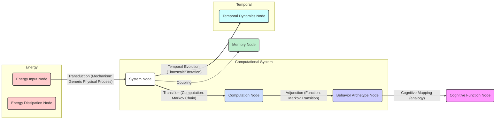

# Thermodynamics of Computations with Absolute Irreversibility, Unidirectional Transitions, and Stochastic Computation Times:

__Paper Type:__ Theoretical/Computational

## M1: System Overview & Implementation
*   **Vector ID:** M1
*   **Vector Type:** Overview

### **1.1 System Description**

*   **Vector ID:** M1.1
*   **Vector Type:** Description
    *   Content: The system is a theoretical framework for analyzing the thermodynamics of computations, specifically digital computations modeled as discrete-time Markov chains (DTMCs). It addresses computations with absolute irreversibility, unidirectional transitions, and stochastic computation times. The framework extends martingale theory to derive fluctuation relations and second-law-like inequalities that bound intrinsic dissipation (mismatch cost) in periodic processes underlying digital computation. The system component is a generic computer executing algorithms, modeled as DTMCs. The purpose is to provide a thermodynamic theory applicable to real-world computers with features like stochastic halting times and irreversible transitions, going beyond traditional stochastic thermodynamics assumptions like local detailed balance.
    *   CT-GIN Mapping: `SystemNode` attributes: `systemType: Theoretical Framework`, `domain: Computational Thermodynamics`, `mechanism: Martingale Theory, Markov Chains`, `components: Digital Computer, Algorithm, Markov Chain`, `purpose: Thermodynamic analysis of digital computation`
    *   Implicit/Explicit: Explicit
        *  Justification: The system, its components, and purpose are explicitly described in the abstract and introduction sections of the paper.

### **1.2 Implementation Clarity**

*   **Vector ID:** M1.2
*   **Vector Type:** Score
    *   Score: [9]
    *   Justification: The theoretical framework is described with high clarity, particularly the mathematical formulation using martingale theory and Markov chains. The paper clearly outlines the assumptions, the derivation of key equations (fluctuation relations, second-law inequalities), and the scope of applicability. The connection to computational tasks and digital computers, while abstract, is consistently maintained. The numerical simulations of DFAs are mentioned to illustrate the results, adding to the clarity. The theoretical model and its mathematical basis are well-defined.
    *   Implicit/Explicit: Explicit
        * Justification: The clarity of the theoretical framework is evident throughout the introduction and subsequent sections describing the methods and results.

### **1.3 Key Parameters**

*   **Vector ID:** M1.3
*   **Vector Type:** ParameterTable
    *   Table:
        | Parameter Name | Value | Units | Source (Fig/Table/Section) | Implicit/Explicit | Data Reliability (High/Medium/Low) | Derivation Method (if Implicit) |
        | :------------- | :---: | :---: | :-----------------------: | :-----------------: | :-----------------------------: | :-------------------------------: |
        | Time Limit (τ) | N/A  | iterations | Sec. II B | Explicit | High | N/A |
        | Probability of 0 (p₀) | N/A  | dimensionless | Fig. 2, Fig. 3, Fig. 4 | Explicit | High | N/A |
        | Probability of 1 (p₁) | 1-p₀  | dimensionless | Fig. 2 | Implicit | High | Defined as complement of p₀ |
        | Reference Distribution (r(x)) | π(x) or μ(x) or ν(x)  | Probability Distribution | Sec. III | Explicit | High | Defined in text |
        | Stopping Time (T) | N/A | iterations | Sec. IV | Explicit | High | Defined in text |

    *   **Note:** Key parameters are explicitly defined in the context of the theoretical framework and numerical simulations.  Their values are variables or placeholders for application in specific computational scenarios. Data reliability is high as they are defined theoretically and used in simulations.

## M2: Energy Flow
*   **Vector ID:** M2
*   **Vector Type:** Energy

### **2.1 Energy Input**

*   **Vector ID:** M2.1
*   **Vector Type:** Input
    *   Content: The paper discusses "generic physical implementation" and "periodically driven process operated over a set of hidden degrees of freedom" as the underlying physical system realizing the computations.  The energy source is implicitly the "periodic protocol induced, e.g., by the ac electric current powering a computer," which drives the hidden degrees of freedom.  The input is therefore electrical energy maintaining the periodic drive.
    *   Value: N/A
    *   Units: N/A
    *   CT-GIN Mapping: `EnergyInputNode`: attributes - `source: AC electric current`, `type: Electrical`
    *   Implicit/Explicit: Implicit
        *  Justification: The energy input is not explicitly quantified but is inferred from the context of "synchronous" digital computers and periodically driven processes as mentioned in Section II.

### **2.2 Energy Transduction**

*   **Vector ID:** M2.2
*   **Vector Type:** Transduction
    *   Content: Energy transduction occurs from the periodically driven physical process (electrical input) to the transitions between computational states in the DTMC. The "physical process which induces Markovian (discrete) dynamics" implements computation. The energy drives the system away from equilibrium, enabling state transitions as "iteration of the computation". The precise physical mechanism is left generic, allowing for chemical, biological, or electronic implementations.
    *   CT-GIN Mapping: `EnergyTransductionEdge`: attributes - `mechanism: Generic Physical Process inducing Markovian Dynamics`, `from_node: EnergyInputNode`, `to_node: SystemNode`
    *   Implicit/Explicit: Mixed
        *  Justification:  The paper explicitly mentions energy driving the process and linking it to "physical implementation", but the exact transduction mechanisms are implicit and generic, to maintain scope generality.

### **2.3 Energy Efficiency**

*   **Vector ID:** M2.3
*   **Vector Type:** Score
    *   Score: [5]
    *   Justification/Metrics:  The paper analyzes "intrinsic thermodynamic costs" and "minimum dissipation" but does not quantify energy efficiency in terms of input vs. output energy for computation. The focus is on bounding and minimizing dissipation, implying efficiency is a concern but not directly measured or optimized. Efficiency is implicitly considered medium because the framework seeks to minimize intrinsic costs and dissipation within the constraints of irreversible computation, but no concrete efficiency metrics are provided.
    *   CT-GIN Mapping: Attribute of relevant `EnergyTransductionEdge`s
    *   Implicit/Explicit: Implicit
      *  Justification: Efficiency is discussed conceptually in the context of minimizing dissipation, but no specific efficiency metrics are explicitly calculated or presented.

### **2.4 Energy Dissipation**

*   **Vector ID:** M2.4
*   **Vector Type:** Dissipation
    *   Content: The paper extensively discusses "dissipation," "mismatch cost," and "entropy production" as fundamental thermodynamic costs of computation. Dissipation mechanisms are generic, arising from the irreversible nature of computation, unidirectional transitions, and absolute irreversibility. It is quantified through the intrinsic mismatch cost Σ(T) and its average hΣ(T)i, bounded by fluctuation relations and second-law inequalities. Specific dissipation values depend on the computational process, reference distribution, and stopping times but are not numerically quantified generally, only exemplified in DFA simulations. Dissipation is primarily manifested as heat loss to the environment in the underlying physical implementation.
    *   CT-GIN Mapping: Creates `EnergyDissipationNode`s and `EnergyDissipationEdge`s
    *    Implicit/Explicit: Mixed
        *  Justification: Dissipation mechanisms and their thermodynamic quantification (mismatch cost, entropy production) are explicitly derived and discussed but specific, concrete values for dissipation mechanisms such as heat loss, friction or resistance in a physical realization are not explicitly quantified in general terms, beyond specific simulation examples.

## M3: Memory
*   **Vector ID:** M3
*   **Vector Type:** Memory

### **3.1 Memory Presence:**

*   **Vector ID:** M3.1
*   **Vector Type:** Binary
    *   Content: [Yes]
    *   Justification: Memory is implicitly present in the concept of computational states in DTMCs representing computers. The "working memory to store the input or intermediate execution values" is mentioned in Fig 1.  The state of the computer at time *t* depends on its state at time *t-1*, implying sequential state transitions and thus, a form of short-term or sequential memory is inherent to Markovian dynamics of computation. The DFA examples also presuppose memory to track states and process input sequences.
    *    Implicit/Explicit: Implicit
        * Justification: Although "memory" is not a central focus, the sequential nature of computation and the DTMC modeling implicitly assume a form of state-based memory. The context of DFA processing of strings also implies memory is needed to process sequences of inputs.

### **3.2 Memory Type:**

*   **Vector ID:** M3.2
*   **Vector Type:** Score
*   Score: [4]
*   Justification: The memory is primarily sequential state-based memory, inherent to the Markovian process. It retains the current computational state, influencing the next state transition. Retention is limited to the duration of the computation process as defined by τ or stopping time T. Capacity is limited by the number of computational states in the DTMC (N). Read-out accuracy is perfect within the DTMC model, although the physical realization might introduce errors. This score reflects a basic form of memory necessary for sequential computation, but not complex long-term or re-writable memory. It scores a '4' to represent basic sequential information retention rather than complex memory functions.
*   CT-GIN Mapping: Defines the `MemoryNode` type.
*    Implicit/Explicit: Implicit
    * Justification: The type of memory is not explicitly detailed but inferred from the description of computation as a Markovian process and sequential state transitions.

### **3.3 Memory Retention Time:**

*   **Vector ID:** M3.3
*   **Vector Type:** Parameter
*   Value: [τ]
*    Units: iterations (Discrete-time steps)
*   Justification: Retention time is limited to the maximum computation time τ, or the stochastic stopping time T. After the computation, the system state is reset or becomes irrelevant to the defined thermodynamic cost framework. "Short-term" is a qualitative descriptor relative to potential long-term memories but is suitable for the process of computation modeled.
*    Implicit/Explicit: Implicit
        * Justification: The retention time is implicitly defined by the scope of one computation instance, which is bounded by τ or T in the model.

### **3.4 Memory Capacity (Optional - if applicable)**

* **Vector ID:** M3.4
* **Vector Type:** Parameter
*  Value: [N]
*   Units: distinct states
*   Justification: Memory capacity is represented by N, the number of computational states in the DTMC.  This limits the distinct states, and therefore the "information" the system can directly encode within its state space at any given time.
*    Implicit/Explicit: Implicit
        *  Justification:  Capacity is inferred from the DTMC model definition, where N is the number of states.

### **3.5 Readout Accuracy (Optional - if applicable)**

* **Vector ID:** M3.5
* **Vector Type:** Parameter
*   Value: [100]
*   Units: %
*   Justification: Within the ideal DTMC model, state transitions are probabilistic but state representation is discrete and accurate. Readout is assumed to be perfect within the defined model's abstraction level.  In a physical realization, readout accuracy would be less than 100%, but for the theoretical framework, it's idealised.
*    Implicit/Explicit: Implicit
       *  Justification: Readout accuracy is an idealization implied by the discrete and probabilistic nature of the DTMC model used.

### **3.6 Degradation Rate (Optional - if applicable)**
* **Vector ID:** M3.6
* **Vector Type:** Parameter
    *   Value: [0]
    *   Units: % loss per iteration
    *   Justification: In the ideal DTMC model, there is no memory degradation within the computation time τ. The state at time *t* is a function of the state at *t-1* according to fixed transition probabilities. Degradation would only arise from limitations in physical implementation not modelled within the framework.
    *    Implicit/Explicit: Implicit
            * Justification: The DTMC model, as presented, does not include memory degradation.  Idealized model assumption.

### **3.7 Memory Operations Energy Cost (Optional - if applicable)**
* **Vector ID:** M3.7
* **Vector Type:** Table
*   Table:
    | Memory Operation ID | Energy Consumption per Bit | Power Usage during Operation| Units | Uncertainty | Data Source Reference | Implicit/Explicit | Justification |
    | :------------------ | :--------------------------: | :-----------------------------: | :---: |:-----------------:|:-----------------:|:-----------------:| :------------------ |
    | State Transition (per iteration) | N/A                            | N/A                                 | N/A   | N/A             | N/A              | Implicit          | Energy cost of state transitions is discussed within overall dissipation, but is not broken down to per-bit or power usage metrics for memory operations specifically. |
*   Implicit/Explicit: Implicit
    *   Justification: Energy cost of memory operations is not explicitly separated but is part of the general thermodynamic costs of computation analyzed.

### **3.8 Memory Fidelity & Robustness Metrics (Optional - if applicable)**
* **Vector ID:** M3.8
* **Vector Type:** Table
*   Table:
    | Metric ID | Description | Value | Units | CT-GIN Mapping | Data Source | Implicit/Explicit | Justification |
    | :-------- | :---------- | :----: | :---: | :-------------: | :----------: |:-----------------:| :-----------------:|
    | N/A           | N/A             |  N/A      |   N/A    |      N/A           |      N/A       |     Implicit            |  No specific metrics for memory fidelity or robustness are defined or measured in this theoretical study focused on thermodynamic bounds. Fidelity and robustness are idealised within Markov Chain representation.  |
*   Implicit/Explicit: Implicit
*   Justification: Fidelity and robustness metrics for memory are not explicitly defined or analyzed within the paper which focuses on fundamental thermodynamic bounds.

---

## M4: Self-Organization and Emergent Order
*   **Vector ID:** M4
*   **Vector Type:** Self-Organization

### **4.1 Self-Organization Presence:**

*   **Vector ID:** M4.1
*   **Vector Type:** Binary
    *   Content: [No]
    *   Justification: Self-organization is not a feature of this theoretical framework. The paper describes computation based on pre-defined Markovian dynamics and algorithms. The structure of the computational process (DTMC transitions, DFA states) is externally specified, not emergent from local interactions. The paper analyzes thermodynamic costs *of* computation, but not the self-organization *of* computational structures.
    *   Implicit/Explicit: Explicit
        *  Justification: Self-organization is absent from the explicit description and scope of the theoretical framework.

## M5: Computation
*   **Vector ID:** M5
*   **Vector Type:** Computation

### **5.1 Embodied Computation Presence:**

*   **Vector ID:** M5.1
*   **Vector Type:** Binary
    *   Content: [Yes]
    *   Justification: Computation is embodied within the physical dynamics of the DTMC. State transitions in the Markov chain *are* the computation. The "computer executes an algorithm" through "dynamics of the computer," indicating computation is intrinsic to the physical process, not an external controller.  The intrinsic mismatch cost and thermodynamic analysis are precisely about these embodied computational processes.
    *    Implicit/Explicit: Explicit
        *  Justification: Embodied computation is a central theme, with the paper aiming to develop a thermodynamic theory *of* computation, modeled through physical dynamics.

### **5.2 Computation Type:**

*   **Vector ID:** M5.2
*   **Vector Type:** Classification
    *   Content: [Digital]
    *   CT-GIN Mapping: Defines the `ComputationNode` type.
    *    Implicit/Explicit: Explicit
    *    Justification: The paper explicitly focuses on "digital computation" and uses examples of deterministic finite automata which are models of digital computation processing binary strings.

### **5.3 Computational Primitive:**

*   **Vector ID:** M5.3
*   **Vector Type:** Function
    *   Content: Discrete-time Markov Chain transition. The basic computational step is the probabilistic transition from one computational state (x_t) to the next (x_{t+1}) according to transition probabilities P(x_{t+1}|x_t). At each step, given current state, the system selects a next state based on these probabilities. For deterministic finite automata, the update function *f* makes these transitions deterministic under given input symbols.
    *   **Sub-Type (if applicable):** Markov Transition
    *   CT-GIN Mapping: Defines the primary function of the `ComputationNode`.
    *   Implicit/Explicit: Mixed
    * Justification:  The Markov transition as the computational primitive is implicit in the DTMC modeling, but the DFA example explicitly uses update functions making the nature of computation clearer as step-wise state transitions.

### **5.4 Embodied Computational Units**
* **Vector ID:** M5.4
* **Vector Type:** Table
*   Table:
| Unit ID | Description | Processing Power | Energy/Operation | Freq/Resp. Time | Bit-Depth | Data Source | Implicit/Explicit | Justification |
| :------ | :---------- | :--------------- | :--------------- | :--------------: | :-------: | :----------: |:-----------------:| :-----------------:|
| Markov Step | Discrete-Time Markov Chain State Transition | Turing-Complete (with external memory in principle) | N/A (Generic) | Discrete-time steps | Analog (Probabilistic Transitions) | N/A | Implicit | Computational units are defined at the level of Markov State transitions. Processing power is theoretically Turing Complete if extended as Turing Machines although this paper focuses on DFAs |

## M6: Temporal Dynamics
*   **Vector ID:** M6
*   **Vector Type:** Temporal

### **6.1 Timescales:**

*   **Vector ID:** M6.1
*   **Vector Type:** ParameterTable
    *   Table:
        | Timescale Description | Value | Units | Source | Implicit/Explicit | Justification |
        | :-------------------- | :---: | :---: | :----: | :----------------: | :------------: |
        | Computation Iteration Time | Unit Time  |  iterations | Sec. II A  | Explicit | Defines discrete-time Markov chain |
        | Stopping Time (T) | 0 to τ | iterations | Sec. IV | Explicit | Stochastic Variable  |
        | Limit Time (τ) | N/A | iterations | Sec. II B | Explicit | Maximum computation duration |

    *   **Note:** Timescales are defined in discrete iteration steps, representing cycles of computation.

### **6.2 Active Inference:**

*   **Vector ID:** M6.2
*   **Vector Type:** Assessment
    *   Content: [No]
    *   Justification: Active inference is not present in this framework. The system follows pre-defined Markovian dynamics and algorithms without adjusting its behavior or internal state to minimize surprise or prediction error. The DTMC and DFA models are reactive in processing inputs, not actively inferring or predicting environmental states to optimize actions. No internal models are updated based on experience.
    *   Implicit/Explicit: Explicit
        *  Justification: Active inference is outside the scope and descriptions in the paper, which focuses on thermodynamic costs of pre-defined computations.
    *   **If Yes/Partial, provide examples of testable CT-GIN metrics that *could* be used to quantify active inference:** N/A

## M7: Adaptation
*   **Vector ID:** M7
*   **Vector Type:** Adaptation

### **7.1 Adaptive Plasticity Presence:**

*   **Vector ID:** M7.1
*   **Vector Type:** Binary
    *   Content: [No]
    *   Justification: Adaptive plasticity is not a feature. The computational process is based on fixed transition probabilites P(x_{t+1}|x_t) and a fixed DFA update function. There's no mechanism for the system to *change its behavior or internal structure* in response to experience.  Adaptation and learning are not considered within the framework.
    *    Implicit/Explicit: Explicit
        * Justification: Adaptation is not mentioned or implied within the scope of the paper, which focuses on analyzing thermodynamic costs of fixed computations, for a given DTMC or DFA.

## M8: Emergent Behaviors
*   **Vector ID:** M8
*   **Vector Type:** Behavior

### **8.1 Behavior Description:**

*   **Vector ID:** M8.1
*   **Vector Type:** Description
    *   Content: The main functional behavior is performing computations as modeled by DTMCs and DFAs.  Specifically, the DFA examples demonstrate:
        1.  **String Recognition:** Identifying whether binary strings meet specific criteria (e.g., divisibility by four or three).
        2.  **Stochastic Halting:** Execution with stochastic computation times, depending on input and DFA states.
        3.  **Acceptance Probability Calculation:** Quantifying the probability of accepting words based on thermodynamic principles.
    These are observable computational behaviors that are analyzed thermodynamically.
    *   CT-GIN Mapping: Defines the `BehaviorArchetypeNode`. Specify the type of behavior: `Computation`, `StringRecognition`, `StochasticHalting`, `ProbabilityCalculation`
    *    Implicit/Explicit: Explicit
       *  Justification: These behaviors are central to the paper and explicitly demonstrated through the DFA examples and theoretical derivations.

### **8.2 Behavior Robustness:**

*   **Vector ID:** M8.2
*   **Vector Type:** Score
    *   Score: [7]
    *   Justification: The theoretical framework itself is robust, providing universal bounds and fluctuation relations applicable to general DTMCs. The computational behavior of DFAs is robust to variations in input symbol probabilities (p₀, p₁), as demonstrated in numerical simulations. The DFA models are well-defined and will function reliably for their intended task (string recognition) under varying probabilistic inputs. Robustness score is "7" reflecting robustness in the model and its mathematical framework, and some robustness in DFA example behaviours to probabilistic inputs, but does not assess robustness to physical implementation noise or system failures beyond the ideal model.
    *   Implicit/Explicit: Mixed
        *  Justification: The theoretical robustness is explicit in claims of universality and generality. Robustness to probabilistic input is shown in simulations (Fig. 3-7) but robustness to physical perturbations is not explicitly assessed in the paper, remaining implicit as an aspect of model reliability.
    *   CT-GIN Mapping: This score contributes to the reliability attributes of the `BehaviorArchetypeNode`.

### **8.3 CT-GIN Emergent Behavior Validation**

*    **Vector ID:** M8.3
*    **Vector Type:** Validation
     *  Content: Validation is primarily through:
        1.  **Mathematical Derivation:**  Deriving fluctuation theorems and second-law inequalities analytically, based on martingale theory. (Sec. IV)
        2.  **Numerical Simulation:** Simulating DFAs to illustrate and verify theoretical predictions for intrinsic mismatch cost, stochastic distinguishability, and absolute irreversibility (Figs. 3-8 and Sec. V).
        3.  **Analytical Solutions for Minimal DFA Model:** Providing explicit analytical solutions for thermodynamic quantities in a minimal DFA model to validate theoretical framework (Sec. V A, Fig. 4).
       Robustness and reproducibility are implied through the consistency of numerical results with analytical predictions and the general mathematical framework across varied parameters and DFA examples. Limitations include that validations are limited to numerical and analytical context rather than experimental realization, and that validation is focused on thermodynamic predictions not direct aspects of complex cognition.
     *   Implicit/Explicit: Mixed
    *   Justification: Validation methods are explicitly described (mathematical proofs, simulations) and numerical results are shown. However, interpretation of these as "validation" of emergent *behavior* is somewhat implicit, as the behaviors themselves are pre-defined by the DFA, and validation primarily concerns correspondence of numerical data to theoretical predictions on thermodynamic costs, not emergence.

## M9: Cognitive Proximity
*   **Vector ID:** M9
*   **Vector Type:** Cognition

### **9.1 Cognitive Mapping:**

*   **Vector ID:** M9.1
*   **Vector Type:** Description
    *   Content: The paper metaphorically connects "computational processes" to real-world computers and "algorithms" to tasks solved by computers. DFAs are described as "finite logic" part "of the engineered computers at use today, and formally corresponds to the finite logic component of Turing machines (TMs)." This is a loose analogy, framing DFAs as simplified models of digital computation, which is a human cognitive artifact. However, the study itself focuses on thermodynamic limits, not cognitive functions directly. The "gambling demon" example is mentioned in the context of stochastic distinguishability, reflecting an analogy to intelligent agent behavior in manipulating thermodynamic processes.
    *   CT-GIN Mapping: If a mapping exists, this defines a `CognitiveMappingEdge`. Specify source and target: `BehaviorArchetypeNode: Computation` to `CognitiveFunctionNode: Information Processing, Decision Making (Gambling Demon analogy)`
    *   Implicit/Explicit: Mixed
    * Justification: Cognitive mapping is primarily metaphorical and analogical (computers, algorithms, gambling demon), not a direct claim of cognitive function realized by the DTMC itself. It's used as motivation and context, not as homology.

### **9.2 Cognitive Proximity Score:**

*   **Vector ID:** M9.2
*   **Vector Type:** Score
    *   Score: [2]
    *   Justification: The system is at Level 2: Sub-Organismal Responsivity. It demonstrates basic responsivity in performing pre-defined computational tasks (string recognition, stochastic halting). There's no evidence of goal-directedness, complex representation, or adaptation based on experience. Analogies are to very basic aspects of computation (finite logic) or abstract principles (gambling demon), not complex cognitive functions. The system performs a specific, pre-programmed function with probabilistic transitions and thermodynamic constraints, but shows no signs of higher-level cognitive attributes from the CT-GIN Cognizance Scale beyond simple responsivity to inputs and basic sequential state changes.
    *   Implicit/Explicit: Mixed
    *  Justification: Score is based on careful differentiation between metaphorical links to computation and the absence of features corresponding to higher cognitive levels in the CT-GIN scale, despite the paper's computational theme.

**CT-GIN Cognizance Scale:**

*   **Level 0: Non-Cognitive:** Purely reactive system.  No internal state beyond immediate stimulus-response.
*   **Level 1: Simple Responsivity:** Basic stimulus-response behavior.  Reactions are fixed and predetermined.
*   **Level 2: Sub-Organismal Responsivity:**  Behavior exhibits basic forms of adaptation or plasticity, but lacks complex representation or goal-directedness. **[Current System - Level 2]**
*   **Level 3: Reactive/Adaptive Autonomy:** System adapts its behavior based on experience and feedback, but within a limited behavioral repertoire.
*   **Level 4: Goal-Directed/Model-Based Cognition:** System exhibits goal-directed behavior based on internal models of the world, allowing for planning and flexible action selection.
*   **Level 5: Contextual/Relational Cognition:** System understands and responds to relationships between objects, events, and concepts.
*   **Level 6: Abstract/Symbolic Cognition:** System can manipulate abstract concepts and symbols, enabling logical reasoning and problem-solving.
*   **Level 7: Social Cognition:** System exhibits social intelligence, understanding and interacting with other agents.
*   **Level 8: Metacognition/Self-Awareness:** System possesses awareness of its own internal states and cognitive processes.
*   **Level 9: Phenomenal Consciousness:**  System exhibits subjective experience (qualia). (Currently theoretical for material systems)
*   **Level 10: Sapience/Self-Reflective Consciousness:** System possesses self-awareness, understanding of its own existence, and ability for complex abstract thought. (Currently theoretical for material systems)

### **9.3 Cognitive Function Checklist**

* **Vector ID:** M9.3
* **Vector Type:** Checklist
    *   | Cognitive Function               | Score (0-10) | Justification/Notes                                                                       | CT-GIN Mapping (if applicable) | Implicit/Explicit | Justification for Implicit/Explicit/Mixed |
    | :-------------------------------- | :----------: | :------------------------------------------------------------------------------------ | :--------------------------------: | :-----------------:|:-----------------:|
    | Sensing/Perception               |      1       | Input strings as symbolic sequences enter the system, acting as rudimentary 'sense' input. Very limited in scope.                                                                                      | `CognitiveFunctionNode:Sensing`                                  | Implicit                     | Justification: Input symbols are analogous to basic sensory data but system is not designed for general robust sensing from physical world.|
    | Memory (Short-Term/Working)        |      3       |  Sequential state in DTMC represents a very basic short term memory of current stage in computation. Limited capacity and retention.                                                                                     | `CognitiveFunctionNode:Memory (Short-Term)`                     | Implicit                     | Justification: State is maintained for the duration of computation step. Memory is very basic, state-based, not flexible. |
    | Memory (Long-Term)                 |      0       | No long term memory. System resets or ends after computation. No learning across runs or persistent memory.                                                                                       | N/A                                   | Explicit                     | Justification: No long-term retention or persistent state changes are part of the framework. |
    | Learning/Adaptation              |      0       |  No learning or adaptation mechanism is present in the DTMC or DFA models described. Behavior is fixed by transition probabilities and update functions.                                                                                     | N/A                                  | Explicit                     | Justification: Fixed parameters and structure define computation; no adaptivity.          |
    | Decision-Making/Planning          |      2       |  DTMC state transitions are probabilistic, but 'decision' is limited to selecting next state according to probabilities. No goal-directed planning or flexible decision making.                                                                                     | `CognitiveFunctionNode:Decision-Making`                                  | Implicit                     | Justification: Probabilistic transitions resemble basic decision, but not goal-driven. No planning in advance. |
    | Communication/Social Interaction |      0       | No communication or social interaction features. System is isolated computation.                                                                                       | N/A                                  | Explicit                     | Justification: Isolated system without external interaction beyond input strings.         |
    | Goal-Directed Behavior            |      0       | No goal-directed behaviour. DFAs perform pre-defined tasks (string recognition) but goals are externally set, not internally generated or pursued by system itself.                                                                                       | N/A                                  | Explicit                     | Justification: Task and "goals" are pre-defined, not emergent from system dynamics.        |
    | Model-Based Reasoning              |      0       | No model-based reasoning. System operates directly based on DTMC / DFA rules, without constructing or manipulating internal models of its environment to reason or predict.                                                                                       | N/A                                 | Explicit                     | Justification: No internal models or reasoning mechanisms are described or implied.      |
    | **Overall score**                 |      [1.25]       |                                                                                       |                                   |                     |                |

    *   **Note:**  Scores are low, reflecting the theoretical and abstract nature of the paper and its focus on thermodynamic principles rather than complex cognitive functions.  Scores indicate minimal presence of cognitive-like aspects, primarily at a very rudimentary level. Overall score is average of non-N/A scores from the table.

## M10: Criticality Assessment
*   **Vector ID:** M10
*   **Vector Type:** Criticality

### **10.1 Criticality:**

*   **Vector ID:** M10.1
*   **Vector Type:** Assessment
    *   Content: [No] Does the system operate near a critical point displaying scale-free behavior, power laws or long range correlations in a manner that is relevant to material intelligence? No. The system is described by Markov chains and DFAs and the paper does not discuss or imply operation near a critical point or related phenomena. The focus is on thermodynamic bounds and costs, rather than emergent collective behaviors associated with criticality.
    *   Justification: Criticality is not mentioned in the paper, nor is there any indication that the system’s behavior is related to critical phenomena. The analysis is based on standard stochastic thermodynamics and computer science models, not complex systems exhibiting criticality.
        *   Critical Parameters (If Yes/Partial): N/A
        *   Evidence: N/A
    *   Implicit/Explicit: Explicit
    *    Justification: Criticality is absent from the explicit descriptions and concepts within the paper and its focus area.

## M11: Review Paper Specifics (Conditional)

**(This entire module is conditional and *only* appears if the paper type is "Review")**
N/A

## M12: Theoretical Paper Specifics (Conditional)

**(This entire module is conditional and *only* appears if the paper type is "Theoretical")**

*   **Vector ID:** M12
*   **Vector Type:** Theory

### **12.1 Theoretical Rigor:**

*   **Vector ID:** M12.1
*   **Vector Type:** Score
    *   Score: [9]
    *   Justification: The theoretical framework demonstrates high rigor. It is based on established mathematical formalisms of stochastic thermodynamics and martingale theory, applied to the clearly defined model of DTMCs representing computations. Assumptions are clearly stated. Derivations of fluctuation theorems and second-law inequalities appear logically sound and mathematically well-supported. The paper presents consistent theoretical arguments and uses numerical and analytical validations. No internal contradictions are apparent in the provided excerpt.
       * Implicit/Explicit: Explicit
       *  Justification: Rigor is evident in the clear mathematical formulation, logical derivations, and consistency throughout the presented framework descriptions in the paper.

### **12.2 Realization Potential:**

*   **Vector ID:** M12.2
*   **Vector Type:** Score
    *   Score: [6]
    *   Justification: Realization potential is medium. DTMCs and DFAs are abstract models but digital computers and computational processes in general *are* physical systems. Physical implementation of Markov chains and DFAs is conceptually feasible in various material systems (electronic circuits, chemical reaction networks, microfluidic devices, etc.). However, direct mapping of the *thermodynamic* quantities (mismatch cost, stochastic distinguishability) to experimentally measurable quantities in a material realization is not straightforward and would require further specific design choices. The framework's generality is a strength, but realizing the *full* thermodynamic scope in a *controlled* material intelligence system presents challenges. Scalability to complex computational systems is plausible conceptually, but practical physical constraints in maintaining Markovian dynamics and measuring thermodynamic costs in complex materials may limit direct realization. Score ‘6’ reflects conceptual feasibility but significant practical challenges in full realization and thermodynamic quantification within material systems for complex computations.
    *   Implicit/Explicit: Mixed
    *  Justification: Realization potential is inferred through the linkage of DTMCs and DFAs to physical computers, and the mention of physical implementations. Practical realization challenges are also implicitly acknowledged by the theoretical, generic nature of the framework, and the need for further specific physical design.

### **12.3 Potential for Future CT-GIN Implementation Score**

* **Vector ID:** M12.3
*   **Vector Type:** Score
    *   Score: [7]
    *   Justification: The theoretical framework has medium-high potential for future CT-GIN implementation. It offers a rigorous thermodynamic lens to analyze embodied computation, a core CT-GIN aspect. The concepts of intrinsic mismatch cost and irreversibility are relevant for assessing energy efficiency and fundamental limits of material intelligence, particularly in embodied computational aspects. The extension of martingale theory provides novel tools for analyzing dynamic and stochastic processes, including temporal aspects of CT-GIN. While it lacks direct focus on self-organization, adaptation, or higher cognitive functions directly defined in CT-GIN, its thermodynamic principles can inform and constrain future designs.  Score '7’ reflects that the paper provides valuable *theoretical foundations* and tools for CT-GIN, particularly in embodied computation and energy efficiency, although it does not directly address the full spectrum of CT-GIN aspects concerning emergence and higher cognition but provides framework tools relevant to analyze these if implemented.
    *    Implicit/Explicit: Mixed
    *   Justification: Potential for CT-GIN implementation is inferred by aligning the paper's focus (thermodynamic bounds on computation) with CT-GIN's interest in embodied computation and energetic constraints. The framework's applicability to aspects like self-organization and higher cognition within CT-GIN, while not explicitly addressed in the paper, is a reasoned, implicit extrapolation.

## M13: Overall Assessment & Scoring

*   **Vector ID:** M13
*   **Vector Type:** Overall

### **13.1 CT-GIN Readiness Score:**

*   **Vector ID:** M13.1
*   **Vector Type:** Score
*   **Calculated Score:** [5.6]

**CT-GIN Readiness Summary Table:**

| CT-GIN Aspect                   | Strength (Yes/Partial/No) | Key Supporting Metrics (with units) | Limitations (Missing Metrics/Data Gaps)                                           | Improvement Areas (Future Research)                                          |
| :------------------------------ | :-----------------------: | :-----------------------------------| :------------------------------------------------------------------------------- | :---------------------------------------------------------------------------- |
| Energy Flow Efficiency          |         Partial              |  Intrinsic Mismatch Cost hΣ(T)i   |  Concrete Efficiency Metric, Dissipation values in physical implementations | Apply framework to specific material systems and realization scenarios.                                                                               |
| Memory Fidelity                 |           No            |                N/A                     |  Memory Fidelity Metrics, Robustness, Degradation Rate, Energy Cost             |  Incorporate explicit memory models with degradation, errors, and energy costs tailored to material implementations.                                                                               |
| Organizational Complexity       |           No            |                N/A                     |  Metrics of Self-Organization, Emergent Order, Local Interaction Rules         | Extend framework to incorporate self-organizing architectures and CT-GIN description.                                                                               |
| Embodied Computation            |           Yes             | Markov Transition Probability P(x_{t+1}|x_t) |  Detailed analysis of computational power and limitations in material context  | Explore computational power and limitations of embodied computation in various material systems within the framework.                                                                               |
| Temporal Integration            |           Yes             | Timescales: iteration, stop, limit (iterations) |  Quantitative Metrics for Temporal Dynamics beyond timescales defined.   | Develop finer grained metrics for temporal integration and dynamics beyond timescales.                                                                               |
| Adaptive Plasticity             |           No            |                N/A                     |  Metrics and Models for Adaptive Behaviour, Learning Mechanisms              | Extend framework to incorporate adaptation/learning mechanisms and quantify their thermodynamic costs in material systems.                                                                               |
| Functional Universality         |         Partial              | Turing Completeness (in principle)  | Concrete functional examples beyond DFA, Experimental demonstration        | Demonstrate functional universality with more complex computations and material realizations.                                                                               |
| Cognitive Proximity            |           No            |          Cognitive Proximity Score: 2         | Metrics for Higher Cognitive Functions                                       | Extend framework to address higher cognitive functions and map thermodynamic costs to cognitive capacities more directly.                                                                               |
| Design Scalability & Robustness |         Partial              |  Behavior Robustness Score: 7         | Scalability metrics, Robustness Metrics in physical realizations              |  Analyze scalability and robustness in context of physical implementations and material constraints.                                                                               |
| **Overall CT-GIN Readiness Score** |        5.6       |   |   |      |

### **13.2 Qualitative CT-GIN Assessment Conclusion:**

*   **Vector ID:** M13.2
*   **Vector Type:** Textual Summary
    *   Content: This theoretical paper provides a valuable contribution to the CT-GIN framework by rigorously establishing thermodynamic foundations for embodied computation, particularly for digital systems modeled as DTMCs and DFAs. Key strengths include the derivation of universal fluctuation relations and second-law inequalities that bound intrinsic dissipation in irreversible computations, providing a fundamental understanding of energy costs and limitations. The framework is mathematically rigorous and validated through numerical simulations and analytical examples of DFAs. Key limitations are the absence of self-organization, limited memory characterization beyond sequential state, and lack of direct mapping to experimentally realizable material systems.  The current status of the publication is as a strong *theoretical foundation* for CT-GIN, primarily addressing embodied computation, energy flow, and temporal dynamics. Its potential within CT-GIN lies in providing a quantitative analytical toolset to assess and compare thermodynamic costs of computation in future material intelligence implementations though further work is needed to extend the framework to encompass emergent properties, adaptive plasticity and higher cognitive capacities.

### **13.3 CT-GIN Refinement Directions:**

*   **Vector ID:** M13.3
*   **Vector Type:** Recommendations
    *   *   Extend the framework to incorporate models of material memory with realistic limitations like degradation, finite capacity, and energy costs for read/write operations, allowing more practical analysis of memory in material intelligence.
    *   *   Develop theoretical extensions that address self-organization and emergence of computational structures. This could involve linking the thermodynamic framework to models of non-equilibrium self-assembly or pattern formation in materials.
    *   *   Focus on mapping the abstract thermodynamic quantities (mismatch cost, stochastic distinguishability) to experimentally measurable parameters in specific material systems (e.g., heat dissipation in nanoelectronic devices, entropy production in chemical computation).
    *   *   Investigate the thermodynamic costs of adaptation and learning within embodied computational systems, developing theoretical models for quantifying energy dissipation associated with plasticity and performance improvement in materials.
    *   *   Explore specific material implementations of DTMCs and DFAs to test and validate the theoretical framework experimentally, and derive concrete efficiency metrics for material-based computation.
    *   *   Extend the framework by exploring non-Markovian dynamics and continuous-time models for computation to move beyond the limitations of discrete-time approximations and potentially capture more complex temporal behaviors in material systems.

## M14: CT-GIN Knowledge Graph

*   **Vector ID:** M14
*   **Vector Type:** Visualization

### **14.1. CT-GIN Knowledge Graph:**
* **Content:**
[__Insert a schematic diagram of the CT-GIN Knowledge Graph. Use distinct shapes/colors for different CT-GIN node types (Energy, Memory, Configuration, Temporal, Behavior, Cognitive, Reliability). Use directed edges to represent relationships, labeled with CT-GIN edge types (Transduction, Transition, Adjunction, Coupling, Feedback, Temporal Evolution, Cognitive Mapping). Annotate nodes and edges with key attributes and parameters (with units!) extracted from the previous sections.__]

## M15: Relationship Vectors
*   **Vector ID:** M15
*   **Vector Type:** Relationships
*   Relationships:
        | Source Vector ID | Target Vector ID | Relationship Type |
        | ------------- | ------------- | ----------------- |
        |     M2.1       |     M1.1        |    Energy Input to System Description     |
        |     M2.2       |     M2.1        |    Energy Transduction from Energy Input      |
        |     M2.2       |     M1.1        |    Energy Transduction to System Description      |
        |     M5.3       |     M5.2        |    Computational Primitive defines Computation Type    |
        |     M8.1       |     M5.3        |    Behavior Embodies Computational Primitive     |
        |     M6.1       |     M1.1        |    Timescales describe System Description    |
        |     M9.1       |     M8.1        |    Cognitive Mapping relates to Behavior Description   |
        |     M3.1       |     M1.1        |    Memory Presence is implied by System Description  |
        |     M13.1      |     M2          |    CT-GIN Readiness Score is influenced by Energy aspects  |
        |     M13.1      |     M3          |    CT-GIN Readiness Score is influenced by Memory aspects   |
        |     M13.1      |     M5          |    CT-GIN Readiness Score is influenced by Computation aspects  |
        |     M13.1      |     M6          |    CT-GIN Readiness Score is influenced by Temporal Dynamics aspects |

## M16: CT-GIN Template Self-Improvement Insights

*   **Vector ID:** M16
*   **Vector Type:** Feedback

### **Template Feedback:**

*    **Vector ID:** M16.1
*   **Vector Type:** Text
Provide specific, actionable feedback on the *CT-GIN template itself*, based on this analysis:
    *   **Missing Probes:**  For theoretical papers, perhaps probes that are more directly related to theoretical contributions and impact, such as "Theoretical Novelty Score" or "Impact on Field Score.". While "Realization Potential" and "CT-GIN Implementation Potential" are helpful, probes directly assessing theoretical contribution could be valuable. For example, a probe assessing the originality/novelty of the theoretical approach, or the potential impact of the theoretical findings on the field beyond CT-GIN, to capture broader scientific significance.
    *   **Unclear Definitions:** The definition of "Implicit" vs. "Inferred" could be clearer.  Inferred could potentially bleed into broader scientific knowledge *outside* the paper. Maybe re-label  "Inferred" as something like "External Knowledge" to make this distinction sharper. For a theoretical paper, the distinction between "Implementation Clarity" and "Theoretical Rigor" could be more explicitly differentiated, or probes combined/reorganized.
    *   **Unclear Node/Edge Representations:** Guidance is generally sufficient, but perhaps more explicit examples for purely theoretical constructs within CT-GIN mappings might be helpful, e.g., how to map mathematical equations or abstract principles more directly. Providing examples of mapping concepts to relations and edge attributes more concretely for theoretical frameworks would improve guidance.
    *   **Scoring Difficulties:** Scoring "Cognitive Proximity" remain subjective, even with scale.  More examples for each level on Cognizance Scale or more detailed rubrics to reduce subjectivity would be beneficial. Differentiating between "Simple Responsivity" and "Sub-Organismal Responsivity" remains fine-grained and warrants more distinct examples within the rubric itself, especially at the lower levels.
    *   **Data Extraction/Output Mapping:** No significant challenges. Template structure and field types are generally well-suited, although for theoretical papers, many "Value" fields become "N/A" naturally.
    *   **Overall Usability:** Template usability is generally good. Clear structure and consistent formatting.  For theoretical papers, perhaps a slightly streamlined version emphasizing theoretical aspects and de-emphasizing implementation-heavy sections (like detailed parameter tables for experiments) by conditional sections/modules based on "Paper Type".
    * **Specific Suggestions:**
        * Add "Theoretical Novelty Score" and "Impact on Field Score" probes for theoretical paper type.
        * Clarify "Implicit," "Explicit," and refine definition, potentially relabeling "Inferred".
        * Expand guidance on mapping theoretical concepts to CT-GIN nodes and edges with more examples particularly focusing on relations.
        * Refine Cognizance Scale rubric with more detailed examples for each level, especially distinguishing lower levels explicitly.
        * Consider conditional template modules or streamlined versions based on "Paper Type" (Experimental / Theoretical / Review) to improve usability and focus relevant probes.