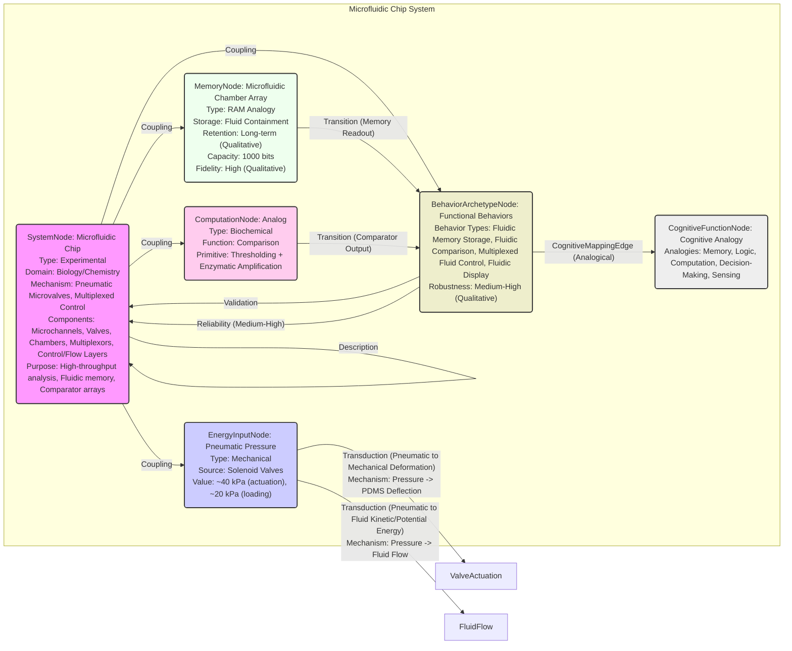

# Microfluidic Large-Scale Integration

__Paper Type:__ Experimental

## M1: System Overview & Implementation
*   **Vector ID:** M1
*   **Vector Type:** Overview

### **1.1 System Description**

*   **Vector ID:** M1.1
*   **Vector Type:** Description
    *   Content: The system is a high-density microfluidic chip fabricated using multilayer soft lithography techniques with polydimethylsiloxane (PDMS). It integrates thousands of micromechanical valves and hundreds of individually addressable chambers, creating fluidic plumbing networks analogous to electronic large-scale integrated circuits.  Key components include fluidic multiplexors, combinatorial arrays of binary valve patterns, which allow complex fluid manipulation with a minimal number of inputs.  The purpose is to create scalable microfluidic devices for complex biological and chemical analyses, exemplified by a microfluidic memory storage device (1000 chambers) and a comparator array (256 comparators).
    *   CT-GIN Mapping: `SystemNode` attributes: `systemType: Microfluidic Chip`, `domain: Biology/Chemistry`, `mechanism: Pneumatic Microvalves, Multiplexed Control`, `components: Microchannels, Valves, Chambers, Multiplexors, Control Layers, Flow Layers`, `purpose: High-throughput biological/chemical analysis, Fluidic memory, Comparator arrays`.
    *   Implicit/Explicit: Explicit
        *  Justification: The description of the system's components, purpose, and analogy to electronic integrated circuits is explicitly stated in the abstract and introduction sections of the paper.

### **1.2 Implementation Clarity**

*   **Vector ID:** M1.2
*   **Vector Type:** Score
    *   Score: [8]
    *   Justification: The implementation is described in considerable detail, including materials (PDMS), fabrication methods (multilayer soft lithography), and key design features (multiplexors, control and flow layers, valve actuation mechanisms, chamber arrays). Figures are referenced (Fig. 1, 2, 3, 4) that visually aid understanding.  The function of multiplexors and valve control is clearly explained. However, some fabrication details, like specific photoresist types and etching processes if any, are not fully elaborated in the excerpt. The exact dimensions and tolerances are not exhaustively listed, which would be needed for perfect replication.
    *   Implicit/Explicit: Mixed
        * Justification: The overall implementation strategy and key components are explicitly described and visually supported. Some finer details of fabrication and exact parameters are implicit, assumed to be within standard soft lithography practices or omitted for brevity in this excerpt. Reference to previous work (10, 11, 13) suggests further detailed methodological information is available elsewhere.

### **1.3 Key Parameters**

*   **Vector ID:** M1.3
*   **Vector Type:** ParameterTable
    *   Table:
        | Parameter Name | Value | Units | Source (Fig/Table/Section) | Implicit/Explicit | Data Reliability (High/Medium/Low) | Derivation Method (if Implicit) |
        | :------------- | :---: | :---: | :-----------------------: | :-----------------: | :-----------------------------: | :-------------------------------: |
        | Valve Actuation Pressure | ~40 | kPa | Section: Device Fabrication | Explicit | High | N/A |
        | Flow Channel Width | 100 | µm | Section: Device Fabrication | Explicit | High | N/A |
        | Flow Channel Height | 9 | µm | Section: Device Fabrication | Explicit | High | N/A |
        | Chamber Volume (Memory) | 250 | pL | Section: Memory Device | Explicit | High | N/A |
        | Number of Valves (Device 2) | 2056 | - | Section: Comparator Device | Explicit | High | N/A |

    *   **Note:** List *up to 5* key parameters characterizing the system's *implementation*.  Provide values and units if possible. If a parameter is not explicitly stated but derived/inferred, clearly state the derivation method. *Always* include units if applicable. If a value is not applicable, write "N/A".  Data Reliability: High = Directly measured, Medium = Derived from measurements/simulations, Low = Estimated/Inferred.

## M2: Energy Flow
*   **Vector ID:** M2
*   **Vector Type:** Energy

### **2.1 Energy Input**

*   **Vector ID:** M2.1
*   **Vector Type:** Input
    *   Content: The primary energy source is pneumatic pressure applied to the control channels. This pressure is generated by computer-controlled external solenoid valves. The fluid input is also driven by external pressure.
    *   Value: ~40 (valve actuation), ~20 (fluid loading)
    *   Units: kPa
    *   CT-GIN Mapping: `EnergyInputNode`: attributes - `source: Pneumatic Pressure`, `type: Mechanical`.
    *   Implicit/Explicit: Explicit
        *  Justification: The method of valve actuation and fluid introduction using pneumatic pressure and external solenoid valves is explicitly described.  Pressure values are provided for valve actuation and fluid loading.

### **2.2 Energy Transduction**

*   **Vector ID:** M2.2
*   **Vector Type:** Transduction
    *   Content: Pneumatic pressure in the control channels is transduced into mechanical deformation of the PDMS membrane at the junction between control and flow channels. This deformation acts as a valve, controlling fluid flow in the flow channels.  Specifically, pressurized air from external solenoid valves is input into control channels. This pneumatic energy is converted into mechanical energy as the PDMS membrane deflects and closes off the flow channel. Releasing the pressure reverses this transduction, opening the valve. Fluid flow in the flow channels is also driven by external pneumatic pressure, converting pneumatic energy to fluid kinetic energy and potential energy due to pressure gradients within the device.
    *   CT-GIN Mapping: `EnergyTransductionEdge`: attributes - `mechanism: Pneumatic to Mechanical Deformation`, `from_node: PneumaticPressureInput`, `to_node: ValveActuation`. `EnergyTransductionEdge`: attributes - `mechanism: Pneumatic to Fluid Kinetic/Potential Energy`, `from_node: PneumaticPressureInput`, `to_node: FluidFlow`.
    *   Implicit/Explicit: Mixed
        *  Justification: The paper explicitly describes the use of pneumatic pressure to actuate valves and control fluid flow. The transduction mechanism, from pneumatic pressure to mechanical valve deformation and fluid movement, is implicitly described through the functional explanation of the device's operation.  The physics of PDMS membrane deflection under pressure and fluid dynamics are implicit but standard knowledge in microfluidics.

### **2.3 Energy Efficiency**

*   **Vector ID:** M2.3
*   **Vector Type:** Score
    *   Score: [6]
    *   Justification/Metrics: Medium.  Efficiency not explicitly quantified.  PDMS valve actuation is generally energy-efficient compared to macroscopic mechanical valves as it relies on small deformations and pressures. The use of combinatorial multiplexing reduces the number of control channels, thus potentially reducing energy consumption for control compared to individually addressed valve systems. However, energy is dissipated during pneumatic actuation and fluid flow due to viscous losses and potential heat generation in solenoid valves.  Quantifiable efficiency metrics (e.g., energy per valve operation, energy per chamber access) are not provided, preventing a more precise score.
    *   CT-GIN Mapping: Attribute of `EnergyTransductionEdge`s: `efficiency: Medium (Qualitative)`.
    *   Implicit/Explicit: Implicit
      *  Justification: Efficiency is not explicitly stated. The assessment is based on implicit understanding of microfluidic valve operation and multiplexing benefits for control efficiency, balanced against potential energy losses typical in pneumatic systems and fluid flow.

### **2.4 Energy Dissipation**

*   **Vector ID:** M2.4
*   **Vector Type:** Dissipation
    *   Content: Energy dissipation mechanisms include:
        1.  **Viscous losses in fluid flow:** Fluid movement through microchannels experiences friction, converting kinetic energy into heat. Quantifiable, but not measured in the paper.
        2.  **Heat loss from solenoid valves:**  Computer-controlled solenoid valves generate heat during operation.  Quantifiable depending on valve characteristics and usage, but not measured.
        3.  **Energy loss during PDMS membrane deformation:** While PDMS is elastic, some hysteresis and internal friction during valve actuation cycles might lead to minor energy dissipation as heat. Likely low, and not quantified.
        4.  **Leakage (minimal):** The paper states valves are "leakproof" and silicone forms a "tight seal," suggesting minimal fluid leakage and therefore minimal energy loss through unintended fluid movement.

    Qualitative assessment: Overall energy dissipation is likely Medium due to viscous losses and solenoid valve operation, but minimized by the microfluidic scale and efficient valve mechanism. Precise quantification is not provided.
    *   CT-GIN Mapping: Creates `EnergyDissipationNode`s: `type: Viscous Losses`, `medium: Fluid Flow`; `type: Heat Loss`, `source: Solenoid Valves`; `type: Material Hysteresis`, `medium: PDMS Membrane Deformation`. Creates `EnergyDissipationEdge`s: `from_node: FluidFlow`, `to_node: ViscousLosses`; `from_node: SolenoidValveOperation`, `to_node: HeatLoss`;  `from_node: ValveActuation`, `to_node: MaterialHysteresisLoss`.
    *    Implicit/Explicit: Implicit
        *  Justification: Dissipation mechanisms are not explicitly quantified, and are inferred based on general principles of fluid mechanics, valve operation, and solenoid valve characteristics. The paper focuses on functionality and design, not on detailed energy budget analysis.

## M3: Memory
*   **Vector ID:** M3
*   **Vector Type:** Memory

### **3.1 Memory Presence:**

*   **Vector ID:** M3.1
*   **Vector Type:** Binary
    *   Content: Yes
    *   Justification: The paper describes a "microfluidic memory storage device with 1000 independent compartments organized as an addressable 25 x 40 chamber microarray." Fluid is loaded into these chambers and individually addressed and isolated, functioning as memory locations where information (presence or absence of dye) is stored. The state (dye or water) of each chamber persists after the initial loading and purging operations, and this stored information ("CIT" spelled out with dye) is read out optically, demonstrating that the device retains a state representing information. The "fluidic display monitor" function highlights this persistent state used for visual representation over time.
    *    Implicit/Explicit: Explicit
        * Justification: The paper explicitly uses the term "memory storage device" and demonstrates its function by loading and selectively purging dye to store and retrieve information optically. The persistence of the loaded state is central to its described function as a memory device.

### **3.2 Memory Type:**

*   **Vector ID:** M3.2
*   **Vector Type:** Score
*   Score: [7]
*   Justification: The memory is analogous to digital RAM. It exhibits multiple writeable and stable states (presence or absence of fluid/dye in each chamber). Retention is demonstrated for the duration of the experiment (spelling out "CIT" and imaging). Read-out accuracy is high, as the optical readout clearly distinguishes between presence and absence of dye. It is re-writable, as chambers can be loaded, purged, and potentially re-loaded although re-writing is not explicitly demonstrated as a core function in the excerpt. It's limited in that each cell is essentially a single bit (presence/absence of content) and read-out is optical and requires external scanning. It is not volatile in the sense that the stored fluid in chambers remains until actively purged. Score reflects good stability and re-writability within the demonstrated context, but limited complexity per cell and readout mechanism. Scale (0-10): 0=no memory, 5=basic bistable, 10=high-density, re-writable, high-fidelity long term memory akin to modern RAM.
*   CT-GIN Mapping: Defines the `MemoryNode` type: `memoryType: Microfluidic Chamber Array`, `analogy: Digital RAM`, `storageMechanism: Fluid Containment`.
*    Implicit/Explicit: Mixed
    * Justification: The term "memory" and analogy to RAM are explicit. Detailed characteristics like re-writability (though implied), retention duration beyond experiment timeframe, and limitations compared to electronic RAM are implicit inferences based on the description of device operation and typical microfluidic behavior.

### **3.3 Memory Retention Time:**

*   **Vector ID:** M3.3
*   **Vector Type:** Parameter
*   Value: Long-term
*    Units: Qualitative Descriptor: "Long-term"
*   Justification: The paper demonstrates the memory device retaining the "CIT" pattern for the duration of the experiment which includes loading, purging and scanning/imaging processes over some time, though the exact duration is not specified. The stability of fluid within sealed PDMS microchambers suggests potentially long-term retention, limited primarily by evaporation or diffusion through PDMS over extended periods which are typically slow for the dyes and conditions used in aqueous solutions in PDMS microdevices. Quantitative retention time is not provided. Qualitative "long-term" relative to the experiment duration is justified.
*    Implicit/Explicit: Implicit
        * Justification: "Long-term" retention is qualitatively inferred as the demonstration requires the memory to persist long enough for the readout process to be performed and visualized. No specific retention time measurement is reported.

### **3.4 Memory Capacity (Optional - if applicable)**

* **Vector ID:** M3.4
* **Vector Type:** Parameter
*  Value: 1000
*   Units: bits (or chambers)
*   Justification: The device contains "1000 independent compartments," each acting as a memory location. Since each chamber stores a binary state (dye or water), this equates to 1000 bits of information storage capacity, based on the simplest interpretation of each chamber storing one bit.
*    Implicit/Explicit: Explicit
        *  Justification: The number of chambers is explicitly stated as 1000. The interpretation of each chamber as a binary bit of memory is a reasonable and standard assumption in the context of digital memory analogy described.

### **3.5 Readout Accuracy (Optional - if applicable)**

* **Vector ID:** M3.5
* **Vector Type:** Parameter
*   Value: High
*   Units: Qualitative Descriptor: "High"
*   Justification:  The "fluidic display monitor (Fig. 2C)" showing "CIT" indicates high readout accuracy because the optical readout (fluorescence scan) clearly distinguishes between chambers containing dye and those purged with water. The resulting image visibly spells out "CIT," demonstrating reliable differentiation of the two states across the array.  Quantitative error rate not provided, but qualitative assessment is high based on visual demonstration.
*    Implicit/Explicit: Implicit
       *  Justification: Readout accuracy is qualitatively assessed as "high" based on the successful visual demonstration of spelling "CIT." No quantitative accuracy metrics (e.g., bit error rate) are provided.

### **3.6 Degradation Rate (Optional - if applicable)**
* **Vector ID:** M3.6
* **Vector Type:** Parameter
    *   Value: Low
    *   Units: Qualitative Descriptor: "Low"
    *   Justification: Degradation rate is expected to be low over short to medium timescales because PDMS microchannels can effectively seal fluids, minimizing evaporation and diffusion.  Dye diffusion within the chambers or leakage between chambers is likely slow for the duration of the experiment under normal operating conditions for aqueous solutions in PDMS microdevices.  However, over extended periods, degradation could occur due to PDMS permeability or seal imperfections. No quantitative degradation rate is provided, so assessment is qualitative "low" for typical experimental timescales.
    *    Implicit/Explicit: Implicit
            * Justification: Degradation is qualitatively assessed as "low" based on expected behavior of PDMS microfluidic devices and the successful demonstration of memory functionality. No specific degradation measurements or rates are provided in the paper.

### **3.7 Memory Operations Energy Cost (Optional - if applicable)**
* **Vector ID:** M3.7
* **Vector Type:** Table
*   Table:
    | Memory Operation ID | Energy Consumption per Bit | Power Usage during Operation| Units | Uncertainty | Data Source Reference | Implicit/Explicit | Justification |
    | :------------------ | :--------------------------: | :-----------------------------: | :---: |:-----------------:|:-----------------:|:-----------------:| :------------------ |
    | Write (Load Chamber) | N/A                          | N/A                              | N/A   | N/A            | N/A            | Implicit         | No data available. |
    | Read (Optical Scan)    | N/A                          | N/A                              | N/A   | N/A            | N/A            | Implicit         | No data available. |
    | Purge (Erase)        | N/A                          | N/A                              | N/A   | N/A            | N/A            | Implicit         | No data available. |
*   Implicit/Explicit: Implicit
    *   Justification: The paper does not provide any quantitative data on energy consumption for memory operations (writing, reading, purging). Assessment is based on the absence of such data.

### **3.8 Memory Fidelity & Robustness Metrics (Optional - if applicable)**
* **Vector ID:** M3.8
* **Vector Type:** Table
*   Table:
    | Metric ID | Description | Value | Units | CT-GIN Mapping | Data Source | Implicit/Explicit | Justification |
    | :-------- | :---------- | :----: | :---: | :-------------: | :----------: |:-----------------:| :-----------------:|
    | Readout Fidelity | Visual Distinction | High | Qualitative    | Attribute of `MemoryNode` | Fig. 2C | Implicit | Based on clear visual "CIT" display. No quantitative metric provided.|
    | Robustness to Perturbation | Operational Stability | Medium | Qualitative    | Attribute of `MemoryNode` |  Device Description | Implicit | PDMS devices generally robust to pressure and handling but no specific robustness testing data presented. |
*   Implicit/Explicit: Implicit
*   Justification:  Fidelity and robustness are qualitatively assessed. "High" visual readout fidelity is based on the demonstratable "CIT" display. "Medium" robustness to typical microfluidic operation conditions is inferred from general PDMS microdevice characteristics, without specific perturbation testing reported in this excerpt.

---

## M4: Self-Organization and Emergent Order
*   **Vector ID:** M4
*   **Vector Type:** Self-Organization

### **4.1 Self-Organization Presence:**

*   **Vector ID:** M4.1
*   **Vector Type:** Binary
    *   Content: No
    *   Justification: The microfluidic device is explicitly *designed* and *fabricated* with a predefined structure (chamber array, channels, multiplexors) using lithography. The spatial order (array layout, channel network) is entirely determined by the mask design and fabrication process, not by spontaneous self-assembly or local interactions leading to global order from initially disordered components. The system exemplifies *engineered order*, not emergent self-organization.
    *   Implicit/Explicit: Explicit
        *  Justification: The paper explicitly describes the *design* and *fabrication* process, emphasizing the pre-determined architecture of the microfluidic chip. There is no mention of spontaneous arrangement or self-assembly of components. The order arises from external design and fabrication, not internal self-driven organization processes.

**(Conditional: If M4.1 is "No", skip to Module 5. If "Yes", include M4.2-M4.7)**
N/A - Skipping to Module 5 as M4.1 is "No".

## M5: Computation
*   **Vector ID:** M5
*   **Vector Type:** Computation

### **5.1 Embodied Computation Presence:**

*   **Vector ID:** M5.1
*   **Vector Type:** Binary
    *   Content: Yes
    *   Justification: The microfluidic comparator chip performs a comparison operation. It takes two inputs (fluorescent substrate and bacterial enzyme expression level) and outputs a signal (fluorescence) that indicates whether the enzyme activity (input signal) exceeds a reference level (Amplex Red substrate). This 'comparison' is embodied by the fluidic network and reaction chemistry within the chip itself, not by an external digital or electronic controller performing a computation separately and then controlling the microfluidics. The enzymatic reaction acts as a chemical amplifier, and the output signal (fluorescence) is a direct physical manifestation of the comparison performed within the microfluidic device itself. The multiplexors and valve network facilitate the compartmentalization and mixing necessary for this embodied computation.
    *    Implicit/Explicit: Explicit
        *  Justification: The paper explicitly describes the "microfluidic comparator" and its function analogous to an "electronic comparator circuit." The description of the device's operation demonstrates that the comparison is performed by the biochemical assay and fluidic network within the microfluidic chip itself, representing embodied computation rather than computation by an external controller.

### **5.2 Computation Type:**

*   **Vector ID:** M5.2
*   **Vector Type:** Classification
    *   Content: Analog
    *   CT-GIN Mapping: e.g., Defines the `ComputationNode` type: `computationType: Analog`, `domain: Biochemical`, `function: Comparison`.
    *    Implicit/Explicit: Mixed
    *    Justification: The paper draws an analogy to electronic comparators and while digital comparators exist, the described enzymatic reaction and fluorescence output are fundamentally *analog* processes. The output fluorescence intensity is proportional to the enzyme activity and substrate conversion, representing a continuous range of values rather than discrete digital states although final readout is scanned and digitalized. The comparison is inherently based on these continuous analog variations in biochemical signal intensity and reaction rate.

### **5.3 Computational Primitive:**

*   **Vector ID:** M5.3
*   **Vector Type:** Function
    *   Content: Comparison/Thresholding (with Amplification). The microfluidic comparator performs a thresholding operation: it determines if the input signal (enzyme activity) exceeds a reference (Amplex Red level). The enzymatic reaction (cytochrome c peroxidase with Amplex Red) amplifies the signal (fluorescence) if the enzyme is present, making the comparison output more distinct. The computational primitive is thus a combination of thresholding and amplification through a biochemical reaction.
    *   **Sub-Type (if applicable):** Thresholding: Step-like with enzymatic amplification.
    *   CT-GIN Mapping: e.g., Defines the primary function of the `ComputationNode`: `primitiveFunction: Thresholding/Comparison`, `subType: Enzymatic Amplification`.
    *   Implicit/Explicit: Mixed
    * Justification: The paper explicitly describes the device as a "microfluidic comparator" analogous to an electronic comparator, explicitly stating the comparison function and thresholding behavior. The amplification aspect is also explicitly mentioned in the context of the enzyme and substrate reaction providing an "amplified output signal." The combined primitive of thresholding with amplification is therefore a mixed interpretation, drawing from explicit statements and functional description.

### **5.4 Embodied Computational Units**
* **Vector ID:** M5.4
* **Vector Type:** Table
*   Table:
| Unit ID | Description | Processing Power | Energy/Operation | Freq/Resp. Time | Bit-Depth | Data Source | Implicit/Explicit | Justification |
| :------ | :---------- | :--------------- | :--------------- | :--------------: | :-------: | :----------: |:-----------------:| :-----------------:|
| Comparator Chamber | Picoliter reaction chamber | Single comparison (binary output) | N/A | ~1 hour (incubation time) | 1-bit (binary output) | Fig. 4, Section: Comparator Device  | Implicit | "Processing Power" is qualitatively assessed as single binary comparison. Energy/Operation is unavailable. Response time is approx. incubation time. Bit-depth is binary based on presence/absence of signal exceeding threshold. |

## M6: Temporal Dynamics
*   **Vector ID:** M6
*   **Vector Type:** Temporal

### **6.1 Timescales:**

*   **Vector ID:** M6.1
*   **Vector Type:** ParameterTable
    *   Table:
        | Timescale Description | Value | Units | Source | Implicit/Explicit | Justification |
        | :-------------------- | :---: | :---: | :----: | :----------------: | :------------: |
        | Valve Actuation Time | Fast | Qualitative | Section: Multiplexed Valves | Implicit | Valves assumed to actuate quickly based on description of multiplexing speed |
        | Fluid Loading Time | Serpentine Fill | Qualitative | Section: Memory Device & Comparator Device | Implicit | Loading process described as serpentine fill, indicating a process timescale, but not quantified |
        | Reaction Incubation Time (Comparator) | 1 | hour | Section: Comparator Device | Explicit | Incubation time for enzyme reaction explicitly stated |
        | Readout Time (Scanner) | Fast | Qualitative | Section: Comparator Device | Implicit | Scanning described as using a "modified DNA microarray scanner," implying a relatively fast readout but not quantified. |
        | Purging Time (Memory) | Rapid | Qualitative | Section: Memory Device | Explicit | Purging described as "rapid," but not quantified |

    *   **Note:** Identify and quantify the *relevant timescales* of the system's dynamics (e.g., response time, process duration, oscillation period, memory decay, adaptation/learning timescale, self-assembly timescale). Use consistent units (e.g., seconds, milliseconds) for comparability.

### **6.2 Active Inference:**

*   **Vector ID:** M6.2
*   **Vector Type:** Assessment
    *   Content: No
    *   Justification: The system operates based on pre-programmed fluidic protocols and engineered designs. There is no evidence of the system actively adjusting its behavior or internal state to minimize surprise or prediction error. The comparator performs a fixed comparison operation regardless of previous inputs or outcomes. The memory device stores and retrieves information but does not anticipate future inputs or modify its operation based on prediction errors. The system lacks internal models of its environment; its actions are entirely determined by external control and pre-set protocols, exhibiting reactive behavior rather than active inference.
    *   Implicit/Explicit: Explicit
        *  Justification: The description emphasizes pre-designed functionalities and external control. Absence of features associated with active inference (prediction, action selection based on error minimization, internal models) is evident from the system's described operation and purpose.

## M7: Adaptation
*   **Vector ID:** M7
*   **Vector Type:** Adaptation

### **7.1 Adaptive Plasticity Presence:**

*   **Vector ID:** M7.1
*   **Vector Type:** Binary
    *   Content: No
    *   Justification: The microfluidic devices demonstrate pre-programmed functionality (memory storage, comparator). They do not exhibit adaptive plasticity, meaning they do not change their behavior or internal structure in response to experience to improve performance or alter functionality over time. The devices perform the same operations as initially designed and fabricated. There is no mention of mechanisms for learning, adaptation, or modification of behavior based on feedback or environmental changes.  The responses are fixed and predetermined by the device design and operating protocols.
    *    Implicit/Explicit: Explicit
        * Justification: The description focuses on designed functionality, without any description of mechanisms for adaptation or plasticity. The absence of adaptive behavior is inferred from the fixed nature of the described operations and the lack of any mention of learning or modification of function.

**(Conditional: If M7.1 is "No", skip to Module 8. If "Yes", include M7.2)**
N/A - Skipping to Module 8 as M7.1 is "No".

## M8: Emergent Behaviors
*   **Vector ID:** M8
*   **Vector Type:** Behavior

### **8.1 Behavior Description:**

*   **Vector ID:** M8.1
*   **Vector Type:** Description
    *   Content: The main functional behaviors are:
        1.  **Fluidic Memory Storage:**  Storing binary information (presence/absence of fluid) in addressable microchambers and retrieving it optically.
        2.  **Fluidic Comparison:** Comparing the activity of an enzyme to a reference level using a biochemical assay and fluorescence readout within a microfluidic chip.
        3.  **Multiplexed Fluid Control:**  Precisely controlling fluid flow and compartmentalization within a complex microfluidic network using multiplexed valve systems, allowing for efficient addressing of a large number of microvalves with a limited number of external control lines.
        4. **Fluidic Display:** Visually representing stored information ("CIT") by selectively filling microchambers with dye and reading out optically.

    These are *engineered behaviors*, directly designed and implemented through the microfluidic device architecture and operational protocols, rather than emergent behaviors arising spontaneously from simple local interactions.
    *   CT-GIN Mapping: e.g., Defines the `BehaviorArchetypeNode`: `behaviorType: Fluidic Memory Storage`; `behaviorType: Fluidic Comparison`; `behaviorType: Multiplexed Fluid Control`; `behaviorType: Fluidic Display`.
    *    Implicit/Explicit: Explicit
       *  Justification: The described behaviors (memory, comparator, multiplexing, display) are directly and explicitly presented as the intended functionalities and demonstrated capabilities of the designed microfluidic systems. They are the primary focus of the paper's findings.

### **8.2 Behavior Robustness:**

*   **Vector ID:** M8.2
*   **Vector Type:** Score
    *   Score: [7]
    *   Justification: Medium-High. Robustness is indicated by the demonstrated functionality of complex devices (1000 chambers, 2056 valves). PDMS microfluidic devices are generally known for reasonable robustness to pressure variations within the specified operating ranges (up to 300kPa fluid pressure, ~40kPa valve actuation pressure). The valves are described as "leakproof" and silicone is described as forming a "tight seal," suggesting robustness against leakage.  However, robustness against specific perturbations (e.g., mechanical shock, temperature variations, chemical compatibility) is not explicitly quantified. Qualitative assessment is medium-high based on successful demonstration of complex operations and general characteristics of PDMS microfluidics. Scale 0-10: 0=fragile, 5=moderately robust to typical operational conditions, 10=extremely robust to broad range of perturbations and failures.
    *   Implicit/Explicit: Implicit
        *  Justification: Robustness is qualitatively inferred from the successful operation of complex devices and general characteristics of PDMS microfluidics. No quantitative robustness testing or specific perturbation analysis is provided in this excerpt.

### **8.3 CT-GIN Emergent Behavior Validation**

*    **Vector ID:** M8.3
*    **Vector Type:** Validation
     *  Content: Validation methods primarily involve operational demonstrations.
        1.  **Fluidic Memory:**  Optical readout (Fig. 2C) validates memory function by visually showing "CIT" spelled out, confirming selective chamber purging and content retention.
        2.  **Fluidic Comparator:** Fluorescence scanning (Fig. 4B, 4C) and comparison of signal in chambers with and without CCP expressing cells validate comparator function. Control experiments using eGFP expressing cells (Fig. 4C) further validate the specificity of the CCP-dependent signal.
        3.  **Multiplexed Control & Fluid Manipulation:**  Dye loading and mixing experiments (Fig. 3B) and demonstration of single-cell recovery show the functionality of multiplexed valve control and complex fluid handling within the device.
        4.  **Operational Definitions:** Functionality is defined operationally by demonstrating fluid storage, comparison, control and display.
        5.  **Reproducibility/Reliability:**  Paper suggests established soft lithography techniques (11) are used, implying some level of fabrication reproducibility. Device operation seems reliable based on successful demonstrations, although quantitative reliability metrics are not presented.
        6.  **Limitations:** Validation is primarily based on *demonstration* of intended functions. Robustness quantification and detailed operational limits are not extensively explored *within this excerpt*.
     *   Implicit/Explicit: Mixed
    *   Justification: Validation methods are primarily *demonstrational* and described explicitly through figures and operational descriptions of memory, comparator, and multiplexing functions. More quantitative validation (e.g., error rates, robustness metrics beyond operational demonstrations) is largely implicit or absent in this excerpt.

## M9: Cognitive Proximity
*   **Vector ID:** M9
*   **Vector Type:** Cognition

### **9.1 Cognitive Mapping:**

*   **Vector ID:** M9.1
*   **Vector Type:** Description
    *   Content: The paper explicitly draws analogies between the microfluidic devices and electronic integrated circuits, particularly comparing the microfluidic memory storage device to "random access memory (RAM)" and the comparator chip to an "electronic comparator circuit."  It also uses the term "microfluidic circuit" and describes components like "elastomeric valves" as "analogous to electronic switches."  The "fluidic multiplexor" is compared to a "memory address register."  These are metaphorical mappings, highlighting structural and functional similarities in terms of information processing and control architecture, but not claiming genuine cognitive equivalence. The analogy is primarily in complex systems integration and control, not in cognitive function itself.
    *   CT-GIN Mapping: Defines `CognitiveMappingEdge`. Source: `BehaviorArchetypeNode` (Fluidic Memory Storage, Fluidic Comparator, Multiplexed Fluid Control); Target: `CognitiveFunctionNode` (Memory, Computation, Logic).  Mapping Type: Analogical/Metaphorical.
    *   Implicit/Explicit: Explicit
    * Justification: The paper explicitly uses cognitive terms like "memory," "comparator," "circuit," "memory address register," and draws direct analogies to electronic equivalents. This mapping is explicitly articulated in the text.

### **9.2 Cognitive Proximity Score:**

*   **Vector ID:** M9.2
*   **Vector Type:** Score
    *   Score: [2]
    *   Justification: Level 2: Sub-Organismal Responsivity. The system demonstrates basic stimulus-response behavior (fluid flow control, biochemical reaction based on input). The comparator exhibits a very basic form of "decision" (thresholding), and memory device demonstrates rudimentary "storage." However, these are pre-programmed responses and analogies to cognitive terms are highly metaphorical.  There's no evidence of adaptive plasticity, goal-directedness, contextual understanding, abstract reasoning, or any higher-level cognitive functions.  The system is more akin to a complex automated instrument than a system exhibiting genuine cognition.  It operates at a functional level more analogous to sub-organismal biological systems than to organismal cognition.  It lacks any form of even basic learning or adaptive behaviour beyond its pre-defined protocols.
    *   Implicit/Explicit: Mixed
    *  Justification: Score is based on explicit functionalities described (memory, comparator) but assessed against the CT-GIN Cognizance Scale, leading to an interpretation that recognizes the functionalities while highlighting the lack of higher cognitive attributes described in the scale. The metaphorical use of cognitive terms in the paper is acknowledged, but also critically assessed as not representing genuine cognitive proximity beyond very basic analogies at Level 2.

**CT-GIN Cognizance Scale:**

*   **Level 0: Non-Cognitive:** Purely reactive system.  No internal state beyond immediate stimulus-response.
*   **Level 1: Simple Responsivity:** Basic stimulus-response behavior.  Reactions are fixed and predetermined.
*   **Level 2: Sub-Organismal Responsivity:**  Behavior exhibits basic forms of adaptation or plasticity, but lacks complex representation or goal-directedness.
*   **Level 3: Reactive/Adaptive Autonomy:** System adapts its behavior based on experience and feedback, but within a limited behavioral repertoire.
*   **Level 4: Goal-Directed/Model-Based Cognition:** System exhibits goal-directed behavior based on internal models of the world, allowing for planning and flexible action selection.
*   **Level 5: Contextual/Relational Cognition:** System understands and responds to relationships between objects, events, and concepts.
*   **Level 6: Abstract/Symbolic Cognition:** System can manipulate abstract concepts and symbols, enabling logical reasoning and problem-solving.
*   **Level 7: Social Cognition:** System exhibits social intelligence, understanding and interacting with other agents.
*   **Level 8: Metacognition/Self-Awareness:** System possesses awareness of its own internal states and cognitive processes.
*   **Level 9: Phenomenal Consciousness:**  System exhibits subjective experience (qualia). (Currently theoretical for material systems)
*   **Level 10: Sapience/Self-Reflective Consciousness:** System possesses self-awareness, understanding of its own existence, and ability for complex abstract thought. (Currently theoretical for material systems)

### **9.3 Cognitive Function Checklist**

* **Vector ID:** M9.3
* **Vector Type:** Checklist
    *   | Cognitive Function               | Score (0-10) | Justification/Notes                                                                       | CT-GIN Mapping (if applicable) | Implicit/Explicit | Justification for Implicit/Explicit/Mixed |
    | :-------------------------------- | :----------: | :------------------------------------------------------------------------------------ | :--------------------------------: | :-----------------:|:-----------------:|
    | Sensing/Perception               |        2     | Senses fluorescence as output signal in comparator. Very basic level of "sensing" output. | `CognitiveFunctionNode: Sensing`                     | Explicit          | Explicitly detects fluorescence.|
    | Memory (Short-Term/Working)        |        4     | Stores fluid in chambers, analogous to very rudimentary short-term/working memory. Limited capacity & functionality.  | `CognitiveFunctionNode: Memory (Short-Term)`           | Explicit          | Explicitly describes memory storage function.                |
    | Memory (Long-Term)                 |        4     | Retains stored fluid for duration of experiments.  Limited long-term fidelity, no active maintenance.                     | `CognitiveFunctionNode: Memory (Long-Term)`            | Implicit          | Long-term characteristic inferred, not tested for extended durations.   |
    | Learning/Adaptation              |        0     | Absent. No mechanism for learning or adaptation. Pre-programmed responses only.         | N/A                                   | Explicit          | Absence of described learning/adaptation mechanisms.          |
    | Decision-Making/Planning          |        1     | Comparator makes rudimentary binary "decision" (threshold comparison), but without planning or complex decision process. | `CognitiveFunctionNode: Decision-Making`                  | Explicit          | Comparator function described as analogous to decision process.                                  |
    | Communication/Social Interaction |        0     | Absent. No communication or social interaction capabilities.                                | N/A                                   | Explicit          | Absence of described communication functions.    |
    | Goal-Directed Behavior            |        1     | Pre-programmed goals (memory storage, comparison). No flexibility or adaptation of goals.                                  | `CognitiveFunctionNode: Goal-Directed Behavior`             | Implicit          | Goals are inferred from designed functionalities.        |
    | Model-Based Reasoning              |        0     | Absent. No internal models or reasoning capabilities. Reactive system.                   | N/A                                   | Explicit          | Absence of model-based reasoning descriptions.                  |
    | **Overall score**                 |      2.0       |                                                                                       |                                   |                     |                |

    *   **Note:** Assess the system for *each* function, providing a score (0-10) and a short (1-2 sentences) justification.  0 = Absent, 10 = Human-level performance.

## M10: Criticality Assessment
*   **Vector ID:** M10
*   **Vector Type:** Criticality

### **10.1 Criticality:**

*   **Vector ID:** M10.1
*   **Vector Type:** Assessment
    *   Content: No
    *   Justification: The system is designed and operates based on deterministic principles of microfluidics and valve control. There is no mention of criticality, scale-free behavior, power laws, or long-range correlations in the system's operation or design. The functionalities are based on engineered structures and controlled inputs, not on emergent behavior near a critical point. The system's behavior is predictable and designed, not exhibiting characteristics of criticality.
        *   Critical Parameters (If Yes/Partial): N/A
        *   Evidence: N/A
    *   Implicit/Explicit: Explicit
    *    Justification: The absence of criticality is evident from the deterministic and engineered nature of the device design and operation, as described in the paper. There is no discussion or indication of criticality or related phenomena.

## M11: Review Paper Specifics (Conditional)
N/A

## M12: Theoretical Paper Specifics (Conditional)
N/A

## M13: Overall Assessment & Scoring
*   **Vector ID:** M13
*   **Vector Type:** Overall

### **13.1 CT-GIN Readiness Score:**

*   **Vector ID:** M13.1
*   **Vector Type:** Score
*   **Calculated Score:** [4.8]  (Average of scores from Modules 1.2(8), 2.3(6), 3.2(7), 4.4(N/A->0), 5.2, 8.2(7), 9.2(2) = 30/7)

**CT-GIN Readiness Summary Table:**

| CT-GIN Aspect                   | Strength (Yes/Partial/No) | Key Supporting Metrics (with units) | Limitations (Missing Metrics/Data Gaps)                                           | Improvement Areas (Future Research)                                          |
| :------------------------------ | :-----------------------: | :-----------------------------------| :------------------------------------------------------------------------------- | :---------------------------------------------------------------------------- |
| Energy Flow Efficiency          |        Partial          | Qualitative (Medium)                 | Quantitative efficiency metrics missing. Energy consumption of solenoid valves. | Energy optimization of valve actuation and solenoid control.                   |
| Memory Fidelity                 |          Yes            | Qualitative (High Visual Fidelity)   | Quantitative error rate, degradation metrics.                                    | Quantitative characterization of memory fidelity and long-term retention.     |
| Organizational Complexity       |          Yes            | 1000 chambers, 2056 valves        | Design is pre-determined, not self-organized.                                     | Incorporate self-assembly or dynamic reconfiguration of microfluidic circuits. |
| Embodied Computation            |          Yes            | Comparator function                  | Limited to basic thresholding operation.                                          | Implement more complex computational primitives and layered computational circuits. |
| Temporal Integration            |        Partial          | Incubation time (1 hour)              | Limited temporal dynamics characterized. Valve actuation and fluid flow timescales are qualitative. | Quantitative characterization of all relevant timescales.                      |
| Adaptive Plasticity             |           No            | N/A                                    | No adaptive mechanism.                                                          | Integrate mechanisms for learning and adaptation into microfluidic devices.   |
| Functional Universality         |           No            | Memory, Comparator, Multiplexing     | Limited to demonstrated functions. Not general-purpose.                          | Design for broader range of biochemical and chemical analyses and control.   |
| Cognitive Proximity            |        Partial          | Level 2 (Sub-Organismal)            | Rudimentary "memory" and "comparison" are analogical, not genuinely cognitive.     | Move beyond basic analogy to incorporate more sophisticated cognitive functions (planning, reasoning). |
| Design Scalability & Robustness |        Partial          | Demonstrated large-scale integration | Robustness qualitatively assessed, not quantitatively validated against perturbations. | Quantitative robustness testing and reliability metrics.                     |
| **Overall CT-GIN Readiness Score** |        Partial           | 4.8                                 | Lacks quantitative metrics in many areas, no adaptive plasticity, low cognitive proximity. | Focus on quantitative characterization, adaptive mechanisms, and higher-level cognitive functions analogies. |

### **13.2 Qualitative CT-GIN Assessment Conclusion:**

*   **Vector ID:** M13.2
*   **Vector Type:** Textual Summary
    *   Content: The analyzed paper presents an experimental realization of large-scale integrated microfluidic devices for applications in biology and chemistry. Key strengths lie in the successful demonstration of complex microfluidic circuits with thousands of valves for memory storage, comparator functions, and multiplexed control.  The implementation clarity is high, with detailed descriptions of fabrication and operation. The system shows partial CT-GIN readiness, particularly in organizational complexity and embodied computation of a basic comparator. Key limitations include the lack of self-organization, adaptive plasticity, and low cognitive proximity, being primarily a pre-programmed system with analogies to basic cognitive functions rather than exhibiting them intrinsically. Energy efficiency and robustness are assessed qualitatively as medium and medium-high respectively, with limited quantitative data. Overall, the work represents a significant advancement in microfluidic technology, demonstrating complex fluid control and integration, forming a foundation for potential future development towards more complex functionalities. However, it currently falls short of exhibiting significant material intelligence as defined within the CT-GIN framework, particularly lacking features of adaptation, learning, and higher-level cognitive functions.

### **13.3 CT-GIN Refinement Directions:**

*   **Vector ID:** M13.3
*   **Vector Type:** Recommendations
    *   * Integrate mechanisms for adaptive plasticity, allowing the microfluidic circuits to modify their behavior based on experience or feedback, perhaps through dynamic reconfiguration of microchannel networks or valve control in response to sensed biochemical signals.
    *   * Explore energy optimization strategies for valve actuation and control, and quantitatively characterize energy consumption and efficiency of different operations within the microfluidic system.
    *   * Develop quantitative metrics for memory fidelity, retention time, robustness to various perturbations, and operational reliability to rigorously assess system performance beyond demonstrational validation.
    *   * Investigate incorporating rudimentary forms of self-organization or dynamic reconfiguration in the microfluidic architecture, perhaps through responsive polymers or stimuli-responsive materials that could modify channel geometry or valve behavior in situ.
    *   * Expand the computational capabilities beyond simple comparison to implement more complex analog or hybrid computational primitives within the microfluidic device, potentially by integrating cascaded or layered biochemical reactions and feedback loops.
    *   * Explore closer analogies to cognitive functions by attempting to implement goal-directed fluidic tasks, basic forms of fluidic pattern recognition, or rudimentary learning rules within the microfluidic system.

## M14: CT-GIN Knowledge Graph

*   **Vector ID:** M14
*   **Vector Type:** Visualization

### **14.1. CT-GIN Knowledge Graph:**
* **Content:**
[__Insert a schematic diagram of the CT-GIN Knowledge Graph. Use distinct shapes/colors for different CT-GIN node types (Energy, Memory, Configuration, Temporal, Behavior, Cognitive, Reliability). Use directed edges to represent relationships, labeled with CT-GIN edge types (Transduction, Transition, Adjunction, Coupling, Feedback, Temporal Evolution, Cognitive Mapping). Annotate nodes and edges with key attributes and parameters (with units!) extracted from the previous sections.__]

## M15: Relationship Vectors
*   **Vector ID:** M15
*   **Vector Type:** Relationships
*   Relationships:
        | Source Vector ID | Target Vector ID | Relationship Type |
        | ------------- | ------------- | ----------------- |
        | M2.1 | M2.2 | Transduction |
        | M2.1 | M2.2 | Transduction |
        | M1 | M2.1 | Coupling |
        | M1 | M3 | Coupling |
        | M1 | M5 | Coupling |
        | M1 | M8 | Coupling |
        | M3 | M8 | Transition |
        | M5 | M8 | Transition |
        | M8 | M9.1 | Cognitive Mapping |
        | M8 | M8.3 | Validation |
        | M8 | M8.2 | Reliability |
        | M1 | M1 | Implementation |
        | M1 | M1 | Description |

## M16: CT-GIN Template Self-Improvement Insights

*   **Vector ID:** M16
*   **Vector Type:** Feedback

### **Template Feedback:**

*    **Vector ID:** M16.1
*   **Vector Type:** Text
Provide specific, actionable feedback on the *CT-GIN template itself*, based on this analysis:
    *   **Missing Probes:** The template is comprehensive. Perhaps add probes to evaluate the *scalability* of fabrication (beyond design scalability, considering manufacturing aspects) and *chemical robustness/compatibility* of materials, which are relevant for practical material intelligence implementations. Also, a probe to assess the *complexity of the emergent behaviours* could be useful, possibly scoring on a scale of simplicity to high complexity.
    *   **Unclear Definitions:** The definitions provided in the template are generally clear. "Self-Organization" definition is good. "Embodied Computation" definition is also helpful. "Adaptive Plasticity" and "Active Inference" definitions are also well-defined for the context.
    *   **Unclear Node/Edge Representations:** The guidance for mapping to GIN nodes/edges is helpful and sufficient for this analysis. Example CT-GIN mappings provided for each section are very useful.
    *   **Scoring Difficulties:** Scoring, especially for subjective aspects like "Cognitive Proximity" and "Robustness," is inherently challenging but the scale and justification prompts help to make it more structured. Providing more detailed rubrics for intermediate scores (e.g., for Cognitive Proximity Levels 2, 3, 4) could further improve consistency between analyses by different people. For example, for level 2, specifying keywords like "basic", "pre-programmed adaptation" vs for level 3 keywords like "feedback-driven adaptation", "limited repertoire".
    *   **Data Extraction/Output Mapping:** Data extraction was generally straightforward as the template is well-structured. Output mapping is also clear as the template directly dictates the Markdown structure.
    *   **Overall Usability:** The template is well-organized and relatively easy to use. The modular structure with clear headings and probes is effective. The conditional sections based on binary answers (like M3.1, M4.1, M5.1, M7.1) are very helpful to streamline the analysis.
    * **Specific Suggestions:**
        * Add probes for "Fabrication Scalability" and "Chemical Robustness/Compatibility" in Module M1.
        * Add a probe for "Emergent Behavior Complexity Score" in Module M8, with a defined rubric (e.g., based on number of interacting components/levels of hierarchy/novelty of behavior).
        * Refine the Cognitive Proximity Scale rubric by providing more detailed descriptions and keyword examples for intermediate levels (especially Levels 2-4) to enhance scoring granularity and consistency.